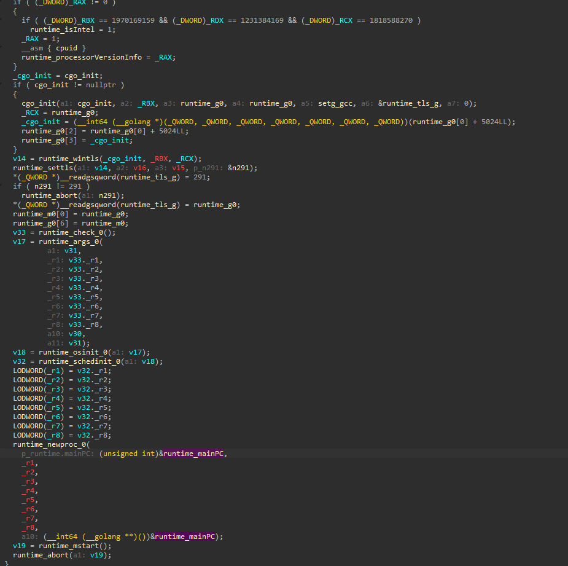
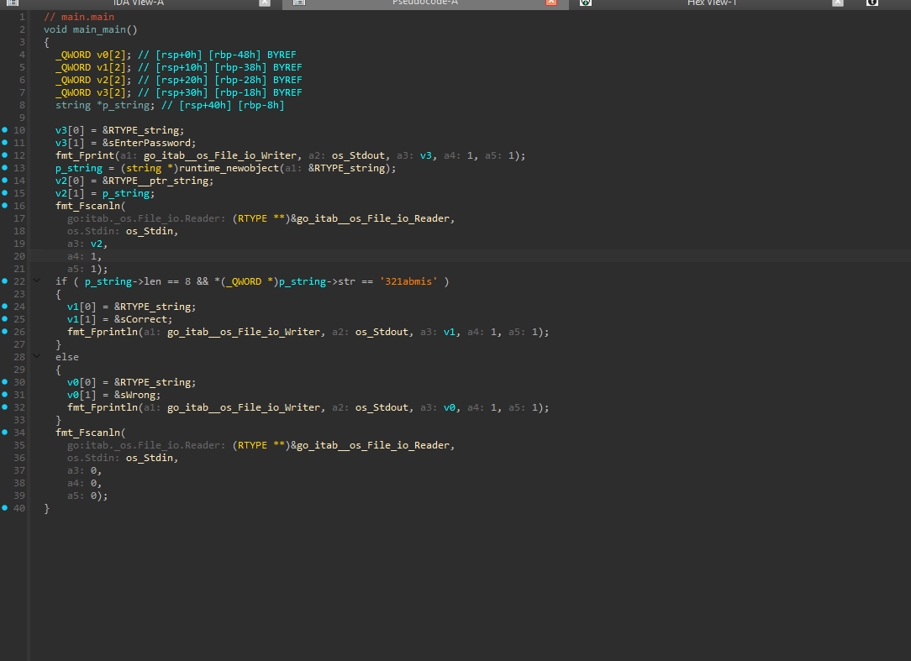
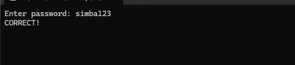

# veryeasycrackme

> A first Go crackme. The whole check in `main.main` is a length test plus a single 8-byte compare; the comparison constant that IDA prints as `'321abmis'` is the password stored as a little-endian qword, so reversing the byte order gives `simba123`.

## Metadata

| Field        | Value |
|--------------|-------|
| Source       | crackmes.one |
| Author       | Not recorded |
| Language     | Go |
| Architecture | x86-64 |
| Platform     | Windows |
| Difficulty   | 1.0 / 6 |
| Quality      | — |
| Date solved  | 2026-10-15 |
| Time spent   | — |
| Tools        | IDA Pro (Hex-Rays) |
| Solve type   | password (recovered statically from the comparison constant) |

## 1. Goal
The program prints `Enter password: `, reads one token from stdin, and prints `CORRECT!` for the right password or a wrong-answer line otherwise. There is a single fixed password to recover.

## 2. Triage / Recon
- **File type:** 64-bit Windows PE built with the Go toolchain (the giveaway is the size — ~2.5 MB for a trivial program — and the pervasive `runtime.*`, `fmt.*`, and `go:itab` symbols the Go compiler bakes in).
- **The real hurdle on a first Go target:** locating `main.main`. Go does not hand control straight to user code; the entry point runs a long runtime bootstrap first, and a disassembler drops the user at `_rt0_amd64_windows`, not at anything resembling `main`. The startup path threads through the scheduler and TLS setup before it ever reaches user code.



- **Startup chain to user code:**

```
_rt0_amd64_windows
  -> runtime.rt0_go
    -> runtime.newosproc / runtime.mstart
      -> runtime.main
        -> main.init
          -> main.main   <- user code
```

`runtime.main` is handed `runtime.mainPC` (a pointer to the user main) via `runtime.newproc`, runs `main.init` first, then calls `main.main`. Following that chain lands on the function that actually validates the password.

## 3. Static Analysis
- **Check function:** `main.main`.
- **Annotated logic:**

```c
// main.main - annotated
fmt_Fprint(..., "Enter password: ", ...);           // prompt
p_string = (string *)runtime_newobject(&RTYPE_string);
fmt_Fscanln(..., os.Stdin, p_string, ...);           // read one token into p_string

if ( p_string->len == 8 && *(_QWORD *)p_string->str == '321abmis' )
    fmt_Fprintln(..., "Correct", ...);               // success
else
    fmt_Fprintln(..., "Wrong", ...);                 // failure
```



- **Algorithm in plain words:** read a string; accept it only if it is exactly 8 bytes long and its 8 bytes, read as one 64-bit little-endian word, equal the constant the decompiler renders as `'321abmis'`. Because the input is exactly 8 bytes, that one qword compare covers the entire password — there is no per-character loop and no transform on the input.

## 4. The Core Insight
IDA prints the 8-byte immediate as the multi-character literal `'321abmis'`, listing its bytes most-significant first. The string in memory is little-endian, so the byte that compares against the *first* character of the input is the *least*-significant byte of that literal — the last character shown. Reading the literal in memory order (reversing it) turns `321abmis` into `simba123`, which is the password.

## 5. Solution
Reverse the byte order of the comparison constant:

```
IDA literal (MSB-first):   '3' '2' '1' 'a' 'b' 'm' 'i' 's'
memory order (LSB-first):  's' 'i' 'm' 'b' 'a' '1' '2' '3'
```

That is 8 bytes, so it satisfies both the `len == 8` gate and the qword compare at once.

**Password:** `simba123`

**Verification:** Running the binary and entering `simba123` prints `CORRECT!`.



## 6. Key Takeaways
- **New technique learned:** how a Go binary boots and where user code lives — the `_rt0_amd64_windows → runtime.rt0_go → runtime.main → main.init → main.main` chain — so `main.main` can be found quickly instead of getting lost in the runtime. Added to my notes.
- **Mistakes / time sinks:** most of the effort went into finding `main.main` on a first Go target; the validation itself was trivial once located.
- **Reusable trick for next time:** an 8-byte-or-shorter password compared as a single integer will show up in the decompiler as a multi-char constant in reversed (byte-swapped) order — reverse it to read the string.

### Recognizing a Go binary
Learned to recognize these signatures and added them to my notes:
- Large file size for a tiny program, and a symbol table full of `runtime.*`, `fmt.*`, `go:itab`, and `RTYPE_*` names.
- Execution starts at `_rt0_amd64_windows` and runs the runtime bootstrap; user code is reached only after `runtime.main` calls `main.init` then `main.main`.
- Go strings are a `{ptr, len}` pair rather than null-terminated, so checks tend to read a length field (`p_string->len`) alongside the bytes.

## 7. Artifacts
- `Binary/veryeasycrackme.exe` — the crackme.
- **Password:** `simba123`.
