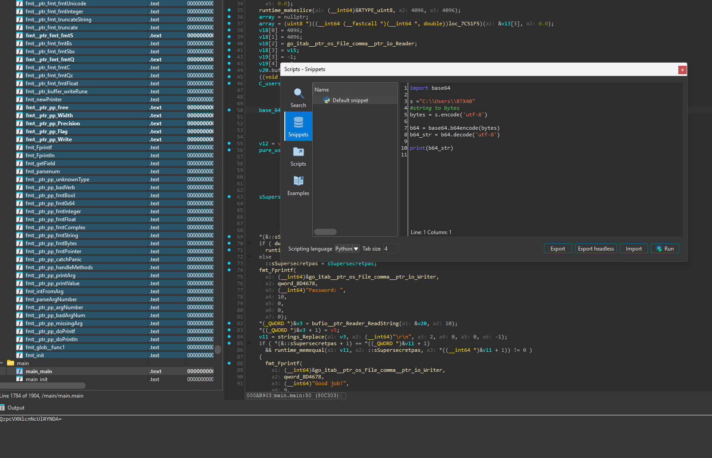
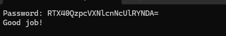

# goCrackMe

> A Go crackme whose password is built from the current Windows user profile: it takes the username out of `C:\Users\<USERNAME>`, base64-encodes the full path, and expects `<USERNAME>` followed by that base64 string. On this machine that is `RTX40QzpcVXNlcnNcUlRYNDA=`.

## Metadata

| Field        | Value |
|--------------|-------|
| Source       | crackmes.one |
| Author       | Not recorded |
| Language     | Go |
| Architecture | x86-64 |
| Platform     | Windows |
| Difficulty   | 1.5 / 6 |
| Quality      | 2.0 / 6 |
| Date solved  | 2026-10-16 |
| Time spent   | — |
| Tools        | IDA Pro (Hex-Rays) |
| Solve type   | password (machine-specific — reconstructed from the username) |

## 1. Goal
The program prints `Password: `, reads one line, and prints `Good job!` for the correct password. The expected value is not a fixed literal — it is derived at runtime from the machine's own user-profile path, so the task is to reconstruct that derivation.

## 2. Triage / Recon
- **File type:** 64-bit Windows PE, Go toolchain (large binary, `runtime.*` / `fmt.*` / `go:itab` symbols, string type used as a `{ptr, len}` pair).
- **Locating user code:** `main.main` is reached through the usual Go runtime bootstrap; jumping straight to it from the function list is the practical way in.
- **First read:** the function pulls in the current user path (`C:\Users\...`), does some string work, base64-encodes something, concatenates, and finishes with a Go string comparison before printing `Good job!`.

## 3. Static Analysis
- **Check function:** `main.main`.
- **What it does, in order:**
  1. Obtains the current user-profile path `C:\Users\<USERNAME>`.
  2. Strips the leading `C:\Users\` to isolate `<USERNAME>`.
  3. Base64-encodes the full `C:\Users\<USERNAME>` path.
  4. Builds the expected password by concatenating the two into one Go string, stored in `sSupersecretpas`:

```
expected = <USERNAME> + base64( "C:\Users\<USERNAME>" )
```

  5. Prints `Password: `, reads a line with `ReadString(&v20, 10)` (delimiter `0x0A` = `\n`), and strips the trailing newline with `strings.Replace(v3, "\r\n", ...)`.
  6. Compares input to `expected` the idiomatic Go way — first the length fields, then the bytes:

```c
// main.main - the comparison, annotated
if ( *(&::sSupersecretpas + 1) == *((_QWORD *)&v11 + 1)      // string lengths equal (the len field of {ptr,len})
  && runtime_memequal(v11, ::sSupersecretpas, *((__int64 *)&v11 + 1)) != 0 )  // and bytes equal
{
    fmt_Fprintf(..., "Good job!", ...);
}
```



- **Algorithm in plain words:** the "secret" is not stored; it is assembled from the environment. The username appears twice — once in the clear as the prefix, and once inside the base64 of the full profile path. So the whole password is `<USERNAME>` immediately followed by `base64("C:\Users\<USERNAME>")`, with no separator.

## 4. The Core Insight
There is nothing to brute-force or invert: the program tells you how to build the password. The only per-machine input is the Windows username, which is visible in the profile path the program itself reads. Reproducing the base64 of `C:\Users\<USERNAME>` and prepending the bare username reconstructs the exact string the program compares against.

## 5. Solution
On this machine the username is `RTX40`, so the profile path is `C:\Users\RTX40`. Reproducing the base64 with a small helper:

```python
import base64
s = "C:\\Users\\RTX40"
bytes = s.encode('utf-8')
b64 = base64.b64encode(bytes)
b64_str = b64.decode('utf-8')
print(b64_str)     # QzpcVXNlcnNcUlRYNDA=
```

Concatenating the username prefix with that base64 gives the password:

```
<USERNAME>            = RTX40
base64("C:\Users\RTX40") = QzpcVXNlcnNcUlRYNDA=
password              = RTX40QzpcVXNlcnNcUlRYNDA=
```

**Password (this machine):** `RTX40QzpcVXNlcnNcUlRYNDA=`

The value is machine-specific: on a host whose profile is `C:\Users\<OTHER>` the password becomes `<OTHER>` + `base64("C:\Users\<OTHER>")`.

**Verification:** Entering `RTX40QzpcVXNlcnNcUlRYNDA=` prints `Good job!`.



## 6. Key Takeaways
- **New technique learned:** a password derived from environment state (the user-profile path) rather than stored — the same value appears both in cleartext and base64-encoded inside the expected string.
- **Mistakes / time sinks:** none of note; the main step was reading the concatenation order correctly (bare username first, base64 second, no separator).
- **Reusable trick for next time:** when a Go string comparison is preceded by a length-field check and `runtime.memequal`, that is ordinary `==` on strings; the operands are the `{ptr, len}` pairs, and the "secret" operand is whatever was assembled just above.

## 7. Artifacts
- `Binary/goCrackMe.zip` — the crackme (zipped).
- **base64 helper** — the snippet in Section 5 reproduces the encoded path.
- **Password (this machine):** `RTX40QzpcVXNlcnNcUlRYNDA=`; general form `<USERNAME>` + `base64("C:\Users\<USERNAME>")`.
