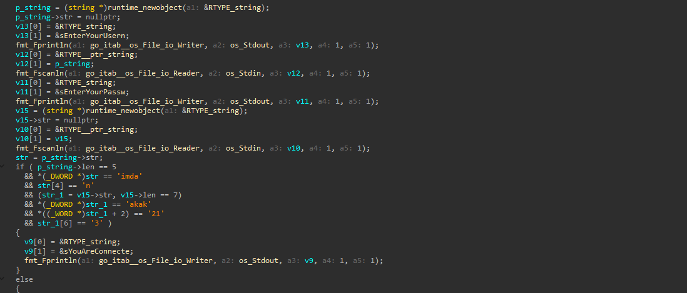
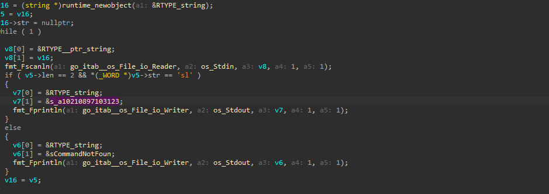
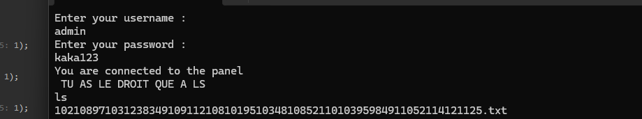

# G0l4ng_1s_C00l

> A Go "login panel" crackme. Both the username and password are checked as little-endian byte comparisons split across DWORD/WORD/byte pieces; reversing each piece reconstructs `admin` / `kaka123`. After login the program drops into a restricted shell that only accepts `ls`, which lists a single file whose name is the flag encoded as concatenated decimal ASCII codes — `flag{S1mple_g0l4ng_b1n4ry}`.

## Metadata

| Field        | Value |
|--------------|-------|
| Source       | crackmes.one |
| Author       | Not recorded |
| Language     | Go |
| Architecture | x86-64 |
| Platform     | Windows |
| Difficulty   | 1.5 / 6 |
| Quality      | 1.5 / 6 |
| Date solved  | 2026-10-17 |
| Time spent   | — |
| Tools        | IDA Pro (Hex-Rays) |
| Solve type   | credentials + flag (recovered statically) |

## 1. Goal
The program asks for a username, then a password. Correct credentials print `You are connected to the panel`, followed by a hint line and a prompt that behaves like a minimal shell. The task is to recover the two credentials, reach the panel, and read the flag it exposes.

## 2. Triage / Recon
- **File type:** 64-bit Windows PE, Go toolchain (large binary, `runtime.*` / `fmt.*` / `go:itab` symbols, `string` used as a `{ptr, len}` pair).
- **Locating user code:** `main.main` is reached through the usual Go runtime bootstrap and holds both the credential check and the post-login loop.
- **First read:** two `fmt.Fscanln` reads (username, password) feed a chain of equality checks; on success the code enters a `while(1)` that reads commands.

## 3. Static Analysis
- **Check function:** `main.main`.

**Credential check** — the username and password are each compared in fixed-size chunks rather than as whole strings:

```c
// username: length 5
if ( p_string->len == 5
  && *(_DWORD *)str == 'imda'      // first 4 bytes
  && str[4] == 'n' )               // 5th byte
// password: length 7
  && v15->len == 7
  && *(_DWORD *)str_1 == 'akak'    // first 4 bytes
  && *(_WORD *)(str_1 + 4) == '21' // next 2 bytes
  && str_1[6] == '3'               // last byte
{
    // "You are connected to the panel"
}
```



Each multi-byte immediate is printed by the decompiler most-significant-byte first, while the string bytes sit in memory little-endian. Reversing each chunk:

| Field | Check | Bytes (memory order) |
|-------|-------|----------------------|
| username[0..3] | `== 'imda'` | `admi` |
| username[4] | `== 'n'` | `n` |
| password[0..3] | `== 'akak'` | `kaka` |
| password[4..5] | `== '21'` | `12` |
| password[6] | `== '3'` | `3` |

So the username is `admin` and the password is `kaka` + `12` + `3` = `kaka123`.

**Post-login shell** — once connected, the program loops reading commands and only recognises one:

```c
while ( 1 )
{
    fmt_Fscanln(..., os_Stdin, v8, ...);          // read a command
    if ( v5->len == 2 && *(_WORD *)v5->str == 'sl' )   // input == "ls"
        fmt_Fprintln(..., &s_a10210897103123, ...);    // print the stored filename
    else
        fmt_Fprintln(..., &sCommandNotFoun, ...);       // "Command Not Found"
}
```



`'sl'` is the little-endian form of `ls` (length 2). Any other command prints `Command Not Found`.

## 4. The Core Insight
There is no hashing or transform on the credentials — the checks are raw byte comparisons broken into a DWORD, a WORD, and single bytes, each shown byte-reversed by the decompiler because the operands are little-endian. Reassembling the reversed chunks yields the credentials directly. The "panel" that follows is cosmetic: a loop whose only real branch is `ls`, which emits one hardcoded filename.

## 5. Solution
**Username:** `admin`
**Password:** `kaka123`

**Verification:** Entering `admin` / `kaka123` prints `You are connected to the panel` and the hint `TU AS LE DROIT QUE A LS` (only `ls` is permitted). Running `ls` then lists a single file:

```
10210897103123834910911210810195103481085211010395984911052114121125.txt
```



**The flag** — the filename is not random: it is a run of concatenated decimal ASCII codes. Splitting it back into character codes and converting each to its character:

```
102 108 97 103 123 -> f l a g {
83 49 109 112 108 101 95 -> S 1 m p l e _
103 48 108 52 110 103 95 -> g 0 l 4 n g _
98 49 110 52 114 121 125 -> b 1 n 4 r y }
```

Decoding the whole `10210897103123...125` string gives:

**Flag:** `flag{S1mple_g0l4ng_b1n4ry}`

## 6. Key Takeaways
- **New technique learned:** how a Go string equality can be compiled into several fixed-width comparisons (DWORD + WORD + byte) over the `{ptr, len}` buffer rather than one call, and how to read each reversed chunk back into the original text.
- **Mistakes / time sinks:** none of note; the credentials fell straight out once the chunked compares were reversed.
- **Reusable trick for next time:** when a decompiler shows a run of `*(_DWORD *) == '....'` / `*(_WORD *) == '..'` checks against a small string, treat the constants as byte-reversed fragments and concatenate them in memory order.
- **Pattern to recognise:** a long all-digits string (like the listed filename) is often concatenated decimal ASCII codes — splitting it into character codes and converting recovered the flag here.

## 7. Artifacts
- `Binary/G0l4ng_1s_C00l.zip` — the crackme (zipped).
- **Credentials:** username `admin`, password `kaka123`.
- **Post-login:** restricted shell; `ls` lists `10210897103123834910911210810195103481085211010395984911052114121125.txt`, whose numeric name decodes (decimal ASCII) to the flag `flag{S1mple_g0l4ng_b1n4ry}`.
