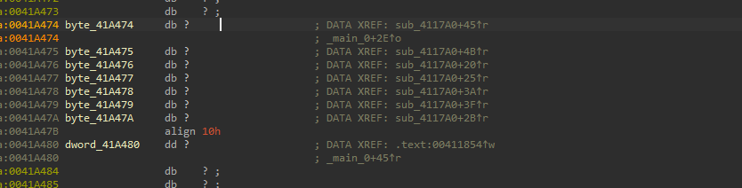
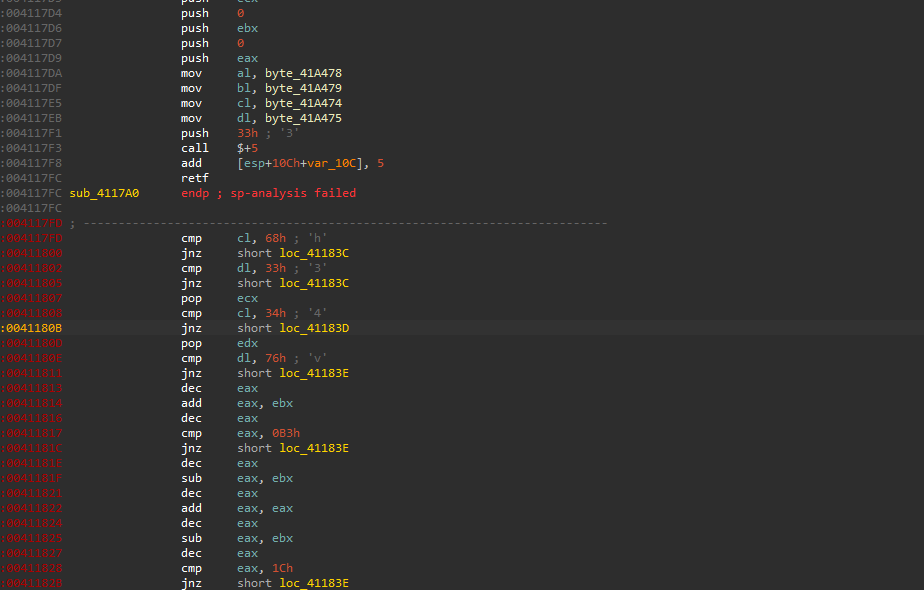
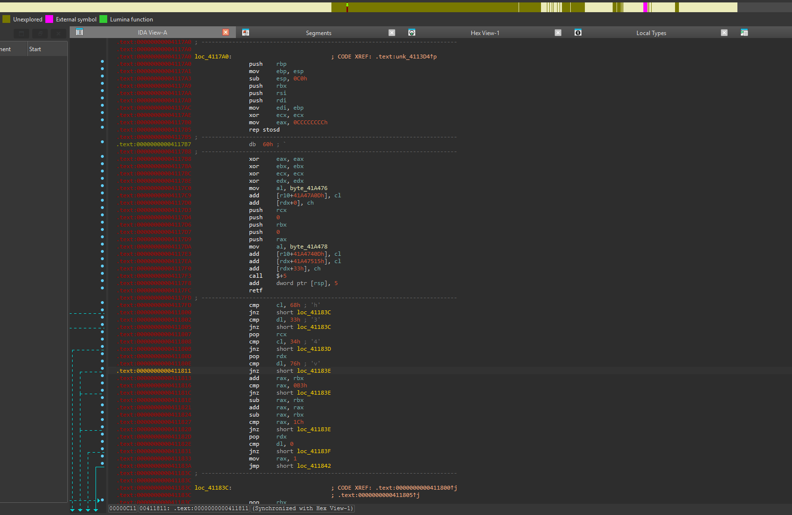
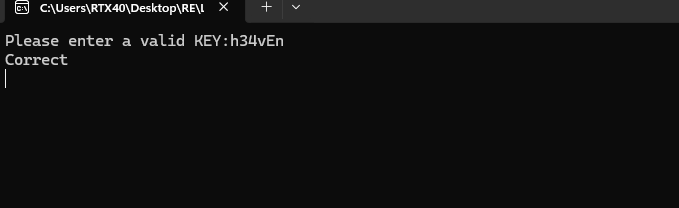

# HeavensGate

> A 32-bit Windows crackme that switches into 64-bit mode mid-function via a far return to selector `0x33`, so the real validation only reads correctly when the bytes after the switch are disassembled as x86-64. The valid key is `h34vEn`.

## Metadata

| Field        | Value |
|--------------|-------|
| Source       | Not recorded |
| Author       | Not recorded |
| Language     | C/C++ |
| Architecture | x86 (PE32) that executes x86-64 through a mode switch |
| Platform     | Windows |
| Difficulty   | ~2 / 6 |
| Quality      | — |
| Date solved  | 2026-10-12 |
| Time spent   | — |
| Tools        | IDA Pro, console run |
| Solve type   | password |

## 1. Goal
The program prints `Please enter a valid KEY:` and reads a string. When the string satisfies every check the validator returns `1` and the program prints `Correct`. Any failed comparison jumps to a fail branch and the success line never appears. There is a single fixed key rather than a per-input scheme, so the task is to recover that one string.

## 2. Triage / Recon
- **File type / compiler:** 32-bit Windows PE, MSVC. The presence of a `_CheckForDebuggerJustMyCode` style routine is the usual fingerprint of a debug build, so the binary was almost certainly compiled with debug settings on.
- **Packed / protected:** No packer. The check function opens with the standard debug-build prologue — the frame is filled with `0xCCCCCCCC` via `mov eax, 0CCCCCCCCh` + `rep stosd`, which is the MSVC debug stack-poison pattern, not obfuscation.
- **Anti-debug:** None. Aside from the debug-build `JustMyCode` marker there are no timing checks, no `IsDebuggerPresent`, no PEB pokes. Nothing resists a debugger.
- **Strings:** The prompt `Please enter a valid KEY:` and `Correct`.
- **Input storage:** `_main` copies the entered bytes into seven single-byte globals, `byte_41A474` through `byte_41A47A`, which the validator later reads.



## 3. Static Analysis
- **Check function:** `sub_4117A0`.
- **What the disassembler shows first:** The function does its debug prologue, loads a few of the input bytes into `al`/`bl`/`cl`/`dl`, and then hits this sequence:

```asm
push 33h                  ; selector for the 64-bit code segment
call $+5                  ; push the address of the next byte onto the stack
add  dword ptr [esp], 5   ; bump that saved address forward, past the retf
retf                      ; far return: pop EIP and reload CS = 0x33
```

IDA closes the function right here and prints `sp-analysis failed`, because as far as a 32-bit analysis is concerned control just left through a far return and the stack no longer makes sense.



- **The trick:** This is Heaven's Gate. `0x33` is the code-segment selector for the 64-bit segment; `0x23` is the 32-bit one. Pushing `0x33` as the far `CS`, computing a return address with `call $+5` / `add [esp], 5`, and executing `retf` reloads `CS` with the 64-bit segment and drops the thread out of 32-bit compatibility mode into 64-bit long mode. Every byte after the `retf` runs as x86-64.

- **Why the tail looks wrong:** IDA loaded the file as a 32-bit image and keeps decoding the post-gate bytes as 32-bit. That produces a listing that *looks* like real code but is not — long strings of `dec eax`, `add eax, ebx`, `dec eax`, etc. The `0x48` bytes that render as `dec eax` in the 32-bit view are actually operand-size prefixes in 64-bit mode, so `48 03 C3` is the single instruction `add rax, rbx`, not `dec eax; add eax, ebx`. The 32-bit reading splits every wide instruction into a prefix-shaped `dec eax` plus a leftover, which is the giveaway that the mode changed.

## 4. Dynamic Analysis
Forcing IDA to disassemble the block after the `retf` as 64-bit produces the honest listing:

```asm
; ---- executing in 64-bit mode after the far return ----
cmp  cl, 68h            ; byte1 == 'h'
jnz  fail
cmp  dl, 33h            ; byte2 == '3'
jnz  fail
pop  rcx
cmp  cl, 34h            ; byte3 == '4'
jnz  fail
pop  rdx
cmp  dl, 76h            ; byte4 == 'v'
jnz  fail
add  rax, rbx          ; rax = byte5 + byte6
cmp  rax, 0B3h         ; (byte5 + byte6) == 179
jnz  fail
sub  rax, rbx          ; rax = byte5
add  rax, rax          ; rax = 2*byte5
sub  rax, rbx          ; rax = 2*byte5 - byte6
cmp  rax, 1Ch          ; (2*byte5 - byte6) == 28
jnz  fail
pop  rdx
cmp  dl, 0             ; byte7 == 0
jnz  fail
mov  rax, 1            ; success
```



The seven input bytes reach the checks through registers and through the stack. Two are compared directly out of `cl`/`dl`; the next two are `pop`ped and compared; the fifth and sixth feed the arithmetic in `rax`/`rbx`; the seventh is `pop`ped last and must be zero. Three pops in total walk the stack down to the final slot, which is why the terminating byte sits where it does.

## 5. The Core Insight
The whole difficulty is the mode switch, not the maths. A 32-bit disassembler reads the bytes after the `retf` in the wrong mode and hands back a plausible but false function full of `dec eax` runs. Once the same bytes are read as x86-64, the validator collapses into a short, ordinary comparison chain: four literal byte checks and two linear equations on a fifth and sixth byte, with a null terminator at the end.

## 6. Solution
Reading the checks in order gives the constraints on the seven bytes:

| Byte | Constraint | Value |
|------|------------|-------|
| 1 | `== 0x68` | `h` |
| 2 | `== 0x33` | `3` |
| 3 | `== 0x34` | `4` |
| 4 | `== 0x76` | `v` |
| 5, 6 | `b5 + b6 == 179` and `2·b5 − b6 == 28` | `E`, `n` |
| 7 | `== 0x00` | `\0` |

The two equations on bytes 5 and 6 form a trivial linear system:

```
b5 + b6      = 179
2*b5 - b6    = 28
-----------------------
3*b5         = 207   ->  b5 = 69  = 0x45 = 'E'
                         b6 = 110 = 0x6E = 'n'
```

So the key bytes are `68 33 34 76 45 6E 00`, which spell:

**Password:** `h34vEn`

**Verification:** Running the binary and entering `h34vEn` prints `Correct`.



## 7. Key Takeaways
- **New technique learned:** Heaven's Gate — using `push 0x33` + `retf` (far return) to leave 32-bit compatibility mode and execute 64-bit code inside a 32-bit process, and, just as important, why a 32-bit disassembler mis-decodes everything after the gate and how to force the correct 64-bit read.
- **Mistakes / time sinks:** Trusting the first listing. The 32-bit tail after the `retf` reads as real code; the runs of `dec eax` were the signal that the CPU mode had changed and the bytes needed to be re-read as x86-64.
- **Reusable trick for next time:** The recognition signatures below.

### Recognizing a Heaven's Gate binary
Learned to recognize the following signatures and added them to my notes, so this pattern gets spotted immediately next time:

- `push 33h` (or `push 0x33`) followed shortly by a far return (`retf`) or a far jump — `0x33` is the 64-bit code selector, `0x23` is the 32-bit one.
- The `call $+5` → `add [esp], 5` → `retf` idiom that builds a return address inline and far-returns.
- A 32-bit disassembler ending the function early with `sp-analysis failed` and code after it that decodes as improbable filler.
- Long runs of `dec eax` (byte `0x48`) inside what should be real logic — in 64-bit mode `0x48` is a prefix, not an instruction.
- A matching far transition back to selector `0x23` to return to 32-bit mode.

## 8. Artifacts
- `Binary/HeavensGate.exe` — the crackme.
- `constraints.txt` — the byte-by-byte constraint derivation.
- **Key:** `h34vEn` (bytes `68 33 34 76 45 6E 00`).
