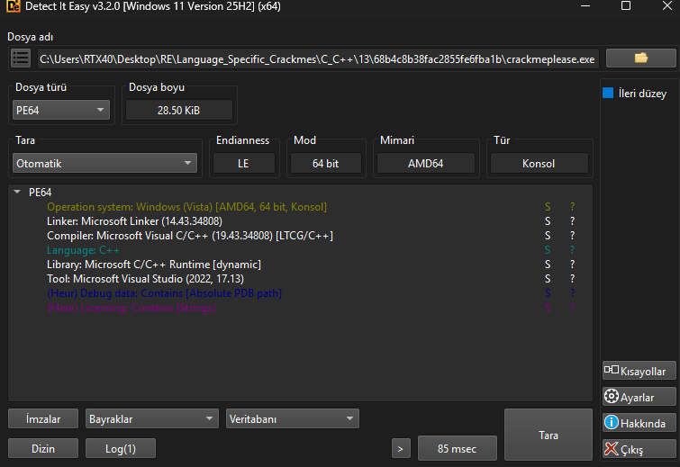
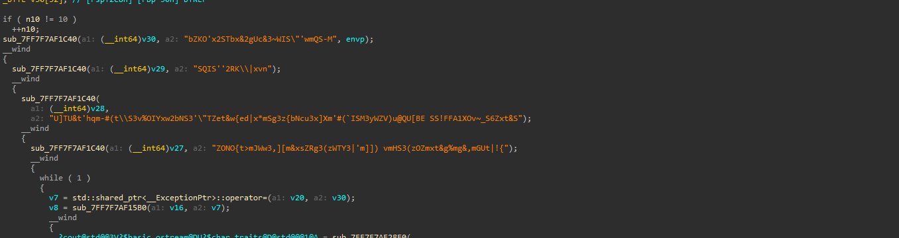
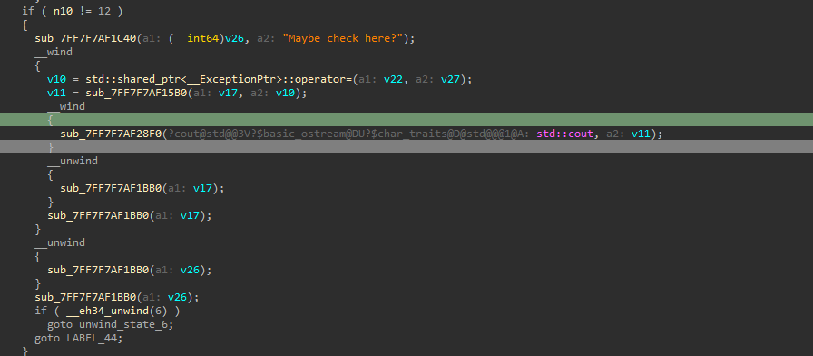
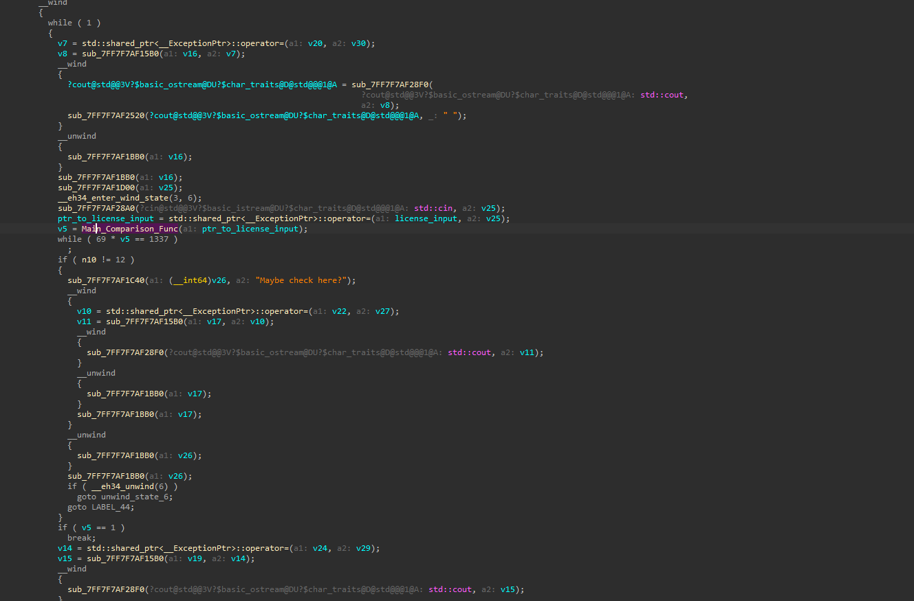
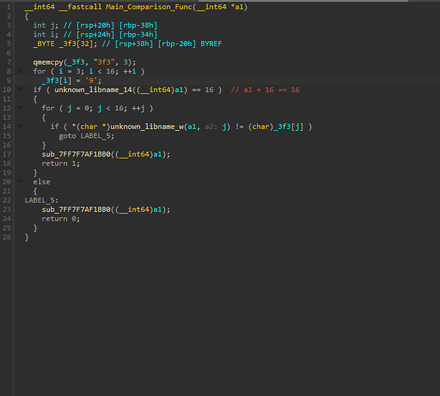
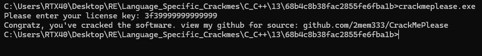

# CrackMePlease

> An MSVC C++ console crackme buried in junk: garbage function calls, meaningless string arguments, decoy branches, and a comparison that can never be true. Stripped of the noise, the real validator is one small function that builds the expected key in place — `"3f3"` followed by thirteen `'9'` characters — and compares it byte-by-byte. The license is `3f39999999999999`.

## Metadata

| Field        | Value |
|--------------|-------|
| Source       | github.com/2mem333/CrackMePlease |
| Author       | 2mem333 |
| Language     | C/C++ (MSVC) |
| Architecture | x86-64 |
| Platform     | Windows |
| Difficulty   | ~2.0 / 6 (estimate) |
| Quality      | — (not rated) |
| Date solved  | 2026-10-21 |
| Time spent   | — |
| Tools        | DIE, IDA Pro (Hex-Rays) |
| Solve type   | password (recovered statically from the comparison function) |

## 1. Goal
The program prints `Please enter your license key: `, reads a line, and on the correct key prints `Congratz, you've cracked the software.`. There is a single fixed license to recover.

## 2. Triage / Recon
- **File type:** 64-bit Windows console PE, MSVC C++ (DIE reports MS linker 14.43, compiler 19.43 with LTCG, dynamic MS C/C++ runtime, built with Visual Studio 2022). An absolute PDB path is left in the file.
- **Not packed:** no packer signature; the bulk is ordinary MSVC code padded with obfuscation.



## 3. Static Analysis
- **The noise:** `main` is deliberately cluttered. There are repeated calls to a helper (`sub_...1C40`) with junk string arguments such as `"bZKO'x2STbx&2gUc&3~WIS\"'wmQS-M"` and `"SQIS''2RK\\|xvn"`, nested exception `__wind` / `__unwind` scopes, and `std::shared_ptr` assignment churn that does no real work.



- **Decoy branches:** one block guards a print on `if ( n10 != 12 )` and passes the string `"Maybe check here?"` — a signpost planted to draw attention away from the actual check.



- **The real control flow:** stripped down, `main` reads the license with `std::cin` into a `shared_ptr`, then calls the validator and keys success off its return value:

```c
// read license via std::cin into a shared_ptr
sub_...28A0(std::cin, v25);
ptr_to_license_input = std::shared_ptr<...>::operator=(license_input, v25);

v5 = Main_Comparison_Func(ptr_to_license_input);   // <-- the only real check

while ( 69 * v5 == 1337 )   ;                        // decoy: 69*v5 can never equal 1337
if ( n10 != 12 ) { ... "Maybe check here?" ... }     // decoy branch
if ( v5 == 1 )  break;                               // success when the validator returned 1
```

The `while ( 69 * v5 == 1337 )` condition is a red herring: `1337` is not a multiple of `69`, so for any integer `v5` it is never true and the loop never runs. The genuine decision is simply whether `Main_Comparison_Func` returned `1`.



- **The validator — `Main_Comparison_Func`:**

```c
__int64 __fastcall Main_Comparison_Func(__int64 *a1)
{
    _BYTE _3f3[32];
    qmemcpy(_3f3, "3f3", 3);            // first 3 bytes = '3','f','3'
    for ( i = 3; i < 16; ++i )
        _3f3[i] = '9';                  // bytes 3..15 = '9' (13 bytes)

    if ( <length of a1> == 16 )         // input must be 16 chars
    {
        for ( j = 0; j < 16; ++j )
            if ( <a1[j]> != _3f3[j] )
                goto LABEL_5;           // any mismatch -> fail
        return 1;                        // all 16 match -> success
    }
    else
LABEL_5:
        return 0;
}
```



- **Algorithm in plain words:** the expected key is assembled at runtime, not stored as one literal — three fixed bytes `"3f3"` followed by thirteen `'9'` bytes, giving a 16-character string. The input is accepted only if it is exactly 16 characters and matches that buffer position-for-position.

## 4. The Core Insight
Almost the entire function body is misdirection — junk calls, dead exception scaffolding, a `"Maybe check here?"` signpost, and a comparison that can never hold. The actual gate is one small function, and its target string is never present as a single constant: it is built from `"3f3"` plus a run of `'9'`. Reconstructing that buffer gives the key directly.

## 5. Solution
The expected buffer is `"3f3"` + `'9' × 13`:

```
"3f3" + "9999999999999"  =  3f39999999999999   (16 characters)
```

**License key:** `3f39999999999999`

**Verification:** Entering `3f39999999999999` prints `Congratz, you've cracked the software.`



## 6. Key Takeaways
- **New technique learned:** reading past heavy junk obfuscation — separating dead calls, garbage string arguments, and decoy branches from the one function that actually decides the result.
- **Mistakes / time sinks:** the planted `"Maybe check here?"` string and the `69 * v5 == 1337` loop are there to burn time; recognising them as noise early is the win.
- **Reusable trick for next time:** follow the value that gates success (here `v5`) back to its source and ignore everything that does not feed it. An expected key built in place from small pieces (`"3f3"` + a fill loop) will not show up as a searchable string, so reconstruct it from the code.

## 7. Artifacts
- `Binary/crackmeplease.exe` — the crackme.
- **License key:** `3f39999999999999` (`"3f3"` followed by thirteen `'9'`).
