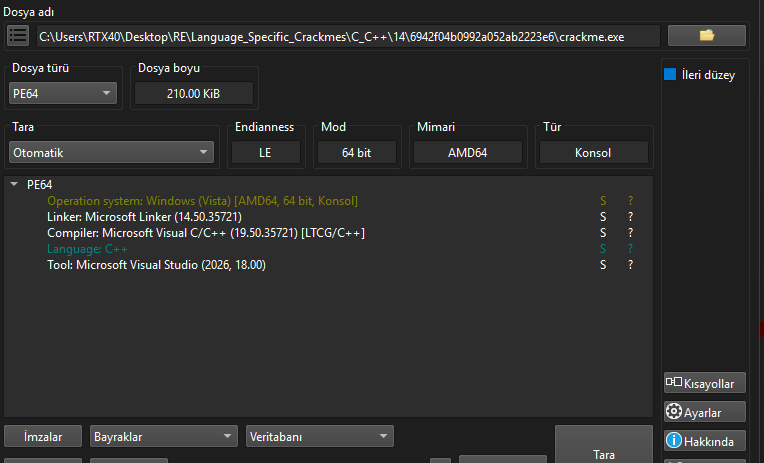
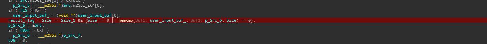
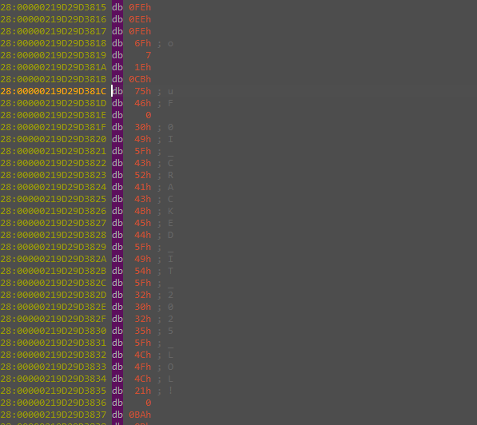
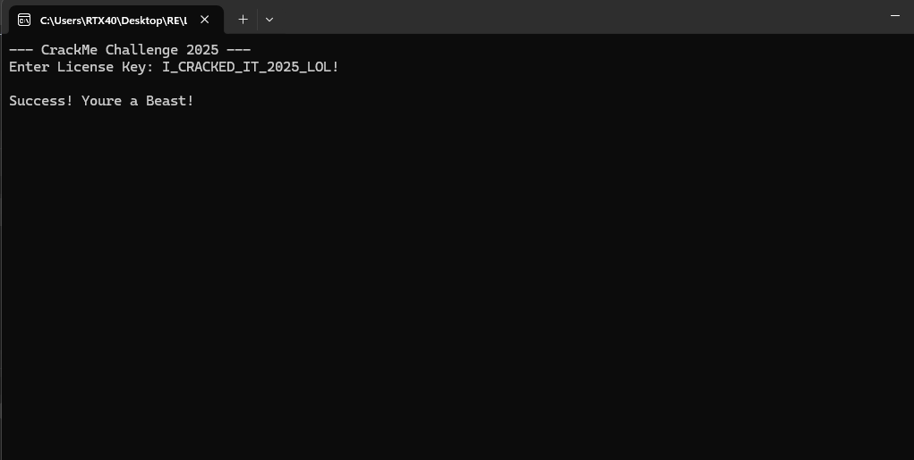

# crackme — XOR-0x5A String-Obfuscated License Check

> A clean MSVC C++ console crackme with no runtime obfuscation beyond a single XOR trick: every string the program ever prints or compares against lives in `.rdata` as a run of SIMD-wide immediates XOR'd byte-by-byte with `0x5A`. The license check is a `memcmp` against one of those decoded strings. Both paths — static recovery (XOR the constants) and dynamic recovery (break after the decode loop and read the plaintext out of memory) — yield the same key: `I_CRACKED_IT_2025_LOL!`.

## Metadata

| Field        | Value |
|--------------|-------|
| Source       | crackmes.one — `6942f04b0992a052ab2223e6` |
| Author       | Not recorded |
| Language     | C/C++ (MSVC — Visual Studio 2026 toolchain, linker 14.50, LTCG) |
| Architecture | x86-64 |
| Platform     | Windows |
| Difficulty   | 2.0 / 6 |
| Quality      | 2.2 / 6 |
| Date solved  | 2026-10-30 |
| Time spent   | ~7–8 minutes |
| Tools        | DIE, IDA Pro (Hex-Rays + local Windows debugger) |
| Solve type   | password (recovered both statically and dynamically) |

## 1. Goal
The program prints a short banner, prompts for a license key, reads one line, and compares against a stored value. A match prints a success line; a mismatch prints a hint-free failure line. The task is to recover the one accepted key.

## 2. Triage / Recon
- **File type:** 64-bit Windows console PE, ~210 KiB. DIE identifies the MSVC toolchain (linker 14.50, compiler 19.50, LTCG, C++) with no packer or protector flags. Clean build.
- **Strings:** nothing readable statically — no `password`, no `Correct`, no `Enter License Key`. All runtime strings are stored encoded and only materialise during execution.
- **Imports:** standard C++ runtime and `std::string` machinery. The decompiler surfaces the usual `operator new` / `j_j_j__free_base` / `std::basic_string` footprint.
- **Shape of `main`:** five sequential `operator new` calls copying 30-, 19-, 23-, 22-, and 22-byte buffers out of 32-byte SIMD immediates, each one XOR-decoded on the fly, interspersed with `printing_func` and `get_user_input` calls and a final `memcmp`.



## 3. Static Analysis
- **The pattern.** Every string the program needs is built the same way: a `__m256i` (32-byte SIMD register) is populated field-by-field from large integer immediates, then `memcpy`'d into a heap buffer. The buffer is subsequently iterated and each byte is `XOR 0x5A`'d into a `std::string`. The same key byte is used for every string in the program.

The five XOR-encoded blobs, in the order `main` consumes them:

| # | Size | Role | Encoded source |
|---|------|------|----------------|
| 1 | 30 B | banner | `0x393B28197A777777`, `0x363B32197A3F1731`, `"6?4=?zhjhozwww"` |
| 2 | 19 B | input prompt | `0x33167A283F2E341F`, `0x3F117A3F29343F39`, `` "#`z" `` |
| 3 | 23 B | success message | `0x7B29293F39392F09`, `0x3B7A3F282F35037A`, `0x3B3F187A`, `").{"` |
| 4 | 22 B | failure message | `0x3F317A3D3435280D`, `0x327A23280E7A7423`, `";(>?(t"` |
| 5 | 22 B | expected license | `0x1F11191B08190513`, `0x686A68050E13051E`, `0x1516056F`, `0x7B16` |

- **The decoder.** Every buffer is run through the same shape of loop. For blob #5:

```c
// annotated decode loop, buffer 5 -> std::string in `Src`
for ( Src.m256i_i64[2] = 0; v29 != v55 + 22; ++v29 )
{
    v30 = *v29 ^ 0x5A;              // the one and only key byte
    // ... std::string::push_back(v30) with small-string-optimisation handling
}
```

- **The check.** After blob #2 is printed and the user line is read, the user's bytes are compared against the decoded blob #5:

```c
result_flag = (Size == Size_1)
           && ( Size == 0 || memcmp(user_input_buf_, p_Src_5, Size) == 0 );
```



- **Which blob is the key?** The decoded buffer passed to `memcmp` is the one built from `v55`. `v4` (blob 3) is printed only on success; `v54` (blob 4) is printed only on failure.

## 4. Dynamic Analysis
Only one breakpoint is needed. Set it on the instruction immediately after the blob-5 decode loop and inspect the `Src` buffer in memory: it holds the finished plaintext before `memcmp` runs. IDA's hex view shows the bytes directly:

```
...3820  49 ; I     ...3829  5F ; _
    3821  5F ; _        382A  49 ; I
    3822  43 ; C        382B  54 ; T
    3823  52 ; R        382C  5F ; _
    3824  41 ; A        382D  32 ; 2
    3825  43 ; C        382E  30 ; 0
    3826  4B ; K        382F  32 ; 2
    3827  45 ; E        3830  35 ; 5
    3828  44 ; D        3831  5F ; _
                        3832  4C ; L
                        3833  4F ; O
                        3834  4C ; L
                        3835  21 ; !
```

That is `I_CRACKED_IT_2025_LOL!` written out in order.



## 5. The Core Insight
A single key byte (`0x5A`) decodes every string in the program, and the stored password is a string like any other. The quickest path to the key is to compute `blob_5 ⊕ 0x5A` offline from the SIMD immediates visible in `main`. The quickest path *without* arithmetic is to break after any one decode loop and read the plaintext out of memory. Both give the same string, which is a nice coincidence to use as a sanity check.

## 6. Solution

**Static recovery.** The 22 bytes of blob 5 reconstructed in memory order (little-endian), XOR'd with `0x5A`:

```
0x1F11191B08190513 -> 13 05 19 08 1B 19 11 1F  ^ 5A -> I _ C R A C K E
0x686A68050E13051E -> 1E 05 13 0E 05 68 6A 68  ^ 5A -> D _ I T _ 2 0 2
0x1516056F         -> 6F 05 16 15              ^ 5A -> 5 _ L O
0x7B16             -> 16 7B                    ^ 5A -> L !
                                                       ---------------
                                              result:  I_CRACKED_IT_2025_LOL!
```

**Dynamic recovery.** Break after the blob-5 decode loop; read 22 bytes from the `std::string` buffer; same result.

**License key:** `I_CRACKED_IT_2025_LOL!`

**Verification.** Entering the key prints `Success! Youre a Beast!`:



For reference, the four other decoded strings resolved from the same loop pattern:

| Blob | Decoded string |
|------|----------------|
| 1 | `--- CrackMe Challenge 2025 ---` |
| 2 | `Enter License Key: ` |
| 3 | `Success! Youre a Beast!` |
| 4 | `Wrong key. Try harder.` |

## 7. Key Takeaways
- **Single-byte XOR string hiding is the most common string-obfuscation shape to recognise.** The decompiler fingerprint is a sequence of `operator new` + wide integer immediates copied into the buffer + a loop `^ 0xKK` into a `std::string`. Spot it, note the key byte, decode every blob at once.
- **SIMD immediates are plaintext in disguise.** When the obfuscator writes bytes via `__m256i` field assignments (`m256i_i64[0] = ...`, `m256i_i32[4] = ...`), the integer values are just the bytes in little-endian order; reading the bytes directly is faster than tracing the fills.
- **If any one buffer uses the same key, every buffer does.** Decode one; the key byte is now the key for all. Here that let the entire program's string table come out from a single XOR.
- **Dynamic breakpoint after the decode loop beats arithmetic every time** when the goal is just to read the plaintext — the program decodes it for the analyst for free. Static decoding is still worth doing as the second pass because it recovers *all* strings, including ones (success/failure messages) the live run never touches on the correct branch.

## 8. Artifacts
- `Binary/crackme.zip` — the crackme (zipped).
- **License key:** `I_CRACKED_IT_2025_LOL!` (22 bytes; blob 5 ⊕ `0x5A`).
- **Decoded string table:** banner `--- CrackMe Challenge 2025 ---`, prompt `Enter License Key: `, success `Success! Youre a Beast!`, failure `Wrong key. Try harder.`, key `I_CRACKED_IT_2025_LOL!`.
