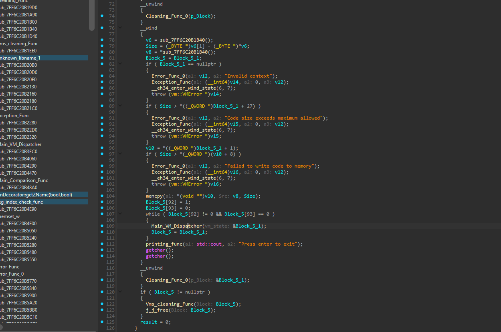
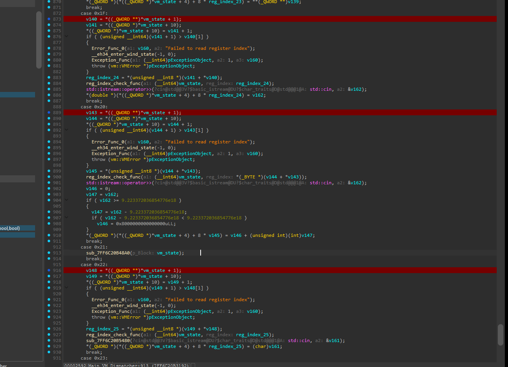
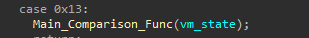
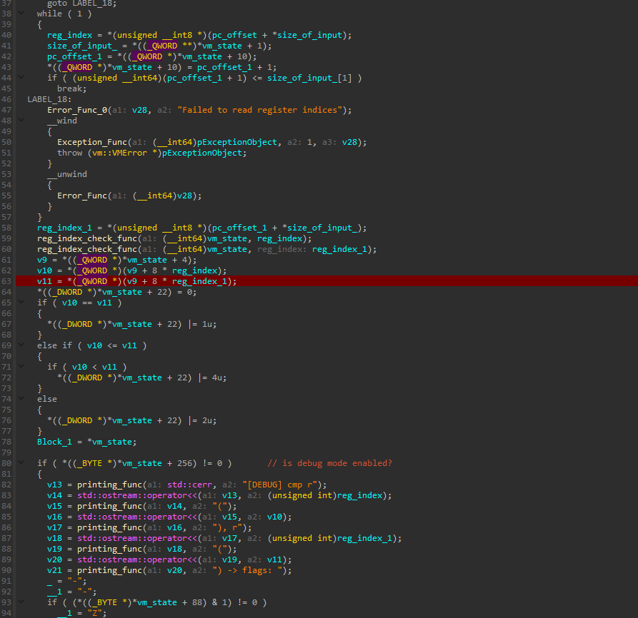
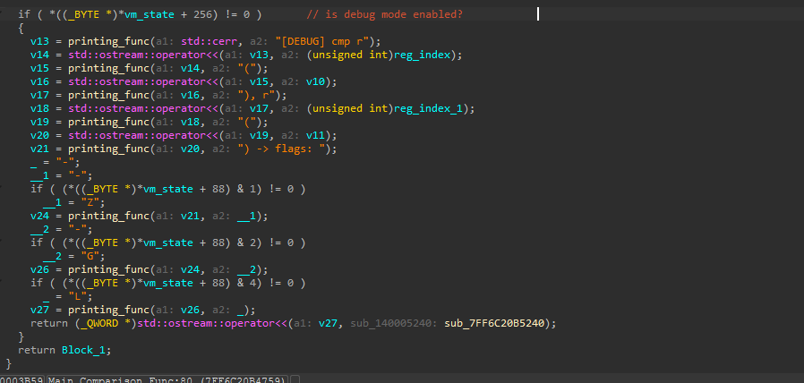
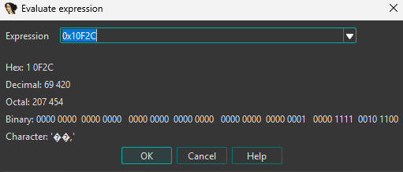
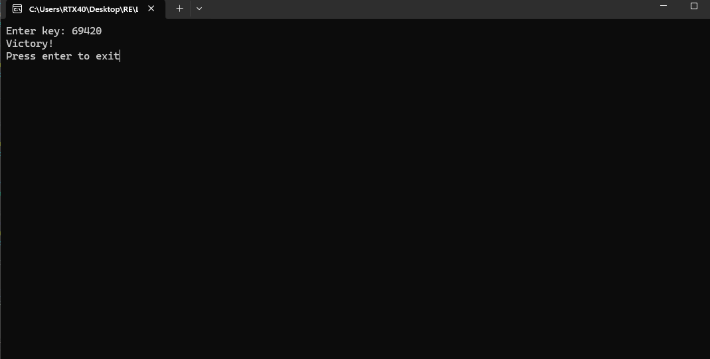

# virtualmachine

> A virtualization-obfuscated crackme: the real program is bytecode run by a custom interpreter with ~39 opcode handlers. Peeling back the VM shows the check is a single register-equality test against a hardcoded target, `0x10F2C`. The key is that value in decimal — `69420`.

## Metadata

| Field        | Value |
|--------------|-------|
| Source       | crackmes.one — `684a150e2b84be7ea77437fd` |
| Author       | Not recorded |
| Language     | C/C++ |
| Architecture | x86-64 |
| Platform     | Windows |
| Difficulty   | ~3.5 / 6 |
| Quality      | — |
| Date solved  | 2026-10-14 |
| Time spent   | — |
| Tools        | IDA Pro, IDA Pro's Built-in WINDBG (hardware breakpoints) |
| Solve type   | password (target constant recovered dynamically) |

## 1. Goal
The program prints `Enter key:` and reads one token. A correct key prints `Victory!`; anything else falls through to the exit path without it. There is a single fixed key rather than a per-user scheme, so the task is to recover that one value.

## 2. Triage / Recon
- **File type:** 64-bit Windows PE, C++ (visible `std::cin` / `std::cout` / `std::ostream::operator<<` usage and `vm::VMError` exception types).
- **No TLS callbacks.** Nothing runs before the entry point, so there is no early anti-analysis stage to worry about.
- **No conventional anti-debug.** The binary attaches and single-steps cleanly; the difficulty is entirely the virtualization layer, not debugger resistance.
- **Shape of the binary:** `main` does not contain the validation logic directly. It allocates a VM state structure, copies a bytecode blob into it after two size sanity checks (`Code size exceeds maximum allowed`, `Failed to write code to memory`), and then drives everything through a dispatcher in a loop until a run flag clears.



## 3. Static Analysis
- **Dispatcher:** `Main_VM_Dispatcher(vm_state)`. It is a large `while(1)` over a program counter, reading an opcode from the bytecode and switching on it. There are roughly `0x27` (39) cases across close to a thousand lines, but a large share of them are never reached — dead handlers padding the switch to make static reading painful. Trying to read the whole VM top-to-bottom statically is the wrong approach; the live handlers are best found dynamically.

The handlers that actually run:

| Opcode | Role |
|--------|------|
| `case 1` | reads a register index and a value; also used to pull input into a register |
| `0x1F`, `0x20`, `0x22` | input handlers — three different overloaded `std::cin operator>>` reads |
| `0x26` | writes to the console |
| `0x13` | the main comparison point |
| `0x15` | jump calculator for the fail/success branches (tests the flags bit) |
| `0x14` | unconditional jump straight to the continuation label |

- **The three input handlers:** cases `0x1F`, `0x20`, and `0x22` each call a different overload of `std::istream::operator>>` (one reads a floating value and clamps it against `9.223372036854776e18`, one reads a char, and so on). This is what makes the input path look more elaborate than it is — the token is parsed by the stream operator for a numeric type, not compared byte-by-byte as a string.



- **The comparison dispatch:** `case 0x13` is a single call.



- **The comparison itself — `Main_Comparison_Func`:** this is the whole decision. It reads the register file base (`v9 = *(vm_state + 4)`), then two registers by index:

```c
v10 = *(v9 + 8 * reg_index);     // left operand  = parsed user input
v11 = *(v9 + 8 * reg_index_1);   // right operand = hardcoded target
*(vm_state + 22) = 0;            // clear the flags dword
if ( v10 == v11 )                *(vm_state + 22) |= 1;   // equal  -> bit 0 (Z)
else if ( v10 <= v11 ) {         if (v10 < v11) *(vm_state + 22) |= 4; }  // less   -> bit 2 (L)
else                             *(vm_state + 22) |= 2;   // greater-> bit 1 (G)
```



- **The flags meaning (confirmed by the debug branch):** the function carries an optional debug feature. When `*(vm_state + 256)` (a debug-mode byte) is non-zero it prints `[DEBUG] cmp r(idx, v10) r(idx, v11) -> flags:` followed by a flag name decoded from the flag bits — `Z` for equal, `G` for greater, `L` for less. That decoder is a clean, human-readable confirmation of what each bit means: bit 0 set means the two operands were equal.



- **How success is gated:** `case 0x15` computes the next program counter from the flags — the success branch is taken when the equal bit (bit 0) is set. So the entire crackme reduces to: **make `v10 == v11` at `case 0x13`.**

## 4. Dynamic Analysis
Static reading gives the structure; the values come from running it.

- **The target is constant.** Feeding character-only inputs of different contents and lengths (`efgeefgeefge`, `abcdabcdabcd`, `abcd`) left `v11` unchanged at `0x10F2C`, and `v10` came out `0` every time. A right operand that never moves means it is a hardcoded target rather than anything derived from the input, and a left operand pinned at `0` for text meant the input was not being consumed as a string.

- **The input is parsed as a number.** That `v10 == 0` for text was the tell: the numeric `operator>>` fails to parse letters and yields `0`. Setting a hardware breakpoint on the overloaded `cin` read and inspecting the parsed slot confirmed the token is read as an integer. For the numeric input `98765432`, `v10` came back as `0x5E30A78` — i.e. the register holds the integer value of the entered number — while `v11` stayed at `0x10F2C`.

- **Conclusion from the run:** the check is not doing any arithmetic on the input at all. It parses the entered number into `v10` and compares it directly to the fixed `v11 = 0x10F2C`. A black-box pass over the comparison function was on the table, but once the operands were in front of the debugger it was plainly a straight equality — no solver or black-box modelling needed.

## 5. The Core Insight
Under all the VM scaffolding and the dead opcode handlers, the validation is one comparison: the entered number, parsed by `cin`, must equal the hardcoded constant `0x10F2C`. Everything else — the dispatcher, the 39 cases, the three input overloads, the debug flag printer — is there to bury that single equality.

## 6. Solution
The target is `v11 = 0x10F2C`. The input is read as a base-10 number, so the key is that constant expressed in decimal:

```
0x10F2C  =  69420 (decimal)
```



**Password / key:** `69420`

**Verification:** Running the binary and entering `69420` prints `Victory!`.



## 7. Key Takeaways
- **New technique learned:** how to attack a virtualization-obfuscated binary in practice — identify the dispatcher, ignore the dead handlers, and find the small set of opcodes that actually execute rather than reading the whole interpreter statically.
- **Mistakes / time sinks:** the three overloaded `cin` handlers and the wall of unused cases made the input path look far more complex than it was. The unlock was noticing that text inputs produced `v10 = 0` and a fixed `v11` — that immediately reframed the problem as "the input is a number and there is a fixed target."
- **Reusable trick for next time:** when a comparison operand is invariant across many different inputs, treat it as a hardcoded target and read it straight out of the register, instead of modelling the transform. Here it removed the need for any black-box work.
- **VM handler recognition:** learned to recognize the dispatcher-plus-opcode-switch layout of a bytecode VM (a `while(1)` reading an opcode from a program counter and branching into per-opcode cases over a `vm_state` structure), and to lean on dynamic tracing to separate the live handlers from padding. Added to my notes.

## 8. Artifacts
- `Binary/virtualmachine.exe` — the crackme.
- `solve_notes.txt` — my working notes captured during the solve.
- **Key:** `69420` (`= 0x10F2C`).
