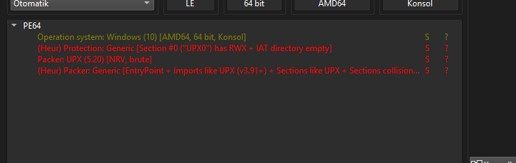
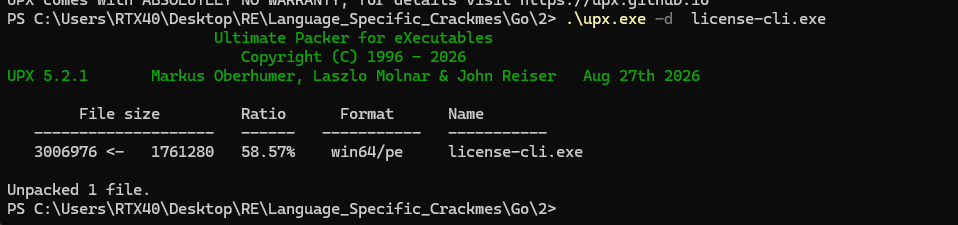
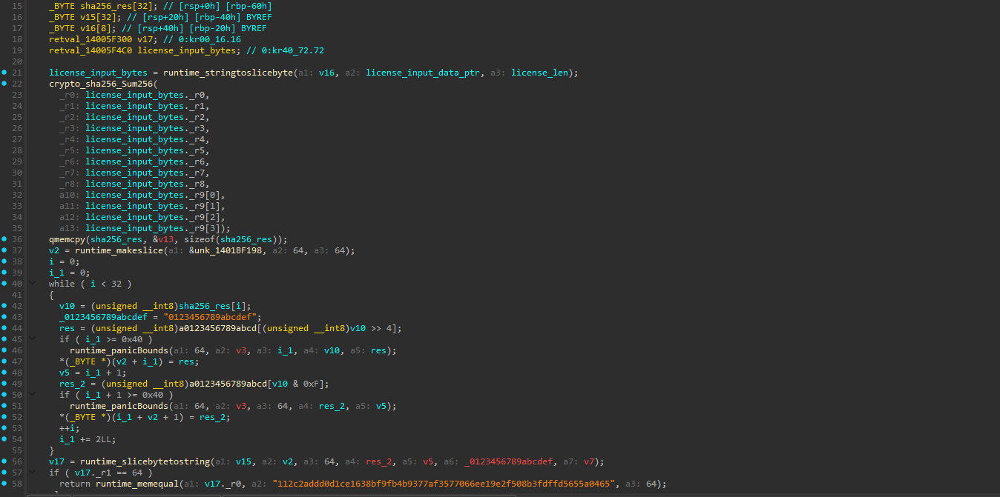
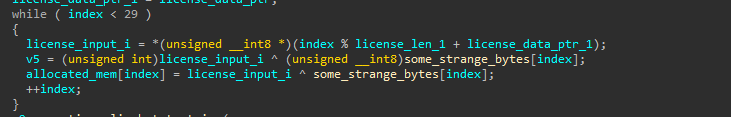
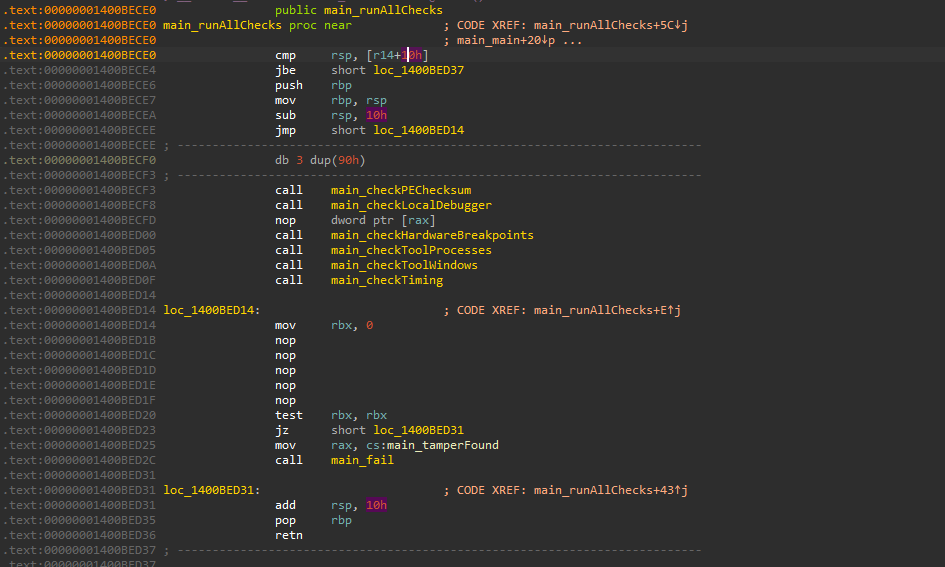

# license-cli

> A UPX-packed Go license validator. After unpacking, the licensing logic splits into two gates: a SHA-256 check (`hex(sha256(license)) == <target digest>`) that is one-way and cannot be inverted, and a repeating-XOR stage that turns the license into a flag but is underdetermined on its own (one equation, two unknowns). The anti-tamper battery was neutralised by patching the single aggregator function; the licensing gates were fully mapped but not solved, since the only remaining path is guessing.

## Metadata

| Field        | Value |
|--------------|-------|
| Source       | crackmes.one |
| Author       | Not recorded |
| Language     | Go |
| Architecture | x86-64 |
| Platform     | Windows |
| Difficulty   | — (not rated) |
| Quality      | — (not rated) |
| Date solved  | 2026-10-19 |
| Time spent   | — |
| Tools        | DIE, UPX, IDA Pro (Hex-Rays), hex editor |
| Solve type   | analysis only — anti-tamper patched; validation gates mapped, not solved (would require guessing) |

## 1. Goal
The program is a command-line license validator: it takes a license string and accepts or rejects it, and a correct license also yields a flag. The aim is to understand the validation and, if practical, produce a valid license.

## 2. Triage / Recon
- **Packer:** DIE flags the file as UPX-packed — section `UPX0` is RWX with an empty IAT directory, and the packer signature reads `UPX (5.20) [NRV, brute]` on a 64-bit Go console PE.



- **Unpacking:** UPX is reversible with its own switch — `upx -d license-cli.exe` restores the original image (1,761,280 → 3,006,976 bytes), giving a clean binary to analyse.



- **After unpacking:** a standard Go binary (`runtime.*`, `crypto/sha256`, string `{ptr,len}`), with a license validator plus a set of self-protection routines.

## 3. Static Analysis
Two independent gates operate on the license.

### Gate 1 — SHA-256 digest check
The validator hashes the license and compares the hex digest to a hardcoded target:

```c
license_input_bytes = runtime_stringtoslicebyte(..., license_input_data_ptr, license_len);
crypto_sha256_Sum256(license_input_bytes ...);        // 32-byte digest -> sha256_res
for ( i = 0; i < 32; ++i )
{
    v10 = sha256_res[i];
    res   = "0123456789abcdef"[v10 >> 4];              // high nibble -> hex char
    res_2 = "0123456789abcdef"[v10 & 0xF];             // low nibble  -> hex char
    // append res, res_2 to the output buffer
}
v17 = runtime_slicebytetostring(...);                  // 64-char lowercase hex
if ( v17.len == 64 )
    return runtime_memequal(v17,
        "112c2addd0d1ce1638bf9fb4b9377af3577066ee19e2f508b3fdffd5655a0465", 64);
```



In plain words: `accept  ⟺  lowercase_hex(sha256(license)) == 112c2addd0d1ce1638bf9fb4b9377af3577066ee19e2f508b3fdffd5655a0465`. This is a one-way relation of the form `sha256(X) == Y`; `X` cannot be recovered from `Y`, so this gate offers no inversion path.

### Gate 2 — repeating-XOR flag stage
A second routine XORs the license against a fixed 29-byte array to produce the flag:

```c
while ( index < 29 )
{
    license_input_i    = *(unsigned __int8 *)(index % license_len + license_data_ptr);  // license cycled
    allocated_mem[index] = license_input_i ^ some_strange_bytes[index];                  // XOR with fixed key
    ++index;
}
```



`some_strange_bytes` is the 29-byte `.rdata` constant `'/&5 !7I"<()3$*E[E%!%&!$"G#/&='`. The relation is `flag = license ⊕ some_strange_bytes` (license cycled over its length). With both the license and the flag unknown, this is a single equation in two unknowns — it does not pin down a unique answer by itself.

## 4. Dynamic Analysis
The unpacked binary guards itself with a battery of checks, gathered under one aggregator:

- **`main_runAllChecks`** calls, in sequence: `main_checkPEChecksum`, `main_checkLocalDebugger`, `main_checkHardwareBreakpoints`, `main_checkToolProcesses`, `main_checkToolWindows`, `main_checkTiming`. If any trip, it sets `main_tamperFound` and calls `main_fail`.
- Separately, `main_hideThreadDebugger` and `main_erasePEHeader` provide anti-debug and anti-dump (the erased PE header frustrates dumping the process image).


**Patch:** rather than defeating each check individually, the aggregator's decision was neutralised at one point — the tamper flag is forced to zero and the branch to `main_tamperFound` / `main_fail` is skipped (a `mov rbx, 0` plus a NOP sled ahead of the `test rbx, rbx` / `jz`), so `main_runAllChecks` always returns clean.



## 5. The Core Insight
The two licensing gates are deliberately arranged so neither yields on its own. The SHA-256 gate is one-way, so the license cannot be derived from the stored digest; and the repeating-XOR flag stage needs that same unknown license, leaving one equation in two unknowns. The only part with a clean, deterministic bypass is the self-protection layer, which funnels every check through a single aggregator — patch that one decision and the whole battery is disabled at once.

## 6. Solution
**Status: analysis complete, license/flag not produced.**

What was recovered:
- The binary was unpacked (`upx -d`).
- Gate 1 identified: `hex(sha256(license)) == 112c2addd0d1ce1638bf9fb4b9377af3577066ee19e2f508b3fdffd5655a0465` — one-way, not invertible.
- Gate 2 identified: `flag = license ⊕ '/&5 !7I"<()3$*E[E%!%&!$"G#/&='` (license cycled), underdetermined without the license.
- The anti-tamper battery (`main_runAllChecks` + `hideThreadDebugger` + `erasePEHeader`) was mapped and neutralised by patching the aggregator.

What was not done, and why: recovering a valid license from here requires guessing — there is no algebraic inversion of SHA-256, and the XOR stage cannot be solved with two unknowns. Chasing a `Success!` message by brute force was judged not worth the effort, so the analysis stops at a fully-mapped scheme rather than a produced key.

## 7. Key Takeaways
- **New technique learned:** UPX unpacks cleanly with `upx -d`; and a self-protection design can route many checks through one aggregator, so patching that single decision disables all of them at once — cheaper than neutralising each check.
- **Mistakes / time sinks:** none — the analysis was straightforward once unpacked; the deliberate choice was to not spend time guessing.
- **Reusable trick for next time:** recognise a `sha256(X) == Y` gate as a dead end for inversion, and treat a `result = input ⊕ key` stage with two unknowns as underdetermined rather than sinking time into it.

## 8. Artifacts
- `Binary/license-cli.zip` — the crackme (UPX-packed original, zipped).
- **Target digest (Gate 1):** `112c2addd0d1ce1638bf9fb4b9377af3577066ee19e2f508b3fdffd5655a0465`.
- **XOR key (Gate 2):** the 29-byte `.rdata` constant `'/&5 !7I"<()3$*E[E%!%&!$"G#/&='`.
- **Patch:** `main_runAllChecks` — tamper flag forced to zero / NOP sled so the `main_fail` branch is never taken.
