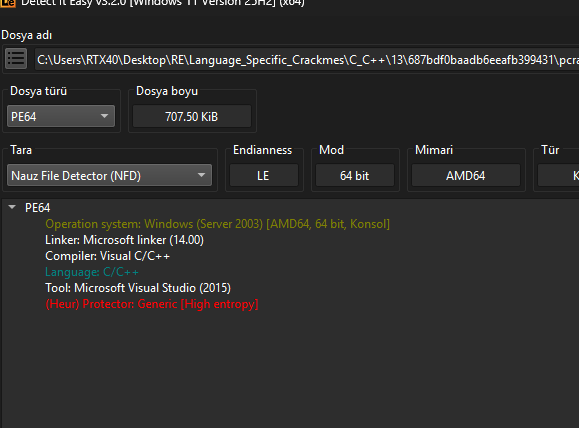
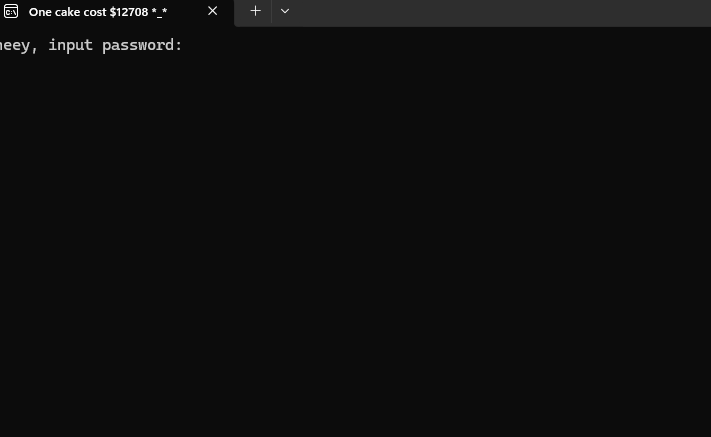
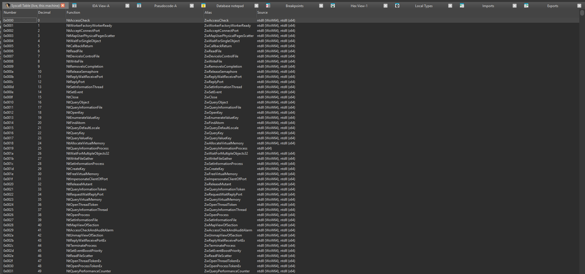
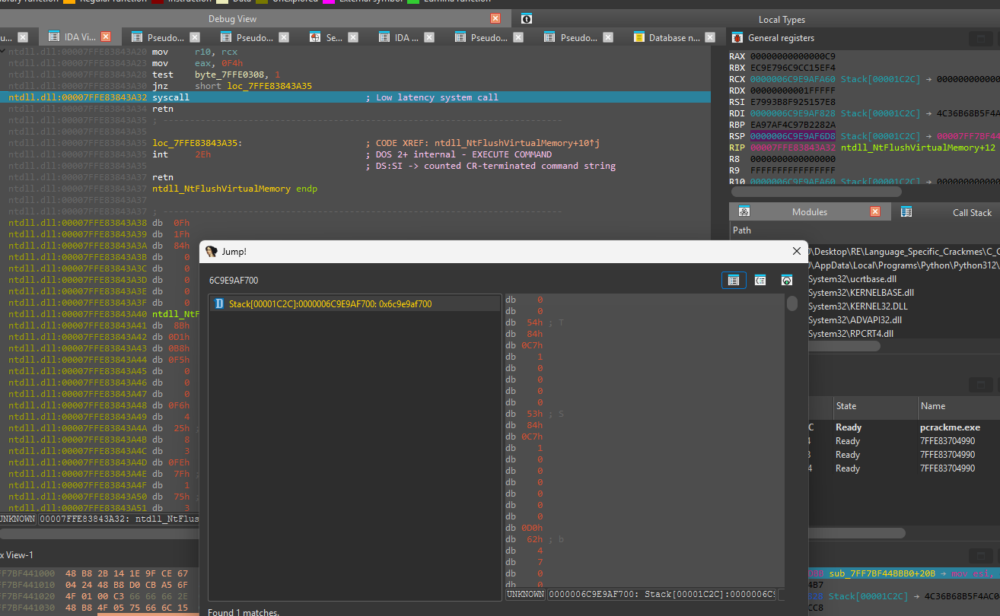
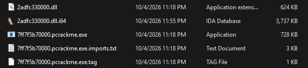
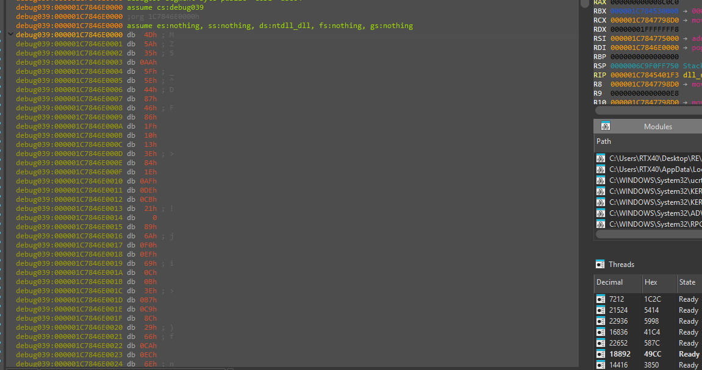
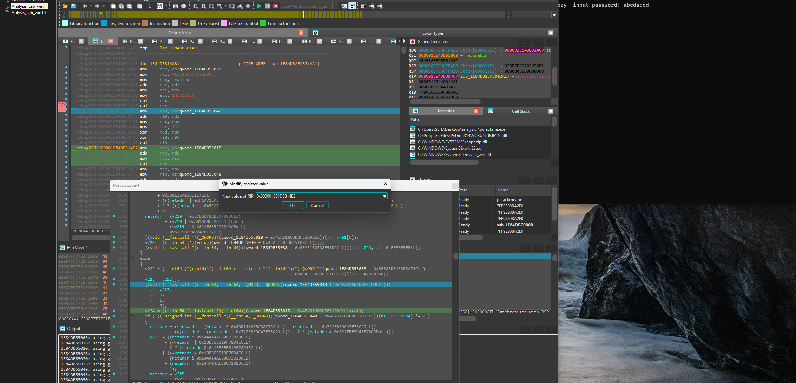
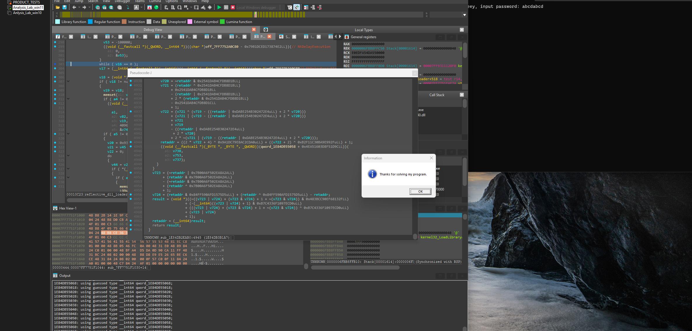

# pcrackme — Reflective-DLL + Direct-Syscall Packed Crackme

> A hardened Windows x64 crackme that defeats direct static reading by stacking four defenses: all call sites are opaque pointer-arithmetic indirections, Nt-level primitives go out through a direct-syscall trampoline (not through `ntdll` exports), every basic block pairs MBA (Mixed Boolean Arithmetic) mutations of the saved return address as a soft tamper check, and the real logic lives inside a DLL that never touches the disk — the program reflectively loads it into its own address space. Solved by neutralising the two decision gates at runtime (ZF flips) and stepping past a `ThreadHideFromDebugger` call via RIP manipulation. The password itself was not reverse-engineered; the research value is the defense stack, not a `Success!` string.

## Metadata

| Field        | Value |
|--------------|-------|
| Source       | crackmes.one — `687bdf0baadb6eeafb399431` |
| Author       | Not recorded |
| Language     | C/C++ (MSVC — Visual Studio 2015 linker 14.00) |
| Architecture | x86-64 |
| Platform     | Windows 10 / 11 |
| Difficulty   | 5.2 / 6 |
| Quality      | 5.5 / 6 |
| Date solved  | 2026-10-28 |
| Time spent   | ~5 days |
| Tools        | IDA Pro (Hex-Rays + local Windows debugger), DIE, pe-sieve, author's own `ida-pro-scripts` syscall-resolver |
| Solve type   | runtime-steered (ZF + RIP manipulation at the two decision gates; password not recovered) |

## 1. Goal
The program eventually prints `heey, input password:` on the console and reads a line. A correct outcome ends in a `Thanks for solving my program.` message box and a short "success"-vibe `.wav` played from the system sound set; an incorrect outcome plays a different, sharper "fail"-vibe `.wav`. The research goal is not the password string — it is the full defense stack that stands between `main` and that prompt.

## 2. Triage / Recon
- **File type:** 64-bit Windows PE, console subsystem, ~707 KiB on disk. DIE flags **High entropy** (`(Heur) Protector: Generic`), linker is Microsoft 14.00 (Visual Studio 2015), compiler Visual C/C++. The entropy flag is the first signal that the body is packed or encoded.



- **Strings:** no `password`, no `Correct`, no `Success` — nothing visible that a strings scan can anchor the check on.
- **Imports:** empty beyond the C runtime; no direct references to the `ntdll` / `kernel32` primitives used later. Every meaningful call reaches its target through an in-process indirection table.
- **TLS callbacks:** none.
- **First run:** the console prints `heey, input password:` and blocks on `stdin`. The window title is set to a decorative `One cake cost $12708 *_*` — set from code inside the injected DLL, not the host executable.



## 3. Static Analysis — Why Static Was Abandoned
Three structural choices make a plain static reading unproductive. The remainder of the solve is dynamic.

### 3.1 Opaque pointer-arithmetic call sites
Every function invocation in `main` goes through a pattern of the form

```c
v51 = ((__int64 (__fastcall *)(_QWORD))
        ((char *)off_7FF729170A78 - 0x33E5F408F5D142D0LL))
      (a1: *((unsigned int *)off_7FF729170B88 - 0xBB39E5EB938E829LL));
```

A table of pointers (`off_7FF729170A78`, `off_7FF729170B88`, …) is offset by a large per-site constant to produce the real target address and arguments. The target is never a direct symbol. Nothing resolves until the process is live and the tables are populated.

### 3.2 Direct syscalls rather than `ntdll` exports
`main` reaches memory primitives (allocate, protect, write, create thread, close, query, read, delay) not through `kernel32`/`ntdll` exports but through a layered dispatcher. The call-site above lands in a helper such as `strange_call_0(unsigned __int16 a1)` which:

1. Verifies this is the first call for a given syscall index, else uses a cached resolution.
2. On a first call, calls back into the resolver base (another opaque pointer) with a 64-bit API hash (e.g. `0xE5A054A174B8CC81`), bounds-checks the returned numeric value against two obfuscated bounds (an upper and a lower), and stores the resolution.
3. Writes the syscall number into `gs:[0]` with `__writegsdword(0, a1)`.
4. Writes the resolved syscall-stub address into `gs:[0x150]` with `__writegsqword(0x150, saved_target)`.
5. Transfers control to a trampoline that executes the syscall:

```asm
syscall_        proc
                mov     eax, gs:0           ; syscall number from gs:[0]
                xor     r10, r10
                mov     gs:0, r10           ; scrub it
                mov     r10, rcx            ; first arg -> r10 per syscall ABI
                jmp     qword ptr gs:150h   ; jump to the real "syscall; ret" site
                endp
```

The jump target at `gs:[0x150]` points to an unhooked `syscall; ret` pair inside live `ntdll` memory, so any user-mode hook installed on the `Nt*` function prologues is never touched — the service transition happens from an address that is not the hooked entry point. The syscall itself remains an ordinary `syscall` instruction; only its reach into the kernel is routed around in-process observers.

The resolver's dispatch is a binary search over a sorted table of 10-byte records (`unk_7FF729170D5A`, `…D34`, `…D40`, `…D4C`, `…D64`, `…D70`, `…D88`): each record holds a 32-bit API hash, a 32-bit numeric value, and a 16-bit field that are combined into the stored target: `(*(uint32_t *)(record+6)) | ((uint64_t)*(uint16_t *)(record+4) << 32)`. A matching hash yields a service identifier; a miss falls through to `MEMORY[0x118E3880000]()` (a controlled trap address).

Because the mapping is a live table, the same call-site expression can route to different services at different phases of execution if a global pointer is rebound — see §6.

### 3.3 Paired XOR mutations of the saved return address — MBA
Each basic block carries matching lines of the form

```c
retaddr ^= 0x4642750D2E6CB76DuLL;
...
retaddr ^= 0x4642750D2E6CB76DuLL;
```

The decompiler surfaces a stack slot it labels `retaddr` sitting at `[rsp+XXh] [rbp+0h]` — i.e. where the function's return address lives on the stack. The two XORs with the same constant are **self-cancelling**: under normal execution the saved RIP is restored before `ret`. This pattern — reversible arithmetic identities applied to a value with inverse applications elsewhere so the value cancels back to its original form — is **Mixed Boolean Arithmetic (MBA)** obfuscation. Applied to a stack slot that *is* the saved return address, the paired XORs do double duty: they bloat the decompiler output with meaningless data dependencies, and they turn the surrounding block into a soft tamper check. Any mid-function patching, inline-hook stub, or trampoline that bypasses one XOR of a pair leaves the saved RIP corrupted and the function returns into garbage. This is not ROP in the attack-primitive sense — there is no chaining of `ret`-terminated gadgets to execute data as code. It is MBA masking plus a flow-integrity guard.

## 4. The Direct-Syscall Layer
The practical blocker is that none of the memory operations show up as `kernel32!VirtualAlloc` or `ntdll!NtAllocateVirtualMemory` traces. Resolving a syscall by index requires knowing which number each `Nt*` service holds on the running Windows image, and both Microsoft and antimalware vendors shuffle those numbers across builds.

**The author's `ida-pro-scripts` syscall-resolver** was built independently to solve exactly this problem and dropped straight in here. It walks the mapped `ntdll` on the current machine, matches the `mov eax, imm32; syscall` prologue byte-signature inside every exported `Nt*`/`Zw*` stub, and emits a live `{Number, Function, Alias, Source}` table. The result is version-independent and runs on any Windows 10/11 target without baked-in offsets.



With that table in hand, each opaque dispatcher resolves back to a named Nt-service, and the trace becomes readable. The whole reflective-DLL dance below runs through these direct syscalls — `NtAllocateVirtualMemory`, `NtProtectVirtualMemory`, `NtWriteVirtualMemory`, `NtCreateThreadEx`, `NtClose`, `NtQueryInformationProcess`, `NtReadVirtualMemory`, `NtDelayExecution` — none visible by static import.

## 5. Reflective DLL Injection — Into the Same Process
The host executable carries a complete DLL image as data, maps it into its own address space, resolves it there, and jumps to its entry point. There is no file on disk. The target process handle used throughout is `0xFFFFFFFFFFFFFFFF` — the current-process pseudo-handle — so the injection is **into self**, not a remote process.

### 5.1 PE sniffing on the embedded image
`reflective_dll_loader` reads two signatures before touching anything:

```c
if ( *(_WORD *)a2 != 23117 )   goto fail;    // 23117 = 0x5A4D = 'MZ'
v10 = *(int *)(a2 + 60);                      // e_lfanew
if ( *(_WORD *)(a2 + v10 + 4) != 34404 )     // (NT_HEADERS + 4) low 16 bits
     goto fail;
```

The `34404 == 0x8664` check is the `IMAGE_FILE_HEADER.Machine` field at offset 4 inside `IMAGE_NT_HEADERS` — IMAGE_FILE_MACHINE_AMD64. So the loader confirms both a valid PE and the correct architecture before continuing.

### 5.2 Image staging via direct syscalls
A trace of the live calls captured during a run — the direct-syscall equivalents are shown with the resolver's names:

```
NtAllocateVirtualMemory(self, &base, 0, &size=0x9C000, MEM_COMMIT|MEM_RESERVE, PAGE_READWRITE)
NtProtectVirtualMemory(self, &base, &size, PAGE_EXECUTE_READWRITE, &oldProtect)
NtWriteVirtualMemory(self, base + 0x00000, &encoded_image, 0x1000, &written)
NtWriteVirtualMemory(self, base + 0x01000, ..., 0x8F600, ...)       ; .text
NtWriteVirtualMemory(self, base + 0x90000, ..., 0x01200, ...)       ; .rdata
NtWriteVirtualMemory(self, base + 0x93000, ..., 0x02600, ...)       ; .data
NtWriteVirtualMemory(self, base + 0x96000, ..., 0x00600, ...)       ; .pdata
NtWriteVirtualMemory(self, base + 0x97000, ..., 0x00200, ...)       ; etc.
...
```

### 5.3 Parameter block and loader stub
A small 64-byte region is allocated separately and filled with everything the DLL needs to resolve itself from inside the mapped image:

```c
v75[0] = LoadLibraryA;         // for resolving imports
v75[1] = GetProcAddress;
v75[2] = RtlAddFunctionTable;  // for unwind registration
v75[3] = base_of_mapped_image;
DWORD2(v76) = reason;          // DllMain fdwReason
v77         = reserved_arg;    // DllMain lpvReserved
v78         = flags_byte;
```

A separate 4 KiB RWX region is then allocated and the function `sub_7FF7290D21A0` (the loader-shellcode stub) is written into it:

```
NtAllocateVirtualMemory(self, &stub_region, 0, &size=0x1000, MEM_COMMIT|MEM_RESERVE, PAGE_EXECUTE_READWRITE)
NtWriteVirtualMemory(self, stub_region, &sub_7FF7290D21A0, 0x1000, ...)
```

### 5.4 Thread creation and the `0x404040` sync sentinel
A fresh thread is spawned at the stub, with the parameter block as its argument:



```
NtCreateThreadEx(&hThread, 0x1FFFFF, 0, self, stub_region, param_block, 0, 0, 0, 0, 0)
NtClose(hThread)
```

The main thread then polls, waiting for the stub to signal completion:

```c
do {
    NtQueryInformationProcess(self, 0, &info, 48, 0);
    if ( info.ExitStatus != 259 /* 0x103 STATUS_PENDING */ ) break;
    NtReadVirtualMemory(self, param_block, local_copy, 64, &read);
    if ( local_copy.sentinel == 0x404040 ) break;      // DLL finished
    NtDelayExecution(0, &-100000);                     // ~10 ms
} while (sentinel == 0);
```

The loader thread writes `0x404040` into a known slot of the parameter block when it has finished mapping the DLL and running its initialisers. The main thread's polling triplet — `NtQueryInformationProcess` → `NtReadVirtualMemory` → `NtDelayExecution` — is the characteristic rhythm the trace will show while the DLL is being brought up.

### 5.5 Dumped artifact
Once the DLL is resident, `pe-sieve` cleanly extracts the mapped image for offline analysis. The dump shows a self-contained 624 KiB DLL alongside the host — not present on disk before execution:



The in-memory image carries an ordinary MZ/PE header, visible as soon as the staging passes complete:



### 5.6 The DLL walk — `dll_runner`
Once the host has staged the raw bytes, the DLL's own entry stub (`dll_runner`, visible after dumping) performs a full PE walk inside the mapped memory:

- **Base relocations:** scan the `.reloc` directory, add the base-delta to every HIGHLOW/DIR64 entry. The signature in the pseudocode is the `(entry & 0xF000) == 0xA000` check — IMAGE_REL_BASED_DIR64 == 0xA.
- **Imports:** iterate the import directory; for each descriptor, resolve the library via `LoadLibraryA` (from the parameter block) and each thunk via `GetProcAddress`. Fill the IAT in-place.
- **TLS callbacks:** if `IMAGE_DIRECTORY_ENTRY_TLS` is populated and `AddressOfCallBacks` is non-null, iterate and call each callback with `DLL_PROCESS_ATTACH`.
- **DllMain:** compute `AddressOfEntryPoint` and call it; on non-zero return, record the base as the "loaded" value in the parameter block; on zero return, store a sentinel error.

At this point the DLL has taken over everything the running program will do next.

## 6. Inside the Injected DLL
The DLL's entry point is a long, heavily arithmetic-obfuscated routine (`sub_1C78476C0C0` at the dumped base). Three things happen inside it that matter.

### 6.1 Byte-by-byte construction of a format string and the prompt
Two local buffers, `v223[64]` and `v224[23]`, are populated **inside** the function by state-machine code. For each buffer, each byte is written through a cascade like

```c
*((_BYTE *)v224 + i) = *((_BYTE *)v224 + i) + i + 20 - 2*(*((_BYTE *)v224 + i) & (i + 20)) + 116;
```

The `+ i + 20 - 2*(x & (i+20))` arithmetic is a reversible per-index MBA identity (the same obfuscation style seen on `retaddr` in §3.3, applied here to data instead of to flow control); the sequence of fetches, state transitions (`n640217919`), and interleaved `retaddr` XORs is the obfuscator working, not real control flow. Executed to completion in the debugger the two buffers resolve to:

- `v224` → the ASCII bytes `"heey, input password: "`.
- `v223` → the matching `wsprintf` format string.

The DLL then calls `user32!wsprintfA` (resolved through the same opaque pointer dance) on `v223` with `v224` as the argument, and the formatted text is written to the console — the first visible evidence of the program after a long silent setup.

### 6.2 Triple-loop input wait
After the prompt the DLL does **not** call a straightforward `ReadFile` on `stdin`. It enters the same three-API polling triplet the loader used earlier:

```
NtQueryInformationProcess -> NtReadVirtualMemory -> NtDelayExecution
```

### 6.3 Hypothesis: resolver-slot rebinding
The call-site at the bottom of the triplet is tagged `NtDelayExecution` in the dispatcher, but single-stepping past it after `stdin` fulfils the read does not re-enter the delay stub — it lands partway into a different routine that is unrelated to `NtDelayExecution`. One global (`qword_1E84DB55…`) is written to between the loader phase and the DLL-live phase, and the resolver's binary search is driven by that pointer. The working hypothesis is that **the resolver table is rebound once the DLL takes over**, so the same hash resolves to a different Nt-service in the second phase. The alternative — that it was never `NtDelayExecution` to begin with and the loader-phase label is wrong — is harder to reconcile with the loader-phase 10 ms pacing, which does match a `NtDelayExecution(-100000)` behaviourally. Confirming this rigorously would mean dumping and diffing the resolver table at phase boundaries; that was left for a follow-up.

## 7. The Two Decision Gates
After the loop releases on input, control reaches a short tail with two independent checks and an anti-debug call wedged between them. All three sit inside the DLL body.

### 7.1 Gate A — byte-flag check
```c
if ( *(_BYTE *)(qword_1E84DB55060 + 0x3FB88DB45DE2A74CLL) != 0 )
    /* fail path */
```

The condition compiles to a `cmp byte ptr [rax+rdx], 0` followed by a `jz` to the success-path continuation. The fail path contains yet another block of `retaddr ^= K` noise and returns a sentinel error. The choice at the solve was **flag manipulation at runtime rather than code patching**, specifically to avoid tripping any still-hidden PE-checksum or `.text`-integrity check that may remain unseen in the obfuscated setup — flipping `ZF` leaves the file bytes intact.


### 7.2 Interlude — `ThreadHideFromDebugger`
Immediately after Gate A the DLL calls

```c
((void (__fastcall *)(__int64, __int64, _QWORD, _QWORD))
    (qword_1E84DB55040 + 0x4EA51603D8F51D9CLL))
    (a1: v223, a2: 17, a3: 0, a4: 0);
```

The `17, 0, 0` signature is distinctive: `NtSetInformationThread(handle, ThreadInformationClass=17, info=0, size=0)` — `ThreadHideFromDebugger`. After the kernel sets the hide-flag the attached debugger stops receiving debug events for the thread and detaches. The first full run of the solve ended there, which was the signal.


The bypass again preserves the file: RIP is moved past the call instruction, so the hide syscall never fires.



### 7.3 Gate B — function-call result compare
```c
v224 = ((__int64 (__fastcall *)(__int64))(qword_1E84DB55018 + 0x4EA51603D8F51D9CLL))(a1);
if ( ((unsigned int (__fastcall *)(__int64, _QWORD))
         (qword_1E84DB55048 + 0x4EA51603D8F51D9CLL))(a1, a2: v224) != 0 )
    /* fail path */
```

Two helpers in sequence — the first produces a value from the input, the second consumes it and the input together. A non-zero return routes to the fail path. The underlying arithmetic is where the real password-derivation would live, and reversing it was deliberately not pursued (the end-reward is a message box, not a flag or key worth the time). `ZF` flipped again at the second `jz`, same justification as Gate A.

## 8. Solution — Runtime-Steered
**Status: scheme fully mapped; password not recovered.** The two decision gates were neutralised in the debugger (ZF forced to 1 at both; RIP walked past `ThreadHideFromDebugger`), the file was left untouched, and the DLL took the success path to completion. This is honestly a *patch-equivalent at the register level*, not an algebraic solve of the check function.

Reasoning for the stop point: the two helpers behind Gate B form the mathematical core of the challenge, and the obfuscator wraps every byte of them in the same `retaddr` and arithmetic noise seen throughout. The question "what password satisfies the check" is answerable in principle but costs many days of symbolic unwinding for a reward that is a message box. The research payoff was the five-layer defense stack — direct syscalls, reflective self-injection, opaque pointer tables, paired-XOR flow integrity, and a late-phase anti-debug — not the inside of two more arithmetic sieves.

### Steps
1. Launch under local Windows debugger.
2. Let the loader stage and the DLL come up (`0x404040` sentinel appears).
3. Break at the prompt; enter arbitrary input (`abcdabcd` was used).
4. At Gate A's `jz`, set `ZF = 1` via register editor.
5. At the `ThreadHideFromDebugger` call site, set `RIP` to the instruction after the call.
6. At Gate B's `jz`, set `ZF = 1`.

## 9. Verification
After both ZF flips and the RIP skip, the DLL continues to its success tail, pops a native message box reading `Thanks for solving my program.`, and plays the success-vibe `.wav` from the system sound set. On an unmodified run, the same tail routes to a different `.wav` with a sharp failure vibe; the two sounds are the oracle.



## 10. Key Takeaways
- **Direct-syscall layer recognition.** The signatures to carry forward: opaque indirect call sites, no `ntdll` imports for memory primitives, a trampoline that writes to `gs:[0]` and `gs:[0x150]` then does `mov eax, gs:0; mov r10, rcx; jmp qword ptr gs:150h`, and dispatcher helpers that binary-search a sorted record array keyed by API hash. Author's `ida-pro-scripts` syscall-resolver turns the whole mess into named services on any Windows 10/11 target without version-specific offsets.
- **Reflective DLL injection into self.** The telltale sequence is: a parameter block holding `LoadLibraryA` + `GetProcAddress` + `RtlAddFunctionTable` + a staging base, PE-signature sniffing (`'MZ'` = `0x5A4D`, PE signature low-16 = `0x8664` for AMD64), `NtAllocate…` + `NtProtect…` + repeated `NtWrite…` to stage the DLL image, a second small RWX region for a shellcode stub, `NtCreateThreadEx` to run the stub, and a polling triplet (`NtQueryInformationProcess` / `NtReadVirtualMemory` / `NtDelayExecution`) that waits for a sentinel value (here `0x404040`) in the shared block.
- **MBA on the saved return address is a tamper check, not ROP.** Paired Mixed Boolean Arithmetic operations (here, two XORs with the same constant) on the saved-RIP stack slot cancel out under correct execution; any mid-function patch that bypasses one of the pair corrupts the return. Treat it as MBA masking plus a flow-integrity guard, not code reuse. The same MBA style covers the per-byte buffer construction inside the DLL — reversible per-index identities operating on data instead of on flow control.
- **Dynamic resolver tables can rebind across phases.** The same opaque dispatcher can resolve to different services at different times when the backing table pointer is rewritten — the slot label captured in Phase 1 is not a guarantee for Phase 2.
- **`ThreadHideFromDebugger` fingerprint.** `NtSetInformationThread(handle, 17, 0, 0)` is the canonical signature; stepping past the call site is less brittle than patching when the surrounding function may be integrity-checked.
- **Runtime register manipulation beats patching when integrity is unproven.** Flipping ZF or walking RIP preserves the file bytes, so unseen `.text`/PE checksum routines (common in packed targets) stay satisfied.

## 11. Artifacts
- `Binary/pcrackme.zip` — the host executable (zipped).
- `pe-sieve` dump: the reflectively-mapped DLL extracted post-load for offline PE analysis.
- Author's `ida-pro-scripts` syscall-resolver — version-independent live syscall-number table generator used throughout the trace.
- **Password:** not recovered (deliberate stop; see §8). **Success oracle:** `Thanks for solving my program.` message box + success `.wav`.
