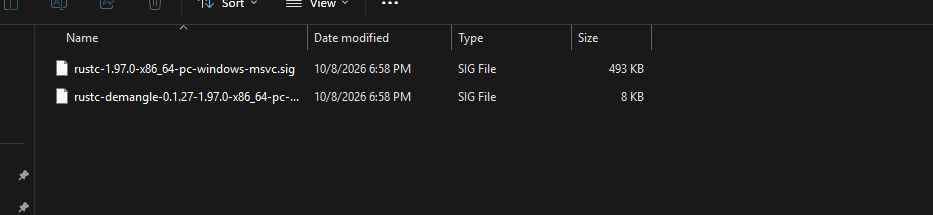
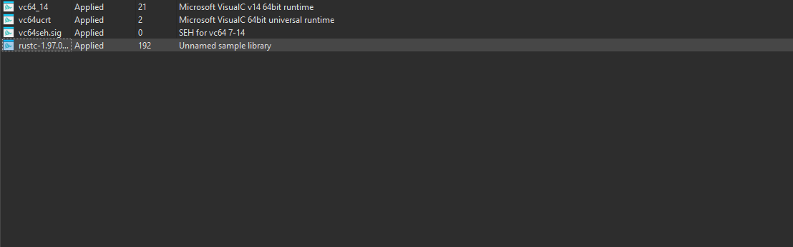
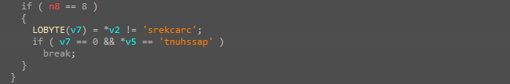
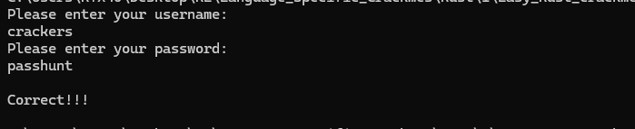

# rust-crackme-easy — Username/Password QWORD Compare (first Rust binary)

> First Rust target. Reads a username and a password, trims each, and gates success on two 8-byte compares against hardcoded constants. Credentials: `crackers` / `passhunt`.

## Metadata

|              |                                                 |
| ------------ | ----------------------------------------------- |
| Platform     | Windows x86-64                                  |
| Language     | Rust (rustc 1.97.0, MSVC toolchain)             |
| Difficulty   | 1.0 / 6                                         |
| Solve type   | Static recovery, confirmed dynamically          |
| Date solved  | 2026-10-31                                      |
| Tools        | IDA Pro 9, Microsoft RIFT (FLIRT for Rust)      |
| Source       | Local archive                                   |

## 1. Goal

Recover the username and password that satisfy the validator and reach the `Correct!!!` branch.

## 2. Triage / Recon

PE64, console target, no packer. Imports and section layout are standard for a Rust/MSVC build. Strings make the shape obvious:

- `Please enter your username:\n`, `Please enter your password:\n`
- `\nWRONG!!!\n`, `\nCorrect!!!\n`
- `failed to read line`, references to `core::result::unwrap_failed` — classic Rust `unwrap()` panic text.

Before touching the decompile, Rust FLIRT signatures were generated with **Microsoft RIFT** against the toolchain used to build the sample (`rustc-1.97.0-x86_64-pc-windows-msvc.sig`, plus `rustc-demangle-0.1.27`), then loaded in IDA. The signature file applied **192 symbols** on top of the usual MSVC runtime sigs (`vc64_14`, `vc64ucrt`, `vc64seh`), which is what makes `std::io::stdio::_print`, `std::io::stdio::stdin`, and `core::result::unwrap_failed` visible by name in the decompile below.




## 3. Static Analysis

`main` is a single function. Pseudocode trimmed to the real logic:

```c
loop {
    // two Rust Strings on the stack: (ptr, len, cap) each
    username = String::new();
    password = String::new();

    std::io::stdio::_print("Please enter your username:\n");
    std::io::stdio::stdin().read_line(&mut username).unwrap();   // sub_...4370

    std::io::stdio::_print("Please enter your password:\n");
    std::io::stdio::stdin().read_line(&mut password).unwrap();

    (u_ptr, u_len) = trim_slice(&username);                      // sub_...1480
    (p_ptr, p_len) = trim_slice(&password);

    if (u_len == 8 && p_len == 8
        && *(u64*)u_ptr == 'srekcarc'
        && *(u64*)p_ptr == 'tnuhssap')
        break;                                                   // Correct!!!

    _print("\nWRONG!!!\n");
    // drop the two Strings, loop again
}
_print("\nCorrect!!!\n");
```

The two helper functions (`sub_...4370`, `sub_...1480`) are `Stdin::read_line` and a slicing helper that strips the trailing `\n` and returns a `(pointer, length)` slice. The validator then does one length check (`== 8`) per field and one QWORD compare per field — nothing else.



## 4. Core Insight

The compare `*v2 == 'srekcarc'` loads 8 bytes from the input into a 64-bit integer and compares against a 64-bit immediate. IDA prints 64-bit integer constants as the MSB-to-LSB ASCII sequence, which **reverses** how the bytes actually sit in memory. Byte-for-byte the input must therefore be the constant read in reverse:

- `'srekcarc'` ⇄ `crackers`  (username)
- `'tnuhssap'` ⇄ `passhunt`  (password)

Both strings are 8 characters, which also matches the length check.

## 5. Dynamic Analysis

Build-and-run on a Windows console, enter the recovered pair, read the output:

```
Please enter your username:
crackers
Please enter your password:
passhunt

Correct!!!
```



## 6. Solution

| Field    | Value       |
| -------- | ----------- |
| Username | `crackers`  |
| Password | `passhunt`  |

Steps:

1. Generate the Rust FLIRT signatures for `rustc-1.97.0-x86_64-pc-windows-msvc` using Microsoft RIFT and load them in IDA; this names the Rust stdlib symbols automatically.
2. Open `main`, locate the two `_print` prompts and the two `read_line` calls.
3. Read the gate: two length-8 checks followed by two QWORD equality compares against `'srekcarc'` and `'tnuhssap'`.
4. Reverse each constant to recover the plaintext (`crackers`, `passhunt`).
5. Run and confirm.

## 7. Key Takeaways

- **First Rust binary.** Setting up Microsoft RIFT once pays off immediately: the Rust standard library collapses into named calls in the decompile, so a validator this small reads end-to-end without any guessing.
- **QWORD immediates in IDA show up reversed.** When the compare is against an 8-char ASCII literal, the memory string is the IDA constant byte-reversed. Same pattern previously seen in `writeup_05` (veryeasycrackme / Go), only the language has changed.
- **Length check + single QWORD compare is a 1.0/6 shape.** The length check is a dead giveaway that the compare is one word, not a loop, and recovery is immediate once the constant is spotted.

## 8. Artifacts

- `Binary/rust-crackme-easy.zip` — the sample.
- `01_rift_generates_rust_flirt_signatures.png` — RIFT output: generated rustc + rustc-demangle `.sig` files.
- `02_ida_applies_rust_signatures_192_symbols.png` — IDA's signature window after loading them (192 symbols applied).
- `03_credential_qword_compares.png` — the credential check in the decompile.
- `04_runtime_crackers_passhunt_correct.png` — runtime proof.
