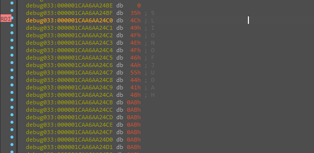
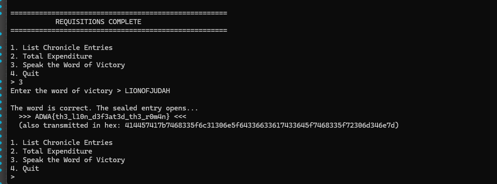

# Adwa Chronicle 1896 — Rust CTF, "Word of Victory" memcmp (dynamic solve)

> Rust CTF crackme themed around the 1896 Battle of Adwa. The user interface walks through a four-step "requisition" ritual and a second menu, but the only real gate is a single `memcmp` in the "Speak the Word of Victory" branch against a locally-built 11-byte buffer. The expected buffer was read live from the debugger (`RDI` → `LIONOFJUDAH`), yielding the flag `ADWA{th3_l10n_d3f3at3d_th3_r0m4n}`.

## Metadata

|                              |                                                |
| ---------------------------- | ---------------------------------------------- |
| Platform                     | Windows x86-64                                 |
| Language                     | Rust (MSVC toolchain)                          |
| Difficulty                   | 2.0 / 6                                        |
| Quality (challenge design)   | 2.5 / 6                                        |
| Solve type                   | Dynamic (debugger-only; static not pursued end-to-end) |
| Date solved                  | 2026-11-01                                     |
| Tools                        | IDA Pro 9 (local Windows debugger), Microsoft RIFT (FLIRT for Rust) |
| Source                       | Local archive                                  |

## 1. Goal

Reach the "Speak the Word of Victory" branch and recover the printed flag.

## 2. Triage / Recon

PE64 Rust console application. The runtime presentation (reproduced from a healthy run):

```
=====================================================
              THE ADWA CHRONICLE - 1896
=====================================================
"I shall not fold my arms and be a spectator when
 countries from afar are coming over to carve up
 Africa amongst themselves."
                            - Emperor Menelik II

Supplies are short. You have 4 requisition orders.
Every order is entered in the chronicle. Choose carefully.

--- Requisition order N of 4 ---
1. Request Ammunition
2. Request Reinforcements
3. Request Medical Supplies
> ...

=====================================================
           REQUISITIONS COMPLETE
=====================================================
1. List Chronicle Entries
2. Total Expenditure
3. Speak the Word of Victory
4. Quit
> ...
```

Microsoft RIFT FLIRT signatures for the Rust standard library (previously generated for the toolchain) were loaded in IDA, which named `std::io::stdio::_print`, `std::io::stdio::Stdin::read_line`, `core::result::unwrap_failed`, and the rest of the stdio/formatting plumbing in the decompile. Without those, the stdio noise would be an unlabelled wall of `sub_*` calls.

**Runtime observation**: the **order of the four requisition choices has no effect on the gate** — entering `1-1-1-1` and `1-2-3-2` both produce the same `LIONOFJUDAH` requirement on the Victory prompt. The requisition subsystem is theatre; the real decision lives in option 3's handler alone.

## 3. Static Analysis

`main` decompiles to roughly 1800 lines of Rust prelude — dense `String`/`Vec` allocation and drop paths, `read_line` unwrap panic handlers, UTF-8 fast/slow write branches for the chronicle entries, and `f32` Display-formatting for the "Total Expenditure" line. A full static walk is possible but slow; a one-day budget felt pessimistic for a challenge whose runtime surface was this small.

The one static anchor that mattered was locating the `case 3` arm of the second menu (the "Speak the Word of Victory" branch) and the `memcmp` call near the end of it: the gate reduces to

```
memcmp(user_input_bytes, built_buffer_bytes, length) == 0
```

Everything upstream of that `memcmp` either prepares the "built buffer" or formats runtime strings for the chronicle. Rather than reverse the construction, the plan was to let the program build the buffer at runtime and read it out of the register at the compare.

## 4. Dynamic Analysis

Launched the sample under IDA's local Windows debugger. Walked the UI to the second menu, selected option 3, and provided a placeholder input (`AAAAAAAAAAA`) at the "Enter the word of victory > " prompt. Stepped forward until execution reached the `memcmp` in option 3's handler.

At the compare, one of the two memcmp pointers (`RDI`) addressed the "expected" buffer. The debugger showed 11 contiguous ASCII bytes followed by uninitialised allocator padding (`0xAB` on this build):

```
4Ch 49h 4Fh 4Eh 4Fh 46h 4Ah 55h 44h 41h 48h  →  L I O N O F J U D A H
```

That is the full gate — one `memcmp` against a locally-built 11-byte buffer whose content, read directly from the debugger, is the ASCII string `LIONOFJUDAH`.



## 5. Core Insight

The chronicle menu, the four requisition rounds, the per-entry logged messages, and the "Total Expenditure" calculation are all narrative decoration — none of their contents, ordering, or counts feed the Victory check. The gate is a single `memcmp` in option 3's handler, and the expected value is **constructed in place** at runtime from a static byte array via an obfuscated per-byte decode. Reading the final decoded buffer live, instead of reversing the decode statically, collapses the 1800-line `main` into a single-byte-sequence observation.

## 6. Solution

Steps:

1. Reach the second menu by completing any four requisition inputs (order is irrelevant).
2. Choose option 3 — "Speak the Word of Victory".
3. Enter: `LIONOFJUDAH`
4. The program prints the flag.

| Field    | Value                                                                                       |
| -------- | ------------------------------------------------------------------------------------------- |
| Password | `LIONOFJUDAH`                                                                               |
| Flag     | `ADWA{th3_l10n_d3f3at3d_th3_r0m4n}`                                                         |
| Flag hex | `414457417b7468335f6c31306e5f64336633617433645f7468335f72306d346e7d`                        |



## 7. Key Takeaways

- **Thick static, thin gate.** 1800 decompiled lines in `main` does not mean the decision is 1800 lines deep — in this challenge the entire verdict is one `memcmp` in one of four menu arms. Finding that compare and reading its "expected" operand live is cheaper than inverting the per-byte decode that builds the operand.
- **Narrative decoration.** The four requisition rounds, the per-entry chronicle messages, and the "Total Expenditure" number are theatre with no influence on the gate. Recognising that early reduces the surface to one branch.
- **Rust FLIRT pays off, again.** Having the Rust standard library pre-named by Microsoft RIFT means the stdio and formatting calls read as themselves in the decompile; the ~1800 lines become scannable in minutes rather than hours.

## 8. Artifacts

- `Binary/crackme.zip` — the sample.
- `01_debugger_rdi_decoded_LIONOFJUDAH.png` — IDA debugger: `RDI` points at the 11-byte expected buffer, bytes read as `LIONOFJUDAH`.
- `02_runtime_LIONOFJUDAH_prints_flag.png` — runtime proof: `LIONOFJUDAH` → `ADWA{th3_l10n_d3f3at3d_th3_r0m4n}`.
