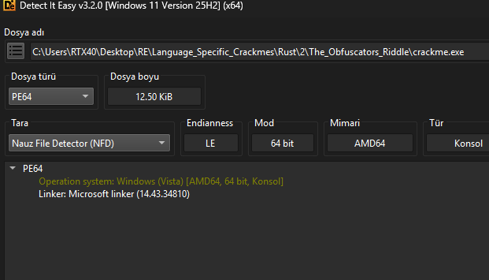
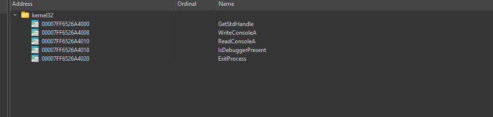
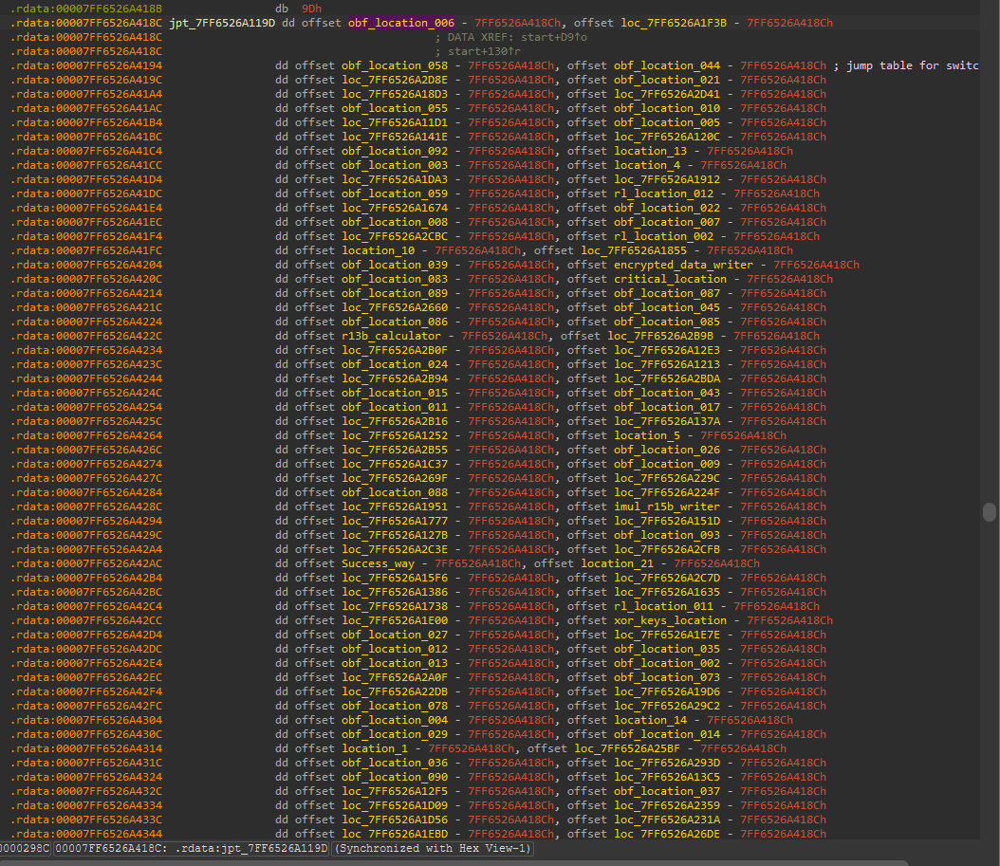
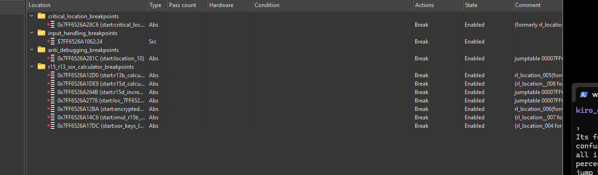
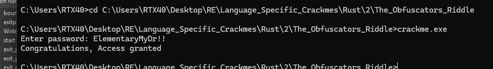

# The Obfuscator's Riddle — 238-Case Jump-Table VM, Keystream Validator, Analytical Inverter

> A 12.5 KiB non-CRT PE64 whose entire validator lives inside one `start` function, routed through a 238-entry jump table that resolves to 109 unique VM handlers. 94 of those handlers are decoys that only advance an opcode byte; the real work is seven handlers that run a 16-iteration per-byte keystream, and one handler that performs a constant-time compare against a static 16-byte reference. An `IsDebuggerPresent` call near the entry forks the VM onto a dedicated "fast fail" path, so a casual single-stepper never reaches the real algorithm. Two IDAPython scripts tag the decoys and rename the real-logic nodes in first-visit order; a 40-line Python inverter recovers the single 16-byte input the pipeline accepts: `ElementaryMyDr!!`.

## Metadata

|                              |                                                                                 |
| ---------------------------- | ------------------------------------------------------------------------------- |
| Platform                     | Windows x86-64                                                                  |
| Language                     | C/C++, MSVC toolchain (linker 14.43.34810, VS 2022)                              |
| Difficulty                   | 4.5 / 6 (self-assessed)                                                         |
| Quality (challenge design)   | 5.0 / 6 (self-assessed)                                                         |
| Solve type                   | Full recovery — static + dynamic + custom tooling + analytical inversion         |
| Date solved                  | 2026-11-05                                                                      |
| Time invested                | ~5 days end to end                                                              |
| Tools                        | IDA Pro 9 (local Windows debugger + IDAPython), Detect It Easy, Python 3        |
| Source                       | Local archive                                                                   |

## 1. Goal

Recover the 16-byte input that drives the `Congratulations, Access granted` branch.

## 2. Triage / Recon

### 2.1 File layout

Detect It Easy reports a PE64 console binary, 12.50 KiB on disk, built with Microsoft linker 14.43.34810 (VS 2022 toolset). No packer, no runtime, no overlay.



### 2.2 Non-standard entry — no CRT, no `main`

The entry point is not the usual `_mainCRTStartup`. IDA puts the cursor on a function literally named `start` that begins with the author's own prologue:

```asm
public start
.text:00007FF6526A1062 start           proc near
.text:00007FF6526A1062                 push    r15
.text:00007FF6526A1064                 push    r14
.text:00007FF6526A1066                 push    r13
.text:00007FF6526A1068                 push    r12
.text:00007FF6526A106A                 push    rsi
.text:00007FF6526A106B                 push    rdi
.text:00007FF6526A106C                 push    rbp
.text:00007FF6526A106D                 push    rbx
.text:00007FF6526A106E                 sub     rsp, 0D8h
.text:00007FF6526A1075                 lea     rcx, lpBuffer_       ; "Enter password: "
.text:00007FF6526A107C                 mov     edx, 10h
.text:00007FF6526A1081                 call    WriteConsoleA_wrapper
```

There is no `_scrt0_init`, no `__security_init_cookie`, no CRT heap bootstrap, no SEH scope — just a direct call into `WriteConsoleA` to print the prompt, followed by `GetStdHandle` and `ReadConsoleA` to read 16 bytes from `STDIN`. This is a bare non-CRT PE. The MSVC flag combination that produces this shape is well known — `/ENTRY:start` (custom entry symbol), `/NODEFAULTLIB` (skip the default C runtime libraries), `/SUBSYSTEM:CONSOLE`, plus `/GS-` to drop the stack cookie prologue. The practical consequence for a reader of the writeup is that there is no stdlib layer to skip past: the first instruction after the function label is already the author's logic.


### 2.3 Imports

Five Win32 APIs, all from `kernel32`, nothing else:

| Address      | Name              | Role in the binary                                   |
| ------------ | ----------------- | ---------------------------------------------------- |
| `0x7FF6…A4000` | `GetStdHandle`    | Fetch `STD_INPUT_HANDLE` for `ReadConsoleA`         |
| `0x7FF6…A4008` | `WriteConsoleA`   | Prompt + final verdict output                       |
| `0x7FF6…A4010` | `ReadConsoleA`    | Read the 16-byte input                               |
| `0x7FF6…A4018` | `IsDebuggerPresent` | Fork the VM onto a dedicated "fast fail" path     |
| `0x7FF6…A4020` | `ExitProcess`     | Terminator                                           |



### 2.4 Decompiler is 95% blind

Opening the function in Hex-Rays recovers roughly 5% of the real control flow. The remainder is a single giant switch dispatched from a jump table of 238 entries — the decompiler shows the entry sequence and the switch skeleton, nothing underneath. All subsequent work was done at the raw assembly level, with IDAPython for the parts that would otherwise take weeks by hand.

### 2.5 Stack frame already names the shape

The stack frame declarations in the IDA listing (after per-session renaming) advertise the design before any instruction is read: `user_input` (xmmword), `length_of_input`, `NumberOfCharsRead`, `xor_key`, `imul_var_r15b`, `Buffer`. The names were set by the author (through IDA's own labeling, not symbol info) during the solve as the roles of each slot became clear — but the roles themselves are evident from use: an input buffer, a running XOR key byte, a 32-bit multiplication accumulator.

## 3. Static Analysis — The VM

### 3.1 The dispatcher

The entire validator is one function dispatched from a single site:

```asm
.text:00007FF6526A117E base_location:                              ; CODE XREF: start+13B↓j
.text:00007FF6526A117E                 test    al, al              ; AL == 0 ⇒ EXIT
.text:00007FF6526A1180                 jz      last_location
.text:00007FF6526A1186                 mov     r14, rdx            ; new r14 ← rdx (passed from previous handler)
.text:00007FF6526A1189                 mov     ebp, ecx            ; new ebp ← ecx (passed from previous handler)
.text:00007FF6526A118B                 movzx   ecx, al
.text:00007FF6526A118E                 mov     al, 9Ch
.text:00007FF6526A1190                 dec     ecx                 ; index = AL - 1
.text:00007FF6526A1192                 movsxd  r8, ds:(jpt - imagebase)[r12 + rcx*4]  ; 238-case table
.text:00007FF6526A1196                 add     r8, r12
.text:00007FF6526A1199                 xor     ecx, ecx
.text:00007FF6526A119B                 xor     edx, edx
.text:00007FF6526A119D                 jmp     r8                  ; dispatch
```

Every VM handler ends with `mov al, <next_opcode>; jmp base_location`. The dispatcher is pure — the only state it preserves between handlers is `r14` (loop index) and `ebp` (accumulator), both routed through `rdx` and `ecx` because every handler zeros those registers before jumping back.


### 3.2 The jump table

The table at `jpt_7FF6526A419D` holds 238 `rva` entries. The dispatcher resolves `target = jpt[AL-1] + imagebase`. Multiple cases alias onto the same handler — this is what inflates 238 cases down to 109 unique handlers.



### 3.3 Why decompilation fails

Hex-Rays sees the dispatch, but the number of successors and the lack of a loop invariant on the opcode byte prevent reconstruction of the control-flow graph. Each handler is a straight-line block that terminates in a known tail-call — a shape that defeats structuring without ground truth on which successor each handler picks. The ground truth is runtime: the AL value a handler sets is often a constant, but 94 of the handlers do nothing except `mov al, <const>; jmp base_location` (the "decoys"), and the real-logic handlers' AL output is still just a constant each. There is no state in the opcode selection to recover statically beyond enumeration.

## 4. Dynamic Analysis — Instrumenting the VM

Two IDAPython scripts, written across days 2 and 3 of the five-day solve, carry the dynamic work.

### 4.1 `vm_loc_dump.py` — first-pass table resolver

A cursor-based reader that walks the jump table from its base address, resolving each 4-byte RVA into an absolute target and printing the opcode → handler mapping. Terminates when it encounters a non-code target. First useful tool for the solve: it enumerated all 238 entries and the 109 unique handler addresses, which was the starting census of what had to be understood.

### 4.2 `vm_handler_profiler.py` — profiling, classifying, auto-renaming

The classic approach — set a hardware breakpoint on the dispatcher's `jmp r8`, run under the debugger, record the handler address each time the BP hits — is sound but produces a trace with 1,173 hits on a clean run. That is unreadable by hand. The profiler script does four things on top of that trace:

1. **Captures the sequential trace.** Every BP hit records (hit#, address, R8, name) into a list.
2. **Classifies each unique handler by static heuristic.** It walks up to 48 instructions of the handler body and tags:
   - `TRIV` — no conditional branch, no memory access, no `call`. These are the 94 decoy nodes that only shuffle AL.
   - `MEM` — touches memory. These are the real-logic nodes.
   - `COND` — contains a conditional jump or `cmov`. These make decisions.
   - `CALL` — issues a `call`. In this binary there is exactly one: the dual `WriteConsoleA` final emitter.
3. **Auto-renames TRIV decoys to `obf_location_NNN`** sorted by address, so the real-logic handlers stand out in the IDA Names window.
4. **Auto-renames real-logic handlers to `rl_location_NNN`** in first-visit order. This step is the one that collapses the problem from "109 opaque targets" to "15 named stages of a readable program".

The profiler output lives at `handler_profile.txt` in this writeup's folder. The key sections it produces:

- **Section 2 — Frequency table.** Shows that the main loop handlers (`rl_002` through `rl_008`, plus `rl_010`) each hit 16 times; the final two handlers (`rl_013`, `rl_014`) hit ~15 times; `rl_015` (the `WriteConsoleA` emitter) hits exactly 2 times. All of these counts match the 16-byte input and the two-call final emit (verdict + newline).

- **Section 3 — Interesting handler bodies.** Prints the raw disassembly of every non-TRIV handler. For a target this size, this is the single most useful artifact in the whole investigation — it shows the entire algorithm in roughly 70 lines.

- **Section 5 — Real execution flow.** The 1,173-hit trace with TRIV decoys filtered out, giving a 164-step sequence that reads like a program:

  ```
  step 1   rl_location_001            (one-time: seed r15 and copy input)
  steps 2..8    rl_002..rl_008        (iteration 1 of the keystream)
  steps 9..15   rl_002..rl_008        (iteration 2)
  … (16 iterations total) …
  step 115  base_location             (branch at the end of iteration 16)
  steps 116..131  rl_010 × 16         (constant-time compare, one byte per step)
  step 132  rl_011                    (test bpl, bpl; setz)
  step 133  rl_012                    (cmovnz — fail/success selector)
  steps 134..162 rl_013 / rl_014      (output decoder loop, 15 iterations)
  steps 163..164  rl_015 × 2          (two WriteConsoleA calls — verdict + \n)
  ```

### 4.3 Breakpoint organisation

To stay oriented during manual stepping, hardware breakpoints were grouped per subsystem in IDA — one group for the anti-debug fork point, one for the critical compare, one for the r13/r15/XOR calculator cluster, one for the input handling. Keeping the groups visible made it practical to toggle whole subsystems off and on while isolating individual stages.



### 4.4 The anti-debug fork

Early in the trace, at a handler the renaming scheme landed on `location_10` (opcode `0x1C`), the VM issues an API call:

```
location_10:
    mov ecx, 0xCB                 ; "no-debugger" opcode
    mov eax, 0xED                 ; "debugger-present" opcode (will be replaced if API returns 0)
    call IsDebuggerPresent
    cmovz eax, ecx                ; EAX = 0 (no debugger) ⇒ take 0xCB
    jmp base_location             ; dispatch on EAX
```

Both input runs (`"crackingout"` and `"abcdabcdabcdabcd"`) under a debugger produce the **same** 22-handler fail chain:

```
0x62, 0x77, 0xD7, 0x11, 0x37, 0x85, 0xE3, 0xD6, 0x81, 0x1C,  ← first 10, shared with clean path
0xEC, 0xB9, 0x0F, 0x5F, 0xD0, 0x7B, 0x91, 0xC5, 0x7E, 0xBF, 0xAA  ← 11 opcode fail tail
```

The last of those (`0xAA` → `location_21`) zeros EAX and jumps back; the dispatcher sees `AL == 0` and routes to `last_location`, which calls `ExitProcess`. The user never sees output.

Running the same inputs **without a debugger** gives a 1,173-hit trace through the real validator. The branch is a single `cmovz`. There is no fingerprinting, no PEB walk, no VEH trick — just one API call on the main path, which is both why it is easy to defeat (patch `cmovz` to unconditional `mov eax, ecx`, or clear `BeingDebugged` in the PEB) and why it is effective at hiding the algorithm from a drive-by single-stepper (if you follow the first interesting-looking branch under the debugger, you end up in a deterministic dead end that gives you nothing).

The clean path is what the rest of the writeup documents.

## 5. The Validator — Named Handlers and Shapes

The six real-logic handlers that compose the main loop, in the order they fire each iteration:

| Rename        | Address         | Static body                                                                                                 | Role                                          |
| ------------- | --------------- | ----------------------------------------------------------------------------------------------------------- | --------------------------------------------- |
| `rl_002`      | `0x7FF6…11267`  | `cmp rbx, length_of_input` + opcode shuffle                                                                 | Loop bounds check against the input length    |
| `rl_003`      | `0x7FF6…124B0`  | `cmp rbx, 10h; jnb bail; mov al, [user_input + rbx]; mov [var_D8], rax`                                     | Fetch input byte `user_input[i]`              |
| `rl_004`      | `0x7FF6…117DC`  | `movzx eax, byte [var_D8]; lea rcx, xor_keys; mov al, [rax+rcx]; mov [var_D0], rax`                         | Substitution lookup: `var_D0 = xor_keys[in[i]]` |
| `rl_005`      | `0x7FF6…112D0`  | `mov r13d, r15d; shr r13d, 8; xor r13b, [var_D0]`                                                           | Produce the output byte for position `i`      |
| `rl_006`      | `0x7FF6…112BA`  | `cmp rbx, 10h; jnb bail; mov [computed + rbx], r13b`                                                        | Write byte `i` of the computed buffer         |
| `rl_007`      | `0x7FF6…114C6`  | `movzx eax, r13b; shl eax, 8; xor eax, r15d; mov [imul_var_r15b], eax`                                      | Feedback: pack new state for next iteration   |
| `rl_008`      | `0x7FF6…11DE9`  | `imul r15d, [imul_var_r15b], 0C2B2AE3Dh`                                                                    | State update multiplication                   |
| (increment, in-handler) | between iterations | `r15d += 1F2E3D4Ch`                                                                              | State update addition — classical LCG step    |


The data at `xor_keys_region` is **256 bytes long** and **a permutation of 0..255** — verified by sorting the dumped bytes and checking that every value from `0x00` to `0xFF` appears exactly once. This is critical to the solution, because a permutation is a bijection and so its inverse exists.


The buffer at `dest_mem_reg` is **exactly 16 bytes**, matching the length of the input.

### 5.1 The pipeline in Python

Combining the handlers in iteration order:

```python
PRIME       = 0xC2B2AE3D         # xxHash32 PRIME32_3
INCREMENT   = 0x1F2E3D4C         # author-chosen LCG constant
SEED        = 0xA5B3C7D9         # initial r15 state (first iteration bypasses the LCG step)
MASK        = 0xFFFFFFFF

r15 = SEED
for i in range(16):
    if i > 0:
        r15 = (prev_imul * PRIME + INCREMENT) & MASK   # rl_008 + the increment handler

    key_byte   = xor_keys[input[i]]                     # rl_004 (substitution lookup)
    out_byte   = ((r15 >> 8) & 0xFF) ^ key_byte         # rl_005
    computed[i] = out_byte                              # rl_006

    prev_imul  = ((out_byte << 8) ^ r15) & MASK         # rl_007 (feedback)
```

Nothing above touches memory other than the 256-byte table lookup and the 16-byte output buffer; nothing calls any API; the only "state" is one 32-bit register `r15` and one 32-bit stack slot `imul_var_r15b`.

### 5.2 The constant-time comparison

After all 16 iterations, the VM dispatches to the compare handler, which runs 16 times (one per byte):

```asm
rl_location_010:                          ; renamed by profiler; opcode 0x21 (plus aliases)
    cmp     r14, 10h
    jnb     bail
    lea     rax, dest_mem_reg
    mov     cl,  [r14+rax]                 ; cl = expected[i]
    xor     cl,  byte [computed + r14]     ; cl = expected[i] ⊕ computed[i]
    or      cl,  bpl                        ; cl |= bpl (OR-accumulate)
    inc     r14
    mov     al,  7Eh                        ; next opcode
    mov     rdx, r14
    jmp     base_location                   ; which does `mov ebp, ecx` → bpl ← cl
```

`bpl` is a one-byte OR accumulator. The subtle part is the write-back path: the handler's own `or cl, bpl` writes into `cl`, not `bpl`. But on the way back through `base_location`, the dispatcher does `mov ebp, ecx`, which copies `cl` into `bpl` for the next iteration. The two handlers together form the classic constant-time pattern:

```
acc = 0
for i in 0..15:
    acc |= expected[i] ^ computed[i]
# acc == 0 iff all 16 bytes match
```

Every byte is read whether or not an earlier byte mismatched — no early-out, no timing leak.

### 5.3 From accumulator to verdict

Two short handlers finish the decision:

```
rl_location_011:                     ; "test bpl, bpl" — capture pass/fail bit
    test    bpl, bpl
    setz    al
    mov     [var_E8], rax

rl_location_012:                     ; cmovnz selects which output region to decode
    test    byte [var_E8], 1
    mov     ecx, 36h                 ; success opcode
    mov     eax, 0C8h                 ; fail opcode
    cmovnz  eax, ecx                 ; if ZF==0, pick 0x36 (success)
    jmp     base_location
```

The verdict is a single `cmovnz`.

### 5.4 Fail/success as a data-pointer choice

The handler that runs 15 times after the verdict (`rl_013` / `rl_014`) is a decode-and-print loop:

```asm
rl_location_014:                      ; opcode 0xBE; the actual byte emitter
    cmp     rdi, 0Eh                  ; 14-byte "Access denied\n" or
                                      ; 30-byte "Congratulations, Access granted\n"
    jnb     bail
    lea     rax, <chosen_region>      ; pointer selected earlier by cmovnz
    mov     al,  [rdi+rax]
    xor     al,  0CDh                 ; XOR-0xCD decoding
    mov     [Buffer + rdi], al
    inc     rdi
    jmp     base_location
```

Both the fail-text region and the success-text region are stored XOR-0xCD-encoded in `.rdata`. Decoding by hand (XOR each byte with `0xCD`):

- `Fail_mem_region` at `0x7FF6…14150` → `"Access denied\n"`
- `Success_mem_region` at `0x7FF6…14130` → `"Congratulations, Access granted\n"`


The decode loop code is **identical** for both branches. The only thing the verdict `cmovnz` changed was the base pointer that the loop reads from. This is the cleanest piece of design in the challenge: the fail/success divergence is not two separate output paths — it is one output path with two different source pointers, chosen by a single conditional move.

## 6. Core Insight

Three observations collapse the challenge:

1. **The 256-byte table is a permutation.** Every byte value `0..255` appears exactly once. Therefore the step `key_byte = xor_keys[input[i]]` is a bijection on the input byte, and its inverse is just `inverse_keys[key_byte] = input[i]`.

2. **The keystream is a bijection in each byte position.** For a given iteration index `i` and a given value of `r15`, the mapping from `input[i]` to `computed[i]` is `input[i] → xor_keys[input[i]] → xor_keys[input[i]] ⊕ (r15 >> 8)`. Both steps are reversible one-byte transformations. Given a target `computed[i]`, there is exactly one `input[i]` that produces it.

3. **The feedback is defined by `computed[i]`, not `input[i]`.** `imul_var = (computed[i] << 8) ⊕ r15`, so once `computed[i]` is pinned to the required value from `dest_mem_reg`, the next iteration's `r15` is also pinned — the entire state trajectory of the validator is determined by the target buffer alone.

The practical implication is that the correct 16-byte input can be recovered byte by byte without searching:

- Compute the required `r15` for position `i` from the previous iteration's feedback (using `dest_mem_reg[i-1]`, not the actual computed byte).
- Compute `pre_xor = (r15 >> 8) & 0xFF`.
- Require `xor_keys[input[i]] == pre_xor ⊕ dest_mem_reg[i]`.
- Look that value up in the inverse table.
- Advance `prev_imul = (dest_mem_reg[i] << 8) ⊕ r15` and continue.

No search, no SMT, no symbolic execution — a 16-iteration inverse pass that runs in microseconds.

## 7. Solution

### 7.1 The inverter

`solve_script.py` in this writeup folder implements the above in ~40 lines:

```python
# 256-entry XOR substitution table dumped from .rdata
xor_keys = [ … 256 bytes … ]

# 16-byte target reference, dumped from .rdata at `dest_mem_reg`
dest_mem_reg = [ 0x8B, 0x4B, 0xB2, 0x5C, 0xD9, 0xA2, 0x9E, 0x4A,
                 0x00, 0x9A, 0xAC, 0x33, 0x7F, 0x6D, 0x35, 0x9D ]

PRIME     = 0xC2B2AE3D       # xxHash32 PRIME32_3
INCREMENT = 0x1F2E3D4C
SEED      = 0xA5B3C7D9
M32       = 0xFFFFFFFF

inverse_keys = [0] * 256
for i, v in enumerate(xor_keys):
    inverse_keys[v] = i

password = bytearray(16)
imul_var = 0
for i in range(16):
    r15 = SEED if i == 0 else (imul_var * PRIME + INCREMENT) & M32
    pre_xor = (r15 >> 8) & 0xFF
    required_key = pre_xor ^ dest_mem_reg[i]
    password[i] = inverse_keys[required_key]
    imul_var = ((dest_mem_reg[i] << 8) ^ r15) & M32

print(password.decode("ascii"))
```

Running it prints the 16-byte password in a single pass:

```
ElementaryMyDr!!
```


### 7.2 Runtime verification

Entering the recovered password at the prompt in a fresh console:

```
C:\…\>crackme.exe
Enter password: ElementaryMyDr!!
Congratulations, Access granted
```



### 7.3 Summary table

| Field                             | Value                        |
| --------------------------------- | ---------------------------- |
| Password                          | `ElementaryMyDr!!`           |
| Password length                   | 16 bytes                     |
| Keystream seed `r15`              | `0xA5B3C7D9`                 |
| LCG multiplier (xxHash32 prime)   | `0xC2B2AE3D`                 |
| LCG increment                     | `0x1F2E3D4C`                 |
| Target buffer at `dest_mem_reg`   | 16 bytes starting `0x8B 0x4B 0xB2 0x5C …` |
| Substitution table at `xor_keys_region` | 256-byte permutation       |
| Fail/success text obfuscation     | XOR-0xCD, 14 and 30 bytes respectively |

## 8. Key Takeaways

- **Tool-building was the whole fight.** The decompiler was 95% blind to a switch-based VM with 238 jump-table entries and 109 unique handlers. A single morning spent building the profiler — a hardware breakpoint on the dispatcher, R8 capture, per-handler static classifier, auto-rename of 94 TRIV decoys to `obf_location_NNN` and 15 real-logic handlers to `rl_location_NNN` in first-visit order — collapsed a 1,173-hit trace to a 164-step readable program. The profiler's output file (`handler_profile.txt`) was the single most valuable artifact of the entire solve.
- **A one-API anti-debug can be structurally expensive even though it is trivially bypassable.** `IsDebuggerPresent` plus one `cmovz` is on every "don't do this" list for anti-tamper authors — but in this binary the branch sits early, both sides share the first 10 handlers, and the fail side runs for 22 handlers to a dead end that produces no output. A reverser who follows the API-return branch under their debugger ends up in a deterministic sink and sees nothing of the real algorithm. The lesson for the reverser is the opposite of the one for the author: resolve the API return before trusting any downstream sequence.
- **Fail/success as a data-pointer choice.** The success/fail divergence after the constant-time compare is a single `cmovnz` that picks between two base pointers for the output-decode loop. The two emitted strings are the same length class, obfuscated the same way (`xor 0xCD`), and run through the same loop. This is good design, and recognising it early (`rl_013`/`rl_014` run the same body regardless of verdict) was the point at which the problem stopped being about control flow and started being about data.
- **The validator is a bijection.** The 256-byte table is a permutation; every byte in the keystream is one XOR + one table lookup, both reversible. The state update is a classical linear-congruential step feeding the next XOR mask. The pipeline has exactly one 16-byte preimage of the target buffer, and that preimage is recoverable in a single forward-order pass over the target.
- **Non-CRT PE recognition.** A 12.5 KiB PE with five kernel32 imports and a `start` entry that begins with the user prologue is the signature of an `/ENTRY:/NODEFAULTLIB/GS-` MSVC build. There is no stdlib layer to skip past; the entry point *is* the author's code. Worth filing this as a recognition pattern: when the imports table has no CRT and the entry is unlabelled `start`, assume the whole thing is handwritten and read from the top.
- **Constant-time compare dispatched through the VM.** The accumulator `bpl` is updated through the VM's own register-passing convention (handler sets `cl`, dispatcher moves `ecx` into `ebp` on re-entry). The pattern is standard for anti-timing in validators, but seeing it threaded through a VM was unusual — and recognising it took the explicit observation that the dispatcher's `mov ebp, ecx` is the write-back half of the accumulate step.

## 9. Artifacts

- `Binary/crackme.zip` — the sample.
- `handler_profile.txt` — full output of `vm_handler_profiler.py` on a clean (non-debugger) run: 1,173-hit sequential trace, frequency table, interesting handler bodies with disassembly, auto-rename maps for both TRIV decoys and real-logic handlers.
- `vm_loc_dump.py` — first-pass IDAPython script that resolves the jump table from the cursor position into a flat `opcode → handler` listing.
- `vm_handler_profiler.py` — the main instrumentation: HW BP on the dispatcher, per-handler static classifier, auto-renamer, trace writer.
- `solve_script.py` — the analytical inverter that produces `ElementaryMyDr!!` in one forward pass over `dest_mem_reg`.
- `01_die_pe64_msvc_linker.png` — PE64 recon.
- `02_start_entry_no_crt_no_main.png` — the raw `start` prologue.
- `03_imports_five_kernel32_apis.png` — the five kernel32 imports.
- `04_dispatcher_base_location.png` — the single VM dispatcher.
- `05_jump_table_238_entries.png` — the 238-entry jump table in `.rdata`.
- `06_xor_keys_256_byte_substitution_table.png` — the 256-byte permutation table.
- `07_dest_mem_reg_16_byte_target.png` — the 16-byte reference the keystream must produce.
- `08_fail_mem_region_xor_cd_access_denied.png` — `Fail_mem_region`, XOR-0xCD encoded "Access denied\n".
- `09_success_mem_region_xor_cd_access_granted.png` — `Success_mem_region`, XOR-0xCD encoded "Congratulations, Access granted\n".
- `10_grouped_hardware_breakpoints.png` — HW BPs organised per subsystem for the dynamic phase.
- `11_solve_script_prints_ElementaryMyDr.png` — `solve_script.py` output.
- `12_runtime_ElementaryMyDr_access_granted.png` — runtime verification.
