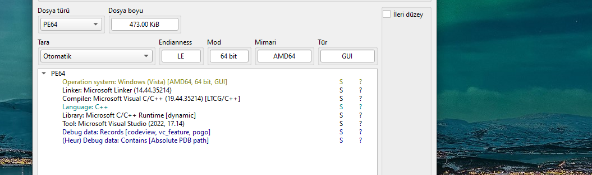

# FLRSCRNSVR — Windows Screensaver, Registry-Resident Validator, Pointer-Arithmetic Compare

> A 473 KiB Windows screensaver (`.scr`) themed around the FLARE-On banner. The config mode writes two registry values to `HKCU\Software\FLRSCRNSVR`: a user-supplied `Text` and a hardcoded `Quak`. The saver mode reads `Text`, feeds it through a three-stage keystream (character substitution → XOR with a nine-character key reinterpreted from a five-DWORD table → full-string reverse), then compares the result to `Quak` through pointer arithmetic that walks the input buffer while indexing into the adjacent `Quak` buffer with a fixed `+520`-wchar stride. Every stage is a bijection in isolation; an analytical inverter recovers the single accepted input, `CMO{frogt4s7ic_r3vers1ng}`. A separate RC4 instance in the paint handler decodes the on-screen congratulation banner once the input is accepted and the frog animation has run long enough to accumulate 3,000 sprite intersections — the only genuine RC4 in the binary, and the one that is *not* gating the challenge.

## Metadata

|                              |                                                                                 |
| ---------------------------- | ------------------------------------------------------------------------------- |
| Platform                     | Windows x86-64 screensaver (`.scr`)                                              |
| Language                     | C/C++, MSVC 2022 (linker 14.44.35214, compiler 19.44.35214), LTCG build          |
| Difficulty                   | 2.0 / 6 (author's rating on crackmes.one)                                        |
| Quality (challenge design)   | 5.0 / 6 (self-assessed — tight, well-themed, three stacked tricks of distinct kind) |
| Solve type                   | Full recovery — static analysis + analytical inverter                            |
| Date solved                  | 2026-11-10                                                                       |
| Tools                        | IDA Pro 9, Detect It Easy, Python 3, `regedit`                                   |
| Source                       | Local archive, originally from crackmes.one                                      |

## 1. Goal

Recover the string that, when entered through the screensaver's **Settings** dialog, causes the saver to accept the input and reveal the final FLARE-themed banner on top of the frog animation.

## 2. Triage / Recon

### 2.1 File layout and compiler shape

Detect It Easy reports a PE64, GUI subsystem, 473.00 KiB on disk, built with the Microsoft Visual C/C++ 19.44 toolchain and linker 14.44.35214 (Visual Studio 2022 17.14 build chain). Compiler mode is `[LTCG/C++]` with codeview + pogo debug records. The binary has an absolute PDB path reference in its debug directory — a cue that the author compiled with full `/Zi` symbols still enabled on the final build.



### 2.2 `.scr` versus `.exe` — the 10% that differs

A Windows screensaver file is a standard PE executable with a `.scr` extension. The on-disk format, the subsystem flag, and the compiler driver are all identical to a regular `.exe` build. The practical differences that matter for a reverser are three, and all of them live outside the binary:

1. **Discovery and installation.** The Windows shell lists `.scr` files from `C:\Windows\System32`, `C:\Windows`, and a few per-user search paths in the Settings → Screen Saver dropdown. Dropping the file into one of those paths is "installation". Right-clicking a `.scr` in Explorer offers an **Install**, **Configure**, and **Test** context menu — these are not special shell verbs; they correspond directly to command-line invocations of the same binary.
2. **A standard command-line contract.** When the Windows screensaver subsystem launches a `.scr`, it passes one of a small set of command-line arguments. The contract is defined by convention, not by any Windows API:

   | Argument      | Mode       | What the saver is expected to do                                       |
   | ------------- | ---------- | ---------------------------------------------------------------------- |
   | `/s`          | Saver      | Run the full-screen screensaver animation on all monitors.             |
   | `/p <HWND>`   | Preview    | Draw the animation inside the small preview window in Settings.       |
   | `/c` or `/c:<HWND>` | Configure  | Pop the configuration dialog (settings for the saver).                 |
   | `/a <HWND>`   | Password   | Legacy, obsolete since Vista; show the "unlock" password dialog.       |

3. **No code changes required to produce a `.scr`.** Any PE that respects the contract above and exposes a `WinMain` can be renamed from `.exe` to `.scr`, dropped into `System32`, and shows up in Settings → Screen Saver. Compilers do not treat `.scr` differently; the extension is a shell affordance.

Everything else — the PE header, the import table, the subsystem, the entry point, the CRT choice — matches the author's intent for an ordinary `.exe` GUI target. The three screens the saver draws (saver, preview, configure) are three branches off the standard `WinMain` command-line parse.

### 2.3 Imports and overall shape

The import table includes `kernel32`, `user32`, `advapi32`, `gdi32`, and (for the paint-time banner) a small number of `msvcrt` helpers through the dynamic C runtime. Three families of API calls carry the challenge logic:

- `RegOpenKeyExW`, `RegCreateKeyExW`, `RegQueryValueExW`, `RegSetValueExW`, `RegCloseKey` — the registry is the state store between the config dialog and the saver.
- `DialogBoxParamW`, `GetDlgItemTextW`, `SetDlgItemTextW`, `EndDialog` — the configure-mode UI.
- `GetDC`, `CreateCompatibleDC`, `CreateCompatibleBitmap`, `DrawTextW`, `BitBlt`, `TransparentBlt`, `IntersectRect` — the frog animation and the final banner draw.

The non-trivial logic is three functions: `WinMain`, `DialogFunc` (configure-mode handler), and `imp_func` (saver-mode validator). A fourth function the IDA session renames `RC4_KEY_GENERATOR` holds the actual keystream transformation. The name is a session-local label chosen before the function's body had been fully mapped — the function implements no part of RC4 and the misleading rename is called out explicitly in **§3.4** below, where it belongs.

## 3. Static Analysis

### 3.1 Command-line fork in `WinMain`

`WinMain` reads `lpCmdLine` and compares the first two wide characters against the three screensaver verbs:

```c
if ( wcsncmp(lpCmdLine, L"/c", 2) == 0 || wcsncmp(lpCmdLine, L"-c", 2) == 0 )
{
    // CONFIGURE mode — pops the settings dialog later
    v10 = 1;
}
else if ( wcsncmp(lpCmdLine, L"/p", 2) == 0 || wcsncmp(lpCmdLine, L"-p", 2) == 0 )
{
    // PREVIEW mode — parses parent HWND, nShowCmd = 4
    v12 = (HWND)wcstoul(lpCmdLine + 3, nullptr, 10);
    nShowCmd = 4;
}
else if ( wcsncmp(lpCmdLine, L"/s", 2) == 0 || wcsncmp(lpCmdLine, L"-s", 2) == 0 )
{
    // SAVER mode — full-screen animation on primary monitor
    nShowCmd = 3;
    dword_7FF60F0C8980 = 1;    // mouse-down-exits latch
}
```


Later, `WinMain` registers a window class, calls `sub_7FF60F0C2BF0` to create the top-level window (which internally picks saver/preview geometry based on `nShowCmd`), and then enters one of two code paths:

- If the configure flag `v10` was set, call `DialogBoxParamW(hInstance, 0x82, nullptr, DialogFunc, 0)` — modal settings dialog, then exit.
- Otherwise, run the standard `GetMessageW` / `TranslateMessage` / `DispatchMessageW` loop until the animation ends.

### 3.2 Config mode (`/c`): persisting `Text` and `Quak` to the registry

`DialogFunc` is a standard Win32 dialog procedure, dispatching on `uMsg`:

- **`WM_INITDIALOG` (0x110).** Calls `imp_func` to compute an initial string, then pre-fills the dialog's edit control (ID `1001`) via `SetDlgItemTextW`. `imp_func` on first run always writes `L"Crackmes.one"` into the buffer, because the `HKCU\Software\FLRSCRNSVR` key does not yet exist.
- **`WM_COMMAND` (0x111) + `IDOK` (1).** The user clicked **OK** in the settings dialog. Flow is:
  1. `GetDlgItemTextW(hDlg, 1001, String_to_Text_Registry, 256)` — pull the typed string.
  2. `RegCreateKeyExW(HKCU, L"Software\\FLRSCRNSVR", …, &hKey, nullptr)` — ensure the key exists.
  3. `RegSetValueExW(hKey, L"Text", 0, REG_SZ, String_to_Text_Registry, 2 * len + 2)` — write the user's input as the `Text` value.
  4. Reopen the same key and `RegSetValueExW(hKey, L"Quak", 0, REG_SZ, aQj, 0x34)` — write a hardcoded 52-byte (26-wchar) buffer as the `Quak` value. The source bytes come from the global `aQj` in `.rdata` and are **the same** on every machine: this is the target the saver mode will compare against.

Both values live under one registry key:

```
HKEY_CURRENT_USER
    Software
        FLRSCRNSVR
            Text  = <whatever the user typed>
            Quak  = <hardcoded 25-wchar validator target + null>
```

The `Quak` buffer is 25 non-null wchars followed by a null terminator. Dumping it from `.rdata`:

```
Offset 0x00: 3C 00 51 00 6A 00 09 00 02 00 07 00 25 00 03 00
Offset 0x10: 30 00 08 00 04 00 29 00 68 00 24 00 01 00 24 00
Offset 0x20: 18 00 6B 00 77 00 0F 00 70 00 36 00 02 00 0E 00
Offset 0x30: 0B 00                                              ← last meaningful byte + null
```

Twenty-five little-endian WORDs: `0x003C`, `0x0051`, `0x006A`, `0x0009`, `0x0002`, …, `0x000B`. These are **not** printable ASCII — they are the post-transform output of the correct input, which is what the saver mode will produce and then compare.

### 3.3 Saver mode (`/s`): reading `Text`, transforming, comparing

In saver mode the window-procedure's `WM_PAINT` handler eventually calls `imp_func`, which carries the real validator logic:

1. Open `HKCU\Software\FLRSCRNSVR` for read.
2. If the key is missing, write `L"Crackmes.one"` to the output buffer and bail — the saver will later show the default banner.
3. Otherwise, read the `Text` value into a local wchar buffer `string_that_will_get_written_to_text_registry`. If the read fails or the string is empty, fall back to `L"Crackmes.one"`.
4. Walk the buffer to compute its length. **If the length is exactly 25 wide characters**, proceed. Any other length skips the compare entirely and returns silently.
5. Copy the string into `crackmes_one_string_1[256]` (a 512-byte stack buffer).
6. Call `RC4_KEY_GENERATOR(crackmes_one_string_1)` — misnomer; the real transformation (§3.4).
7. Call `sub_7FF60F0C1890(v35)` where `v35[256]` is the stack buffer **immediately following** `crackmes_one_string_1` — this helper reads the `Quak` registry value (or defaults to `aQj`) into `v35`.
8. Compare the two buffers via the pointer-arithmetic trick (§3.6).
9. On full match, set the global `Success_flag = 1`.

The exact-25 length check means the correct answer is always 25 wchars long. The `Quak` buffer being 25 wchars is the other half of the length constraint.

### 3.4 The transformation (misnamed `RC4_KEY_GENERATOR`)

The function labelled `RC4_KEY_GENERATOR` in the IDA session is a user-set rename made before the function's body was fully understood. The function implements **no** RC4: there is no 256-byte S-box initialization, no permutation step, no stream generation, no key-byte iteration against a sliding `i`/`j` pair. The rename is retained in the writeup for consistency with the artifact folder's names, but every reference to it below describes what the function actually does.

The function performs three stages, in order, on the 25-wchar input:

**Stage 1 — Character substitution.** Two parallel 67-character strings are built on the stack:

```
str1 = "abcdefghijklmnopqrstuvwxyzABCDEFGHIJKLMNOPQRSTUVWXYZ0123456789}_{=-"
str2 = "-={_}9876543210ZYXWVUTSRQPONMLKJIHGFEDCBAzyxwvutsrqponmlkjihgfedcba"
```

For each character `c` in the input, the function finds `c`'s position in `str1` with `wcschr`, then overwrites it with the character at the same position in `str2`. In Python terms:

```python
input[i] = str2[str1.index(input[i])]
```

`str1` is the alphabet `a..zA..Z0..9` plus the five symbols `} _ { = -`. `str2` is the same set in reverse order. The substitution is thus a straight character-level reversal of the alphabet, applied per position — a permutation of the character set, which makes it a bijection.

**Stage 2 — XOR with the FLARERALF keystream.** After the substitution, the function builds a five-DWORD local array `v32`:

```c
v32[0] = 0x004C0046;
v32[1] = 0x00520041;
v32[2] = 0x00520045;
v32[3] = 0x004C0041;
v32[4] = 0x00000046;
```

It computes `v10` as the length of this array read as little-endian 16-bit WORDs. The DWORD→WORD reinterpretation is covered in detail in §3.5; the result is `v10 == 9` and the WORD view is the ASCII sequence `F L A R E R A L F`. Then:

```c
for ( m = 0; m < v11; ++m ) {                    // v11 = 25 (input length in wchars)
    LOWORD(v25) = *((_WORD *)v32 + m % v10) + m; // key_word = flare[m % 9] + m
    *(_WORD *)(crackmes_one_string + 2 * m) ^= v25;
}
```

Each wchar of the input is XORed with `flare[m % 9] + m`, where `m` is the position index and `flare` is the nine-byte FLARERALF key. The `+ m` term injects a position-dependent offset so that two identical input bytes do not produce identical output bytes.

**Stage 3 — Full-string reverse.** The final loop reverses the 25-wchar buffer in place using a classic two-pointer swap:

```c
v12 = 0; v28 = &input[v11 - 1];
while ( v12 < v11 >> 1 ) {
    v29 = input[v12];
    input[v12] = *v28;
    *v28 = v29;
    ++v12; --v28;
}
```

After these three stages, `crackmes_one_string_1` holds the post-transform buffer. The function returns, and control returns to `imp_func` which fetches `Quak` into the parallel buffer and performs the comparison.

### 3.5 The FLARERALF XOR key — DWORD → WORD reinterpretation

The key material is stored in the function as five 32-bit immediates:

```
v32[0] = 0x004C0046
v32[1] = 0x00520041
v32[2] = 0x00520045
v32[3] = 0x004C0041
v32[4] = 0x00000046
```

On an x86-64 target, 32-bit values are stored in memory little-endian: least significant byte at the lowest address. Writing those five DWORDs into the stack produces this byte sequence:

```
Offset:  0  1   2  3   4  5   6  7   8  9  10 11  12 13  14 15  16 17  18 19
Bytes:  46 00  4C 00  41 00  52 00  45 00  52 00  41 00  4C 00  46 00  00 00
```

The function then reads the same memory **as 16-bit WORDs** instead of as 32-bit DWORDs — this is the `*((_WORD *)v32 + m % v10)` cast in the XOR loop. Reading each pair of bytes as a little-endian WORD gives the sequence:

```
WORD:   0x0046  0x004C  0x0041  0x0052  0x0045  0x0052  0x0041  0x004C  0x0046  0x0000
Char:    F       L       A       R       E       R       A       L       F       \0
```

Nine printable wide characters, then a null terminator — so the length probe in `v10` loops until the first zero WORD and lands on **nine**. The key is the palindromic string `FLARERALF`, chosen so that the DWORD immediates themselves look like a random lookup table but the WORD view is a legible nod to the FLARE-On banner.

This DWORD→WORD reinterpretation is the key design trick in the transformation layer. Reading the five DWORDs *as DWORDs* in the decompile shows no obvious key; the FLARE pattern only emerges when the same bytes are viewed at half the natural width.

### 3.6 The pointer-arithmetic comparison

After the transformation, `imp_func` holds two 25-wchar buffers on the stack:

```c
wchar_t crackmes_one_string_1[256];   // [rsp+0x2C0]  —  post-transform user input (512 bytes)
...other locals in between (variable gap)...
wchar_t v35[256];                      // [rsp+0x6D0]  —  Quak target, read from registry (512 bytes)
```

The byte distance between the two buffers' starts is `0x6D0 - 0x2C0 = 0x410 = 1040 bytes`. In wchars, that is `1040 / 2 = 520`.

The comparison is then written as this short loop:

```c
v15 = crackmes_one_string_1;
do {
    v16 = v15[520];                  // one wchar at base + 520 wchars  →  Quak[i]
    v17 = *v15 - v16;                // delta between input[i] and Quak[i]
    if ( v17 != 0 )
        break;                        // mismatch — leave v17 nonzero
    ++v15;
} while ( v16 != 0 );                // continue until the Quak terminator

if ( v17 != 0 ) {
    /* mismatch path — a cosmetic DC/bitmap drive-by, Success_flag stays 0 */
} else {
    /* match path */
    Success_flag = 1;
}
```

Reading this as a strcmp on `v15` is natural but wrong. The subscript `v15[520]` is *not* an index into the user-input buffer; the array only has 256 wchars. The expression `v15[520]` is pointer arithmetic that dereferences the memory address `v15 + 520 wchars = v15 + 1040 bytes`, which lands exactly on `v35[0]`, which contains `Quak[0]`. As `v15` is advanced byte by byte, `v15[520]` also advances byte by byte through `Quak`.

The loop terminates on either a mismatch (`v17 != 0`) or the Quak terminator (`v16 == 0`). On full match, `v17 == 0`, both the transformed input and `Quak` are 25 wchars long, and `Success_flag` is set to `1`.

This is a familiar C-level idiom used as an obfuscation: a reader scanning the function body sees a tight loop that *looks* like it is comparing a buffer against itself at some weird offset, with the real comparison target hidden by the fact that the array declaration `wchar_t crackmes_one_string_1[256]` does not acknowledge that there is another live buffer sitting 520 wchars later. The decompiler annotates `v15[520]` without qualification, offering no hint that the index crosses the declared bound of the array.

### 3.7 The real RC4 — in the paint handler, for the final banner

The window-class procedure `Procedure_Of_Class` handles `WM_PAINT` by drawing the frog animation and, under one condition, decoding and displaying a congratulation banner. The condition is `byte_7FF60F0C8899 != 0`, a sentinel that is set to `1` only after the animation's `WM_TIMER` handler has observed **3,000** rectangle intersections between frog sprites. The frog bounce loop advances positions each tick and tests pairs with `IntersectRect`; the global `dword_7FF60F0C8984` is bumped every time two frogs intersect, and the sentinel flips once it crosses 3,000.

Once the sentinel is set, the paint handler does the following:

1. `wcstombs_s(…, Dst, 0x100, Src, 0xFFFFFFFFFFFFFFFF)` — convert a global `Src` wide string into a multi-byte buffer `Dst`.
2. `qmemcpy(encrypted_bytes, byte_7FF60F0C8280, 18)` — copy 18 bytes of ciphertext from `.rdata` into a stack buffer.
3. `RC4_KSA_Alg(FindFileData, Dst, PtNumOfCharConverted.left - noise_var_0 - 1)` — initialize an S-box in the `FindFileData` scratch area, keyed with `Dst` and the computed length. This is a genuine RC4 key-scheduling algorithm (`for i: j = (j + S[i] + key[i % keylen]) & 0xFF; swap(S[i], S[j])`).
4. A hand-inlined RC4 PRGA loop then runs 18 iterations:
   ```
   i = (i + 1) & 0xFF;
   j = (j + S[i]) & 0xFF;
   swap(S[i], S[j]);
   encrypted_bytes[idx] ^= S[(S[i] + S[j]) & 0xFF];
   ```
   The loop is written in the decompile with `HIBYTE(FindFileData.cFileName[106])` and `LOBYTE(FindFileData.cFileName[106])` as the `i` and `j` registers — the two state bytes live in the same word of the `FindFileData` struct, which is a readability obfuscation but not a functional one.
5. Check three bytes of the decrypted buffer against **three fingerprints**:

   ```c
   if (   encrypted_bytes[0] == Success_flag + 69
       && encrypted_bytes[1] == Success_flag + 75
       && encrypted_bytes[2] == 83 - Success_flag )
   {
       /* draw encrypted_bytes[3..17] as the banner */
   } else {
       /* fallback to L"Crackmes.one" */
   }
   ```

   With `Success_flag == 1`, the required three bytes are `70, 76, 82`, i.e. `'F', 'L', 'R'`. With `Success_flag == 0`, the required bytes would be `69, 75, 83`, i.e. `'E', 'K', 'S'` — which would never match the RC4 plaintext, since the plaintext begins with `"FLR"` regardless of `Success_flag`. The three-byte check is a success-flag integrity binding: the paint handler cannot show the real banner unless the saver's validator had set `Success_flag = 1`.

The real RC4 is thus a **display gate**, not a validation gate. The challenge is already decided at the point `imp_func` sets `Success_flag`. The RC4 and the frog-intersection counter only control whether the user eventually sees the "well done" banner on top of the animation. A reverser who follows the RC4 chain looking for the input constraint will spend time well upstream of the actual decision site in `imp_func`.

### 3.8 Noise and decoys

The decompile is heavily padded with instructions whose only purpose is to lengthen the function bodies and dilute the real logic. Every function in the binary contains some combination of:

- `dwErrCode = GetTickCount() % 0x64 + 5; SetLastError(dwErrCode);` — writes a benign error code based on the tick count. Never read.
- `v24 = 5; do { ++dwErrCode; --v24; } while ( v24 != 0 );` — a counted five-iteration bump of a local. The result is overwritten before next use.
- `GetDC(nullptr); CreateCompatibleDC; CreateCompatibleBitmap(…, 1, 1); DeleteObject; DeleteDC; ReleaseDC;` — allocates and immediately releases a 1-pixel-by-1-pixel compatible bitmap. The handle is never used.
- `GetWindowsDirectoryW(Buffer, 0x104); wcscat_s(Buffer, 0x104, L"*.dll"); FindFirstFileW(Buffer, &FindFileData); FindClose;` — a throwaway file enumeration of `C:\Windows\*.dll`. The `FindFileData` structure is sometimes reused later as scratch space (see §3.7 — the RC4 S-box is placed inside it); in most call sites the enumeration output is discarded.
- `GetDesktopWindow(); IsWindow(hWnd);` — reads the desktop HWND, tests whether it is a window (always true), discards the result.
- `QueryPerformanceCounter(&PerformanceCount);` — reads a timestamp into a local, never read.
- `noise_func()` — tests `PEB.ReadImageFileExecOptions`, a reserved and typically-zero PEB field, and does nothing on either branch.

None of these affect state. Reading them out of the decompile and flagging each one as decoy is a mechanical pass. The volume is significant — the five functions in §3.1–§3.4 contain **roughly one noise block for every two statements of real logic** — so the eye adapts quickly, but the first pass is noisy enough to disrupt flow.

## 4. Dynamic Analysis

### 4.1 First-run default

Installed to `%SystemRoot%\System32\FLRSCRNSVR.scr` and launched through **Settings → Lock screen → Screen saver**. The first run writes nothing to the registry, so `imp_func` falls through to `L"Crackmes.one"`, the saver draws the frog animation, the `WM_PAINT` handler reads `qword_7FF60F0C89A8` as a bitmap for the frogs, and the banner text displays as the default `L"Keep Calm and FLARE On"` behind the sprites until enough intersections accumulate.


### 4.2 Mapping the stack layout at the compare

Setting a breakpoint at the pointer-arithmetic compare inside `imp_func` after calling `sub_7FF60F0C1890` confirms the stack layout: `crackmes_one_string_1` at `[rsp+0x2C0]` holds the post-transform user input, `v35` at `[rsp+0x6D0]` holds the registry-read `Quak`, and the two buffers are exactly 520 wchars apart. The compare walks both in lockstep.

### 4.3 Confirming the Quak target

Dumping the 25 non-null wchars at `v35` after the registry read matches, byte-for-byte, the `aQj` constant in `.rdata` — the same bytes that `DialogFunc` writes to the registry's `Quak` value on first configuration. This is the fixed target the inverter must drive the transformation to.

## 5. Core Insight

Three observations collapse the challenge to a single analytical pass.

1. **Each stage of the transformation is a bijection in isolation.** The substitution table maps the 67 printable alphabet characters to a permutation of themselves (character-level bijection). The XOR step maps a wchar at position `m` to `wchar ⊕ (flare[m%9] + m)`, which is a bijection in the wchar input for each fixed `m`. The reversal is a trivial bijection on the whole buffer. Composition of bijections is a bijection, and inversion is the composition of each stage's inverse in reverse order.

2. **The target is fixed, not derived.** The `Quak` value written to the registry is a hardcoded constant in `.rdata`. There is no per-machine salt, no computer-name mixing, no timestamp. The relationship between the user's input and `Quak` is pure function composition, invertible by hand once the three stages are mapped.

3. **The RC4 is downstream of the decision.** The real RC4 in the paint handler acts on a different buffer entirely and is gated by `Success_flag`, which was already set by the end of `imp_func`. A reverser can ignore the RC4 for the purpose of finding the input — reading its 18 ciphertext bytes is only relevant to the question "what is the final on-screen banner?", not to "what is the correct input?".

## 6. Solution

### 6.1 The inverter

`solve_script.py` reverses the three stages in opposite order:

```python
# Step 1 — Undo reverse
step1 = quak[::-1]

# Step 2 — Undo XOR (same key, same formula; XOR is self-inverse)
step2 = [ step1[i] ^ (i + flare[i % 9]) for i in range(25) ]

# Step 3 — Undo substitution (str2 → str1)
inv_subst = dict(zip(str2, str1))
flag = "".join(inv_subst.get(chr(c), chr(c)) for c in step2)
print(f"Flag: {flag}")
```

Running the script prints:

```
Flag: CMO{frogt4s7ic_r3vers1ng}
```

### 6.2 Runtime verification

Opening the screensaver's **Settings** dialog, entering `CMO{frogt4s7ic_r3vers1ng}`, and clicking **OK** causes `DialogFunc` to:

1. Write `Text = CMO{frogt4s7ic_r3vers1ng}` to `HKCU\Software\FLRSCRNSVR`.
2. Write the hardcoded `Quak` to the same key.

Starting the saver (`/s` mode) then:

1. Reads `Text` back from the registry.
2. Runs the three-stage transformation.
3. Compares the result to `Quak` via the pointer-arithmetic walk.
4. Finds all 25 wchars equal.
5. Sets `Success_flag = 1`.

The frog animation then runs. After enough on-screen intersections to trip the 3,000 counter, the paint handler flips the sentinel, decrypts the 18-byte RC4 ciphertext, verifies the `FLR` prefix (which now matches because `Success_flag == 1`), and draws the full FLARE-themed banner from `encrypted_bytes[3..17]` on top of the sprites.

### 6.3 Summary table

| Field                           | Value                                                      |
| ------------------------------- | ---------------------------------------------------------- |
| Input (the flag)                | `CMO{frogt4s7ic_r3vers1ng}`                                |
| Input length                    | 25 wide characters                                         |
| Registry location               | `HKCU\Software\FLRSCRNSVR\Text` (user), `…\Quak` (target)   |
| XOR key (WORD view)             | `FLARERALF` (`0x0046 0x004C 0x0041 0x0052 0x0045 0x0052 0x0041 0x004C 0x0046`) |
| XOR key (DWORD view)            | `{ 0x004C0046, 0x00520041, 0x00520045, 0x004C0041, 0x00000046 }` |
| Substitution table              | 67-char alphabet, mapped to its reverse                     |
| Stage order (forward)           | substitute → XOR with `flare[i%9] + i` → full-string reverse |
| Compare type                    | pointer-arithmetic walk, `v15[520]` reaches the adjacent `Quak` buffer |
| Success sentinel                | `Success_flag = 1`                                          |
| Secondary gate                  | 3,000 sprite intersections before paint handler decodes RC4 banner |
| Banner RC4 prefix check         | `[0]=='F', [1]=='L', [2]=='R'` (iff `Success_flag == 1`)    |

## 7. Key Takeaways

- **`.scr` is `.exe` in a different hat.** The screensaver subsystem is a shell convention around a standard PE. The only reverser-visible differences are discovery (Settings → Screen Saver dropdown, `System32` location), a conventional command-line contract (`/s`, `/p`, `/c`, `/a`), and the three branches off `WinMain` that match those modes. Everything else — PE format, imports, calling conventions, debugger behaviour — is the same as a regular GUI `.exe`.
- **IDA session renames are hypotheses, not facts.** `RC4_KEY_GENERATOR` was a user-set label chosen from the function's shape before its body was fully mapped — it turned out to be a misnomer, and the real RC4 was in a different function entirely. Renames are debugging shortcuts; the body of each function has to be verified against its name before the label is trusted downstream.
- **DWORD → WORD reinterpretation is a quiet layout trick.** The FLARERALF key stored as five DWORDs produces no legible string in the decompile; the same bytes read as WORDs are a nine-character pattern that reads as a FLARE reference. Any time a key or table is laid out at a width different from the native width of its elements, the shift in view is worth attempting first.
- **Pointer-arithmetic compare across adjacent stack buffers is a recognisable idiom.** When a decompiler shows a loop that indexes a declared array far past its bound, the real target is usually another live variable sitting at a predictable offset in the function's stack frame. Checking the stack layout at the comparison instruction confirms this quickly.
- **The RC4 instance was downstream of the decision.** A real RC4 implementation sits in the paint handler and runs after `Success_flag` is already set. A reverser who followed the RC4 looking for the input constraint would be chasing a display gate rather than a validation gate. The validation lives in `imp_func`, in the three-stage transformation and the pointer-arithmetic compare — the RC4 only controls whether the final banner shows.
- **Noise is a readability tax, not a correctness tax.** Every function body is heavily padded with `SetLastError`, five-iteration counting loops, 1-by-1 compatible bitmaps, and throwaway `Windows\*.dll` enumerations. None of them affect state. Learning to filter the noise on first read is faster than trying to understand each decoy as it appears.
- **FLARE-On themeing is a tell, not a solve.** The challenge is FLARE-themed throughout — the XOR key is `FLARERALF`, the default banner reads "Keep Calm and FLARE On", the file name is `FLRSCRNSVR`, the RC4 plaintext begins with `FLR`. These are decorative and do not reveal the input, but they do confirm from the first run that the author built the challenge in a FLARE-On idiom. On crackmes.one the flag format (`CMO{…}`) is the canonical "crackmes.one" flag wrapper, and the inner text (`frogt4s7ic_r3vers1ng` → "frogtastic reversing") rewards sticking with the frog animation long enough to earn the on-screen banner.

## 8. Artifacts

- `Binary/FLRSCRNSVR.zip` — the sample.
- `solve_script.py` — the three-stage inverter; dumps the 25-wchar `Quak` buffer, reverses, un-XORs with `flare[i%9] + i`, applies the inverse substitution, prints `CMO{frogt4s7ic_r3vers1ng}`.
- `01_die_pe64_msvc_screensaver.png` — Detect It Easy output: PE64 GUI, MSVC 2022 LTCG, 473 KiB.
- `02_winmain_commandline_fork_c_p_s.png` — the `/c`, `/p`, `/s` dispatch in `WinMain`.
- `03_first_run_default_frog_banner.png` — first run with no registry key set; frog animation with the default `Keep Calm and FLARE On` banner behind the sprites.
