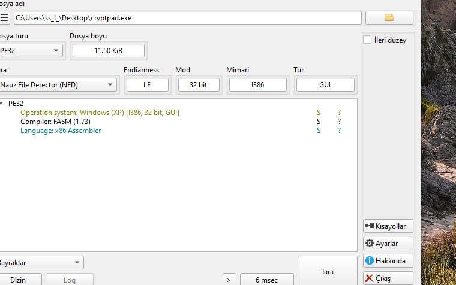
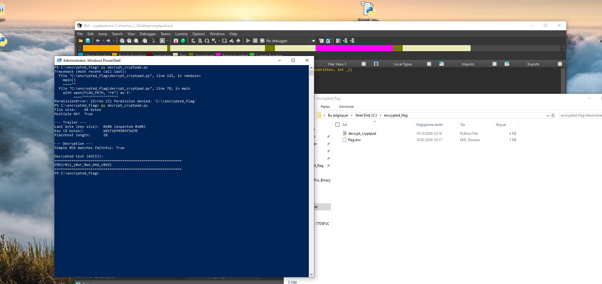

# cryptpad — FASM-Built Note Editor, "Key-with-Ciphertext" RC4

> A 11.5 KiB FASM-built PE32 that advertises itself as a notepad with "encrypted save". The save path wraps RC4 (8-byte key, extended to 256 bytes for the KSA) in a pre-XOR / post-XOR sandwich that uses the same cycling 8-byte key — the two outer layers cancel at every position, so the pipeline is mathematically identical to plain RC4. The key is written to the last 13 bytes of the output file as a plaintext trailer (`[plaintext_len:4] [key:8] [size:1]`); anyone holding the `.enc` file holds the key. The accompanying `flag.enc` decrypts in a single pass to `CMO{r0ll_y0ur_0wn_b4d_c0d3}` — the flag text itself a direct quotation of the "don't roll your own crypto" axiom the challenge is built around.

## Metadata

|                              |                                                                                 |
| ---------------------------- | ------------------------------------------------------------------------------- |
| Platform                     | Windows x86 (32-bit, GUI subsystem)                                              |
| Language                     | x86 assembly, FASM 1.73 (Flat Assembler)                                         |
| Difficulty                   | 2.0 / 6 (author's rating on crackmes.one)                                         |
| Quality (challenge design)   | 4.0 / 6 (self-assessed — the "roll your own crypto" idea is textbook, but the trailer encoding and the cancelling XOR sandwich are nicely themed) |
| Solve type                   | Full recovery — static analysis + Python inverter                                |
| Date solved                  | 2026-11-12                                                                       |
| Tools                        | IDA Pro 9, Detect It Easy, Python 3, hex editor                                   |
| Source                       | Local archive                                                                     |

## 1. Goal

Recover the plaintext of the provided `flag.enc` file. The expected output is a crackmes.one `CMO{…}` flag.

## 2. Triage / Recon

### 2.1 File shape

Detect It Easy reports a PE32, GUI subsystem, **11.50 KiB on disk**, 32-bit I386, built with **FASM 1.73**. The language tag reads "x86 Assembler" — no high-level compiler, no C runtime library tag. A binary of this size with those tags has no CRT dependency and no stdlib wrappers; everything the program does is a direct Win32 API call.



### 2.2 FASM entry — no CRT, no `WinMain`

The entry point `start` is reached by the Windows loader directly. There is no `_mainCRTStartup`, no `__security_init_cookie`, no `WinMainCRTStartup`. `start` runs the full Win32 window-registration sequence inline:

```c
void __noreturn start()
{
    hInstance = GetModuleHandleA(nullptr);

    /* fill WNDCLASSEXA at &stru_40242D */
    stru_40242D.lpfnWndProc    = Window_Procedure;
    stru_40242D.hIcon          = LoadIconA(hInstance, (LPCSTR)0x7F00);  // IDI_APPLICATION
    stru_40242D.hCursor        = LoadCursorA(nullptr, (LPCSTR)0x7F00);  // IDC_ARROW
    stru_40242D.lpszClassName  = ClassName;
    stru_40242D.cbClsExtra     = 0;
    stru_40242D.cbWndExtra     = 0;
    /* … */

    if ( RegisterClassExA(&stru_40242D) != 0
      && (hMenu = LoadMenuA(hInstance, (LPCSTR)1),
          (hWnd = CreateWindowExA(0, ClassName, Caption, 0xCF0000,
                                  CW_USEDEFAULT, CW_USEDEFAULT, 700, 500,
                                  nullptr, hMenu, hInstance, nullptr)) != nullptr) )
    {
        ShowWindow(hWnd, 1);
        UpdateWindow(hWnd);
        while ( GetMessageA(&Msg, nullptr, 0, 0) )
        {
            TranslateMessage(&Msg);
            DispatchMessageA(&Msg);
        }
    }
    else
    {
        MessageBoxA(nullptr, Text, Caption, MB_ICONHAND);
    }
    ExitProcess(Msg.wParam);
}
```

This is the stereotypical FASM shape — a Win32 program expressed in direct API calls with no stdlib layer in between. The practical consequence for a reverser is that `start` carries only glue code; the application logic lives entirely in `Window_Procedure`, which is the function pointer the registered class dispatches on.

### 2.3 Imports and overall structure

The import table pulls from five DLLs, each contributing a small, functionally obvious set of calls:

- **user32** — windowing (`CreateWindowExA`, `SendMessageA`, `DispatchMessageA`, `GetMessageA`, `TranslateMessage`, `DefWindowProcA`, `RegisterClassExA`, `LoadIconA`, `LoadCursorA`, `MessageBoxA`, `ShowWindow`, `UpdateWindow`, `SetWindowTextA`, `GetWindowTextLengthA`, `GetWindowTextA`, `LoadMenuA`, `PostQuitMessage`)
- **gdi32** — font creation (`CreateFontA`)
- **comdlg32** — save-file dialog (`GetSaveFileNameA`)
- **advapi32** — randomness (`RtlGenRandom`)
- **kernel32** — process / heap / file I/O (`GetModuleHandleA`, `GetProcessHeap`, `HeapAlloc`, `HeapFree`, `CreateFileA`, `WriteFile`, `CloseHandle`, `ExitProcess`)

Only `RtlGenRandom` is interesting — the binary generates randomness, and the places it does so pin down where keys and padding originate. Everything else is standard UI plumbing.

The application logic reduces to four functions: `Window_Procedure`, `Save_File`, `Imp_func`, and `RC4_KSA_PRGA`. The last of those carries the crypto; it is the only non-trivial function in the binary.

## 3. Static Analysis

### 3.1 The notepad-like UI

The window class's `WM_CREATE` handler (`Msg == 1`) spawns a single child `EDIT` control that fills the client area at 700 × 500 pixels, configured as multi-line with a vertical scrollbar and auto-vertical-scroll. A 400-weight 18-pixel font is created with `CreateFontA` and sent to the edit control as `WM_SETFONT`. The result is a minimal notepad: the user types text into the edit control, hits a menu item, and the text is saved.

The window class's background brush is null and the icon pair is loaded from resource ID `0x7F00` (standard `IDI_APPLICATION`). There is no custom paint handler — the edit control draws itself.

### 3.2 Menu dispatch in `Window_Procedure`

Menu commands arrive through `WM_COMMAND` (`Msg == 0x111`) with the menu item ID in the low word of `wParam`. The IDs are **packed ASCII bytes**, making the dispatcher read almost like a switch on single characters:

| wParam (hex) | wParam (char) | Menu item | Behaviour |
| --- | --- | --- | --- |
| `0x65` | `'e'` | **E**dit → New | `SendMessageA(editCtrl, WM_SETTEXT, Caption, 0)` clears the edit; `String` global reset to empty |
| `0x70` | `'p'` | Help → **About** | `MessageBoxA` with the "cryptpad 1.0" info banner |
| `0x6F` | `'o'` | Help → **Register** | `MessageBoxA` with the "to register, send…" shareware banner |
| `0x66` | `'f'` | File → **Open** | `This_option_is_only_available_in_full_version_writer` — stub, pops a messagebox |
| `0x67` | `'g'` | File → Save | `Save_File` → `Imp_func` (the encryption path) |
| `0x69` | 105 | File → Quit | `PostQuitMessage(0)` |

The only command that touches cryptography is `'g'`. The `'f'` "Open" command is deliberately disabled with a "full version only" messagebox — the binary ships without a decryption UI even though a decryption function exists internally (see §3.6).

The window procedure also handles `Msg == 2` (`WM_DESTROY`) by posting a quit message, and `Msg == 1` (`WM_CREATE`) by creating the edit control.

### 3.3 The save path — `Save_File` and `Imp_func`

`Save_File` fills an `OPENFILENAMEA` and calls `GetSaveFileNameA` with the "Encrypted Files" filter and a default `.txt` extension — the dialog defaults the saved extension to `.txt`, but the file content it writes is the encrypted buffer, not plain text. The chosen path lands in the global `String`.

`Imp_func` is the save handler. In pseudocode:

```c
BOOL Imp_func()
{
    hHeap = GetProcessHeap();
    NumberOfBytesWritten = GetWindowTextLengthA(editCtrl) + 1;   // plaintext length + null terminator
    RandomBufferLength   = 64 - NumberOfBytesWritten % 0x40;     // pad to next 64-byte boundary

    input = HeapAlloc(hHeap, 0, NumberOfBytesWritten + RandomBufferLength);
    hObject = CreateFileA(outputPath, GENERIC_WRITE, 0, nullptr,
                          CREATE_ALWAYS, FILE_ATTRIBUTE_NORMAL, nullptr);

    GetWindowTextA(editCtrl, input, NumberOfBytesWritten);                // read the user's text
    RtlGenRandom(&input[NumberOfBytesWritten], RandomBufferLength);       // fill padding
    RtlGenRandom(&key_reg, 8);                                            // 8-byte RC4 key

    v3 = RC4_KSA_PRGA(input, NumberOfBytesWritten, 1);                    // mode = 1: encrypt
    WriteFile(hObject, input, v3, &NumberOfBytesWritten, nullptr);        // write to disk
    CloseHandle(hObject);
    HeapFree(hHeap, 0, input);
}
```

Points worth pinning down:

- **Buffer layout.** The heap allocation is sized `plaintext_len + padding_len`. The plaintext (with its null terminator) occupies the first `plaintext_len` bytes; the rest is filled from `RtlGenRandom`.
- **Padding is to a 64-byte boundary.** `RandomBufferLength = 64 - plaintext_len % 64`. The on-disk file size is therefore always a multiple of 64 — a visible fingerprint of the format.
- **Key is per-save.** `RtlGenRandom` is called fresh every time, so no two encryptions of the same plaintext produce the same ciphertext.
- **Return value is the total write size.** `v3` is `RandomBufferLength + plaintext_len` — the full buffer. The on-disk file contains everything the heap allocation held.

### 3.4 The encryption pipeline — `RC4_KSA_PRGA(input, plaintext_len, 1)`

The crypto routine supports two modes, selected by the third argument: `1` for encrypt, `0` for decrypt. Encryption mode runs a six-step pipeline before writing the trailer in step seven.

**Step 1 — Pre-XOR.** Each byte of the plaintext is XORed with the 8-byte key, cycled by position:

```python
for i in range(plaintext_len):
    buffer[i] ^= key[i % 8]
```

**Step 2 — S-box initialization.** The standard RC4 identity table:

```python
S = list(range(256))      # S[i] = i for i in 0..255
```

**Step 3 — Key extension to 256 bytes.** The 8-byte key is written **32 times in a row** into a 256-byte scratch region. This gives `extended_key = key * 32`, which is the standard RC4 convention of filling the KSA input by repeating the key until it reaches 256 bytes.

**Step 4 — RC4 KSA.** Standard 256-round key schedule:

```python
j = 0
for i in range(256):
    j = (j + S[i] + extended_key[i]) & 0xFF
    S[i], S[j] = S[j], S[i]
```

**Step 5 — RC4 PRGA.** `plaintext_len` keystream bytes are generated and XORed into the buffer in place. The decompile's loop body is wordy because it holds `i` and `j` in different registers, but it is a plain PRGA:

```python
i = j = 0
for n in range(plaintext_len):
    i = (i + 1) & 0xFF
    j = (j + S[i]) & 0xFF
    S[i], S[j] = S[j], S[i]
    buffer[n] ^= S[(S[i] + S[j]) & 0xFF]
```

**Step 6 — Post-XOR.** Each byte of the now-RC4-encrypted buffer is XORed with the same cycling 8-byte key as in step 1:

```python
for i in range(plaintext_len):
    buffer[i] ^= key[i % 8]
```

**Step 7 — Trailer append.** A 13-byte trailer is written at offset `plaintext_len - 13 + RandomBufferLength`, which — because the full buffer is `plaintext_len + RandomBufferLength` bytes long — is **exactly the last 13 bytes of the output file**:

| Offset from end of file | Size | Content |
| --- | --- | --- |
| `−13` | 4 bytes | `plaintext_len` (little-endian DWORD) |
| `−9`  | 8 bytes | `key_reg` (the 8-byte RC4 key) |
| `−1`  | 1 byte  | `0x08` (key-size sentinel) |

Only the first `plaintext_len` bytes of the buffer carry the ciphertext proper; everything between them and the trailer is the `RtlGenRandom` padding.

### 3.5 The trailer — key stored next to ciphertext

The design decision to pack the encryption key into the end of the output file is the sole security weakness of the challenge, and it is deliberate. Anyone holding the `.enc` file has, by construction, possession of the 8-byte key that encrypted it. The file is self-decrypting with respect to any reader who understands the trailer format — including a reader who has only the `.enc` and never saw `cryptpad.exe`.

Even without the trailer disclosure, the two outer XOR layers would still add nothing. XOR is self-inverse, and because the pre-XOR and post-XOR use the **same cycling 8-byte key**, they cancel at matching positions:

```
Encrypt(P)[i] = ((P[i] ⊕ K8[i%8]) ⊕ RC4_stream[i]) ⊕ K8[i%8]
              =  P[i] ⊕ RC4_stream[i]  ⊕  (K8[i%8] ⊕ K8[i%8])
              =  P[i] ⊕ RC4_stream[i]
```

The pipeline is **mathematically identical to plain RC4** with the 8-byte key. The two outer XOR layers are theatre: they look like a cipher-strengthening sandwich but add exactly zero bits of security. The decryptor can either run the full three-stage faithful pipeline, or skip to RC4 directly, and get byte-for-byte identical plaintext. The decrypt script included with this writeup checks both and reports `Simple RC4 matches faithful: True`.

### 3.6 The decryption branch — dead code in the binary (`mode=0`)

The `RC4_KSA_PRGA` function body contains a second code path for the `mode == 0` argument that reads the trailer and inverts the pipeline:

```c
if ( mode == 0 )
{
    Size           = *(DWORD*)&input[plaintext_len - 1];   // low byte = 0x08 (key size)
    Start_of_key   = &input[plaintext_len - 1 - Size];     // ptr to 8-byte key
    qmemcpy(&key_reg, Start_of_key, Size);                 // pull key out
    plaintext_len  = *((DWORD*)Start_of_key - 1);          // 4 bytes before the key is the length
    *((DWORD*)Start_of_key - 1) = 0;                       // zero the length slot
}
/* then: pre-XOR -> RC4 KSA/PRGA -> post-XOR, same as mode = 1 */
```

In this branch, the argument `plaintext_len` is actually the **full file size** on input; the branch parses the trailer out of the input buffer, extracts the key and the real plaintext length, and then falls into the shared pipeline body.

But — critically — `cryptpad.exe` **never calls `RC4_KSA_PRGA` with `mode == 0`**. The menu does not expose "Open encrypted file"; the `'f'` command is a stubbed "full version only" messagebox. The author presumably used the `mode = 0` path during development to verify the encryption worked, and left the function in the shipping binary. Any reverser who patches a single argument byte at a call site, or writes their own call to `RC4_KSA_PRGA` with `mode = 0`, can get the plaintext back without touching the algorithm at all.

Shipping the inverse of a custom cipher inside the same binary that produced the ciphertext is a second cryptographic anti-pattern on top of the key-with-ciphertext trailer — it hands the attacker a working oracle.

## 4. Dynamic Analysis

### 4.1 File layout of `flag.enc`

The provided `flag.enc` is **64 bytes**. Reading from the end:

| File offset | Size | Content |
| --- | --- | --- |
| `0x00 .. 0x1B` | 28 bytes | ciphertext (RC4-encrypted plaintext) |
| `0x1C .. 0x32` | 23 bytes | random padding (`RtlGenRandom`, no meaning) |
| `0x33 .. 0x36` | 4 bytes  | plaintext length = `0x0000001C` = 28 |
| `0x37 .. 0x3E` | 8 bytes  | key = `e8 17 1b f4 50 3f 3d 70` |
| `0x3F`         | 1 byte   | key-size sentinel = `0x08` |

The trailer parse yields a plaintext length of 28 and the 8-byte key `e8171bf4503f3d70`. The ciphertext proper is the first 28 bytes.

The file size being a multiple of 64 and the last byte being `0x08` are two independent sanity checks for a `cryptpad.exe`-produced file. Both hold.

## 5. Core Insight — "Roll Your Own Bad Code"

Three observations collapse the challenge to a one-pass inversion:

1. **The key is in the file.** The last 13 bytes of `flag.enc` carry the length, the key, and the key-size sentinel in plaintext. No search is needed — the key is read, not derived.
2. **Two outer XOR layers cancel.** Because the pre-XOR and post-XOR use the same 8-byte key cycled by the same position function, the composition is equivalent to no XOR at all. The pipeline degenerates to plain RC4 with the 8-byte key, dressed up in XOR packaging that provides neither additional entropy nor additional work for the attacker.
3. **RC4 is a symmetric stream cipher.** Encryption and decryption are the same operation — generate the keystream from the key, XOR into the ciphertext. The 28-byte ciphertext goes in; the 28-byte plaintext comes out.

The flag string is a direct quotation of the lesson: `CMO{r0ll_y0ur_0wn_b4d_c0d3}` — "roll your own bad code", the long-standing security axiom that non-specialists should not design their own cryptographic primitives. The challenge demonstrates two anti-patterns at once — the key co-located with the ciphertext, and the "strengthening" XOR layers that are mathematically inert — and names the lesson in the plaintext itself.

## 6. Solution

### 6.1 The inverter

`decrypt_cryptpad.py` reads `flag.enc`, parses the trailer, and runs the three-stage pipeline (which, as noted in §3.5, is equivalent to just RC4):

```python
def decrypt(enc: bytes) -> bytes:
    plaintext_len, key = parse_trailer(enc)                 # last 13 bytes
    buf = bytearray(enc[:plaintext_len])

    xor_cycle(buf, key)   # Stage 1: pre-XOR with cycling 8-byte key
    rc4_crypt(buf, key)   # Stage 2+3: KSA (key extended to 256) + PRGA
    xor_cycle(buf, key)   # Stage 4: post-XOR (cancels Stage 1)

    return bytes(buf)
```

The RC4 routine mirrors the binary's implementation: the 8-byte key is extended to 256 bytes (repeated 32 times) and fed into the standard KSA; the PRGA uses the usual `S[(S[i]+S[j]) % 256]` keystream.

Running the script against the shipped `flag.enc`:

```
File size:      64 bytes
Multiple 64?    True

--- Trailer ---
Last byte (key size): 0x08 (expected 0x08)
Key (8 bytes):   e8171bf4503f3d70
Plaintext length: 28

--- Decryption ---
Simple RC4 matches faithful: True

Decrypted text (ASCII):
==================================================
CMO{r0ll_y0ur_0wn_b4d_c0d3}
==================================================
```



The `Simple RC4 matches faithful: True` line is the empirical confirmation of §3.5: running RC4 alone on the ciphertext produces the same 28 bytes as running the full three-stage pipeline. The two outer XOR layers are genuinely inert.

### 6.2 Summary

| Field | Value |
| --- | --- |
| Flag | `CMO{r0ll_y0ur_0wn_b4d_c0d3}` |
| Plaintext length | 28 bytes (27 printable characters + null terminator) |
| Encrypted file size | 64 bytes |
| RC4 key (8 bytes) | `e8 17 1b f4 50 3f 3d 70` |
| Pre/post XOR key | same 8 bytes, cycled by `i % 8` |
| Padding size | 23 bytes (random, bridges ciphertext end and trailer start) |
| Trailer size | 13 bytes (`[plaintext_len:4] [key:8] [size:1]`) |
| Faithful pipeline ≡ plain RC4 | True (confirmed byte-for-byte on the recovered plaintext) |

## 7. Key Takeaways

- **Storing the key with the ciphertext is the canonical "roll your own crypto" mistake.** It defeats encryption against anyone who holds the ciphertext — which, in any realistic threat model, is the person the plaintext is being kept from. The challenge spells this out in the flag text; the design is a deliberate teaching example and the giveaway is painted on the output file.
- **XOR layers around a stream cipher are often cosmetic.** When the pre- and post-XOR layers use the same key with the same cycling schedule, they cancel at matching positions and the composition degenerates to the stream cipher alone. The surrounding XORs *look* like they add work, but the ciphertext is byte-for-byte identical to a plain-RC4 output. Any time a stream-cipher-based scheme appears to be sandwiched, a quick check for XOR commutativity and self-cancellation is worth the two minutes.
- **FASM-built PE recognition.** 11.5 KiB, PE32, no CRT dependency, `start` entry with the full Win32 window-registration dance inlined, five minimal imports, menu commands dispatched as packed ASCII values — this is the stereotypical FASM shape. Encountering it predicts the next few things: no stdlib wrappers, no decompiler-recognised runtime, no exception-handling frame, no obvious compiler-generated patterns.
- **Dead inverse code in the binary is a hint.** The `mode == 0` branch of `RC4_KSA_PRGA` is never called from the UI but is fully functional. Even without reading the trailer format, a reverser can patch the save path (or a hand-written loader) to call `RC4_KSA_PRGA(encrypted_buffer, file_size, 0)` and let the binary decrypt its own files. Shipping the inverse of a custom cipher inside the shipped binary gives any attacker a working oracle for free.
- **The flag text is self-commentary.** `CMO{r0ll_y0ur_0wn_b4d_c0d3}` is "roll your own bad code" — one of the oldest security axioms, and the plaintext the challenge author chose to encrypt. On crackmes.one submissions this is a recurring pattern: the plaintext is often the author's own one-line summary of the mistake the challenge models. Worth remembering as a tell for interpreting the exercise once the flag is recovered.

## 8. Artifacts

- `Binary/cryptpad.exe` — the sample (11.5 KiB PE32, FASM 1.73).
- `Binary/flag.enc` — the provided 64-byte encrypted file.
- `decrypt_cryptpad.py` — the inverter: parses the trailer, extracts the key and plaintext length, runs the pre-XOR + RC4 KSA/PRGA + post-XOR pipeline, cross-checks against plain-RC4 equivalence, prints `CMO{r0ll_y0ur_0wn_b4d_c0d3}`.
- `01_die_fasm_pe32_gui.png` — Detect It Easy output: PE32 GUI, FASM 1.73, 11.5 KiB.
- `02_decrypt_script_recovers_flag.png` — console session running the decryptor against `flag.enc`, with the trailer parse log and the recovered plaintext.
