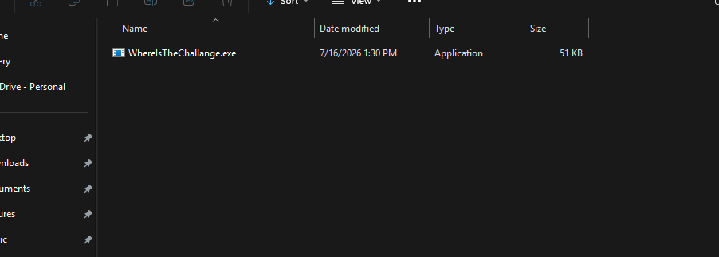
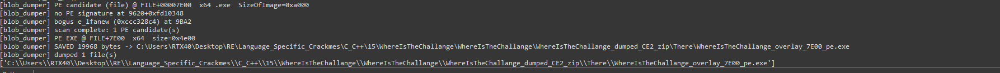
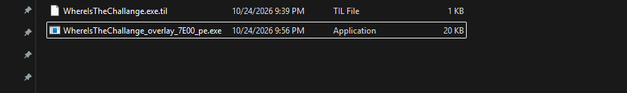
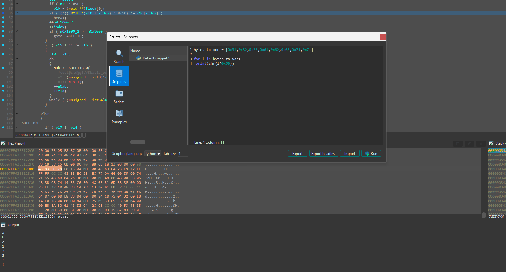

# WhereIsTheChallange — Four-Layer Peel (PNG → ZIP → EXE → Overlay EXE → XOR-0x50 Validator)

> A 22 KiB `.png` named `WhereIsTheChallange.png` that renders as the phrase "Where is the Challange?" and carries a ZIP archive concatenated after the IEND chunk. The ZIP unpacks to a 51 KiB PE64 (`WhereIsTheChallange.exe`) that in turn carries a second PE64 at offset `0x7E00` in its overlay. The inner 20 KiB PE64 is the real crackme: a console validator whose core check reduces to `(input[i] ^ 0x50) == expected[i]` against eight bytes dumped from `.rdata`. Inverting is a one-XOR pass: `input = [0x31, 0x32, 0x33, 0x61, 0x62, 0x63, 0x71, 0x71] ^ 0x50` → `abc123!!`.

## Metadata

|                              |                                                                                 |
| ---------------------------- | ------------------------------------------------------------------------------- |
| Platform                     | Windows x86-64 console                                                           |
| Language                     | C/C++, MSVC 2022 (linker 14.43.34808, VS 2022 17.13)                             |
| Difficulty                   | 3.0 / 6 (self-assessed — the layering is the whole fight; each layer in isolation is routine) |
| Quality (challenge design)   | 3.0 / 6 (self-assessed — a clean, well-named polyglot stack but the inner validator is a single XOR) |
| Solve type                   | Full recovery — layer-by-layer unpacking + one-XOR inverter                      |
| Date solved                  | 2026-11-20                                                                       |
| Tools                        | IDA Pro 9 + custom [ida-pro-scripts](https://github.com/ShadowStrike-Labs/ida-pro-scripts-collection) dumpers, Detect It Easy, Python 3, Windows shell |
| Source                       | Local archive                                                                     |

## 1. Goal

Recover the password accepted by `WhereIsTheChallange.exe`'s innermost validator — the final file in a four-layer peel that begins with a PNG.

## 2. Triage / The PNG

The starting file is `WhereIsTheChallange.png`, 22,848 bytes, which displays the text "Where is the Challange?" when opened in an image viewer. The misspelling of "Challenge" is intentional and preserved in every downstream file name.

The file size is the first signal that this is more than a flat PNG. A `.png` that renders a single line of black text at ~800×200 pixels should sit well under 10 KiB; 22 KiB is roughly 2–3× the expected size. Appended data after the `IEND` chunk is the canonical hiding spot — PNG decoders stop at `IEND` and ignore trailing bytes.

## 3. Layer 1 — PNG + ZIP Polyglot

Scanning for a ZIP end-of-central-directory signature (`PK\x05\x06`) inside the PNG lands on offset `0xCE2`. The custom IDAPython helper `dump_blob(0xCE2)` from the author's `ida-pro-scripts` repository (`blob_dumper` module) walks the ZIP from that offset, finds the EOCD at absolute offset `0x4C4E = 19,528`, follows the central-directory pointer to offset `19,353`, computes a ZIP size of 175 bytes for the central directory, and saves the full ZIP region (19,950 bytes) to disk as `WhereIsTheChallange_dumped_CE2_zip.zip`:


The arithmetic is standard: EOCD gives both the start of the central directory and the size, which together with the file's current cursor position (the embedded ZIP's start) determines the total length to save. The dumper's output is a self-contained, standards-compliant `.zip` that any extractor can open.

The resulting file layout on disk after the first peel:


## 4. Layer 2 — ZIP → EXE

Unzipping `WhereIsTheChallange_dumped_CE2_zip.zip` yields a single file:

| File                       | Size   | Type           |
| -------------------------- | ------ | -------------- |
| `WhereIsTheChallange.exe`  | 51 KiB | PE64 (console) |



The ZIP is minimal — no `Readme.txt`, no decoy files, no comments. It exists purely as the second layer of the peel.

## 5. Layer 3 — EXE with PE at Overlay

Running Detect It Easy against `WhereIsTheChallange.exe` surfaces four observations:

| DIE finding                                                        | Meaning                                                                                               |
| ------------------------------------------------------------------ | ----------------------------------------------------------------------------------------------------- |
| `PE64 (Store) [Offset = 0x7e00, Boy = 0x4e00]`                     | A nested PE64 begins at file offset `0x7E00` and spans `0x4E00` bytes. DIE identifies it as a store overlay. |
| `(Heur) Packer: Generic [PE at overlay]`                           | The classic "PE at overlay" packer signature. The outer EXE's job is to carry the inner EXE.           |
| Outer: `Linker 14.43.34808 / Compiler 19.43.34808 / Tool VS 2022 17.13 LTCG` | Standard MSVC 2022 build chain.                                                                      |
| Inner (nested PE64, scanned recursively): same compiler toolchain  | Both PEs are built from the same toolchain — not a repackaged third-party binary.                     |


The outer EXE's logic — not analysed in depth for the solve — exists to extract and run the inner PE. Its presence is confirmed by DIE's heuristic, and the extraction is handled directly rather than by running the outer binary.

## 6. Layer 4 — The Overlay PE

The same `ida-pro-scripts/blob_dumper` module, invoked without arguments, scans the file for MZ/PE signatures. It flags one false positive at `FILE+0x00007E00` with `SizeOfImage=0xA000` (a bogus `e_lfanew` of `0xCCCC328C4` at `0x9BA2` that fails validation), continues scanning, finds a valid PE at `FILE+0x7E00` (`e_lfanew` leading to a well-formed `PE\0\0` header at `0x9BA2`), and saves 19,968 bytes to `WhereIsTheChallange_overlay_7E00_pe.exe`:



The dumped file is 20 KiB — one third the size of the outer EXE:



This is the final layer: a stand-alone PE64 console binary that implements the actual validator.

## 7. The Validator

The dumped overlay executable's `main` contains a byte-by-byte check loop. The decompile, after cleaning up the dispatch glue:

```c
for ( index = 0; index < n0x1000; ++index )
{
    if ( n15 > 0xF )
        v10 = (void **)Block[0];
    if ( (*((_BYTE *)v10 + index) ^ 0x50) != v16[index] )
        break;
    ++n0x1000_2;
    ++index;
    if ( n0x1000_2 >= n0x1000 )
        goto LABEL_10;
}
```

The crypto reduces to one line:

```
if ( (input[i] ^ 0x50) != expected[i] )
    break;
```

`v10` points at the user's input buffer, `v16` points at an 8-byte constant array in `.rdata`, and the loop walks the two in lockstep. The break triggers on the first mismatch, and the stage falls through to a "wrong password" branch; a full-length match reaches `LABEL_10` and the success path.

Dumping the eight bytes at the `.rdata` reference yields:

| i | expected[i] | expected[i] ^ 0x50 | char |
|---|-------------|---------------------|------|
| 0 | `0x31`      | `0x61`              | `a`  |
| 1 | `0x32`      | `0x62`              | `b`  |
| 2 | `0x33`      | `0x63`              | `c`  |
| 3 | `0x61`      | `0x31`              | `1`  |
| 4 | `0x62`      | `0x32`              | `2`  |
| 5 | `0x63`      | `0x33`              | `3`  |
| 6 | `0x71`      | `0x21`              | `!`  |
| 7 | `0x71`      | `0x21`              | `!`  |

Each XOR is a one-byte involution: `(a ^ b) ^ b == a`, so the inverse of "input XORed with 0x50 equals stored" is "stored XORed with 0x50 equals input". Running the inversion in a two-line Python snippet from inside the IDA scripting window:

```python
bytes_to_xor = [0x31, 0x32, 0x33, 0x61, 0x62, 0x63, 0x71, 0x71]
for i in bytes_to_xor:
    print(chr(i ^ 0x50))
```



The result is the eight-character string `abc123!!`.

## 8. Core Insight

Three observations collapse the challenge:

1. **PNG size mismatch signals an appended payload.** A `.png` that renders a short line of text at ~800×200 pixels is a known shape. A file that renders that shape but weighs 22 KiB has roughly 15 KiB of unexplained bytes past the `IEND` chunk — the canonical place to hide a ZIP, since PNG decoders stop at `IEND` by specification and the ZIP's EOCD can be found by any ZIP tool that scans backward from the end of file.
2. **"PE at overlay" is the standard DIE fingerprint for a nested PE packer.** The outer EXE's `.rdata`/`.text` sections carry no interesting-looking strings; the inner PE lives at a predictable offset past the end of the outer's section headers. Both the outer loader's logic (which would extract and run the inner) and the inner validator can be reached without running the outer at all — a static dump of the overlay offset `0x7E00` gives a standalone PE64 that runs on its own.
3. **XOR-0x50 is a bijection.** The byte-level validator checks `input[i] ^ 0x50 == expected[i]`. XOR with a constant is self-inverse: knowing `expected` and the key gives `input` in one pass. No search, no table lookup, no state.

## 9. Solution

### 9.1 The one-XOR inverter

`solve_wheristhechallange.py` in this folder runs the inversion in two lines and verifies the forward direction:

```python
expected = bytes([0x31, 0x32, 0x33, 0x61, 0x62, 0x63, 0x71, 0x71])
flag = bytes(b ^ 0x50 for b in expected)

print(f"Recovered flag: {flag.decode('ascii')}")

reencoded = bytes(b ^ 0x50 for b in flag)
print(f"Re-encode matches stored bytes: {reencoded == expected}")
```

Running:

```
Recovered flag: abc123!!
Re-encode matches stored bytes: True
```

The forward re-encode is a cheap sanity check: XORing the recovered flag back with `0x50` must reproduce the original stored bytes.

### 9.2 Runtime verification

Feeding `abc123!!` to the dumped inner EXE:

```
C:\…\> WhereIsTheChallange_overlay_7E00_pe.exe
abc123!!
correct pass!
Press any key to continue . . .
```


### 9.3 Summary table

| Field                          | Value                                                         |
| ------------------------------ | ------------------------------------------------------------- |
| Flag                           | `abc123!!`                                                    |
| Flag length                    | 8 bytes                                                        |
| Starting file                  | `WhereIsTheChallange.png` (22,848 bytes)                      |
| Layer 1 artifact               | ZIP concatenated at offset `0xCE2` (19,950 bytes total)        |
| Layer 2 artifact               | `WhereIsTheChallange.exe` (51 KiB PE64, MSVC 2022 LTCG)        |
| Layer 3 artifact               | Nested PE64 at outer offset `0x7E00`, size `0x4E00`            |
| Layer 4 artifact               | `WhereIsTheChallange_overlay_7E00_pe.exe` (20 KiB PE64)        |
| Innermost validator            | `(input[i] ^ 0x50) == expected[i]` for `i ∈ 0..7`              |
| Expected bytes (stored)        | `0x31 0x32 0x33 0x61 0x62 0x63 0x71 0x71`                       |
| XOR key                        | `0x50`                                                        |

## 10. Key Takeaways

- **File size as the first clue.** A `.png` that renders a single short line of text is a known cost class — well under 10 KiB. 22 KiB on disk is a factor-of-3 anomaly, which is the usual size overhead for an embedded ZIP of a small executable. Recognising the mismatch is the fastest way to know a polyglot is present before any file-format tool is run.
- **PNG + ZIP concatenation is a standard polyglot shape.** PNG decoders stop at `IEND`; ZIP tools scan backward from end-of-file for the EOCD signature. Both decoders succeed on the same file, each reading a different payload. No image corruption, no ZIP corruption, no clever trick — just two file formats stacked.
- **DIE's "Packer: Generic [PE at overlay]" is a reliable "there is more here" signal.** It makes the next step mechanical: find the overlay offset, dump the bytes, re-triage. The outer EXE's logic becomes irrelevant to the solve once the inner EXE can be extracted statically.
- **Byte-level XOR equality is a bijection, and nothing more.** Any time the decompile shows `(input ^ K) == expected` with a constant `K`, the inverse is `expected ^ K`. No side effects, no state, no search. This is the simplest validator shape in the entire crackme ecosystem, and the hardness of the challenge sits entirely in getting to the file where that check lives.
- **A good custom tool pays off across writeups.** The same `blob_dumper` module from the author's `ida-pro-scripts` repository peeled layer 1 (`.zip` from `.png`) and layer 4 (PE64 from an EXE overlay) with two different invocation modes. Investing in a reusable scanner that handles both ZIP EOCD lookups and PE signature validation makes the next polyglot/overlay challenge collapse to a one-command dump.
- **Author-set names and misspellings are signals.** "WhereIsTheChallange" (with "Challange" misspelled) is the author's playful hint that the challenge is a game of successive extractions — the challenge is where the challenge lives. Preserving the author's exact spelling in file names (even when the system auto-correct would fix it) is part of the forensic trail.

## 11. Artifacts

- `Binary/WhereIsTheChallange.png` — the starting 22 KiB PNG, PNG + ZIP polyglot.
- `solve_wheristhechallange.py` — the one-XOR inverter; prints `abc123!!` and runs a forward re-encode sanity check against the stored bytes.
- `01_blob_dumper_extracts_zip_from_png.png` — custom dumper locates the ZIP EOCD at `0xCE2` and saves 19,950 bytes.
- `02_extracted_files_on_desktop.png` — files on disk after the first peel.
- `03_zip_contents_wheristhechallange_exe.png` — ZIP contents: one 51 KiB PE64.
- `04_die_pe64_overlay_pe_at_offset_7e00.png` — DIE flags the overlay PE at `0x7E00` with the "PE at overlay" packer signature.
- `05_blob_dumper_extracts_overlay_pe.png` — PE blob-dumper output: rejects the bogus header, extracts the valid overlay PE.
- `06_overlay_pe_dumped_20kb.png` — final overlay EXE dumped at 20 KiB.
- `07_ida_xor_0x50_check_python_decode.png` — the innermost validator's `(input ^ 0x50) == expected` check with the Python decoder run inline in IDA.
- `08_runtime_abc123_correct_pass.png` — runtime verification: `abc123!!` → `correct pass!`.
